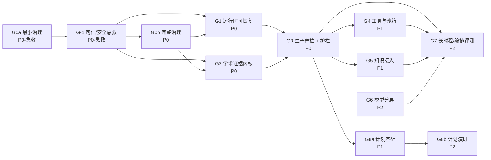

# ARC 统一学术推理基座：调研总纲与实施路线（v1.4n）

> **用途**：把当前**已调研、未执行**的四份报告合并成一条可执行路线；每阶段给出目标、交付物、**可失败（能变红）的验收目标**、前置依赖与外部锚点。
>
> **不在本文范围**：已完成的代码缺口修复（`code_wiki/11–14`，PR-1..PR-6，2026-10-29 完成、CI 通过）属于**基线**，不重复排期。
>
> **口径**：本文只做"排期与验收"，不重复各报告的证据链。事实与代码行号以原报告为准。
>
> **修订**：v0.2（2026-11-06，P-003）按 [审查报告](docs/arc-roadmap-review-20261106.md) §6 订正六处——G3 的 H-4 前提（§4 G3）、§5 新增 C-9 与「生效起点」列、A2-3 的测试口径（§4 G2）、§7 标题、Q11 与 §10 的钩子数。审查报告本身仍绑定 v0.1 / `7d0e70a`，不改写。
>
> **修订**：v0.3（2026-11-07）§11 增运行时后端审计依据；§7 增 Q17（默认后端选型，决定审计粒度）。
>
> **修订**：v0.4（2026-11-08，P-005）裁决落地——D-1=A（H-5 移入 C-9、§5 删箭头）、D-2=C（A2-4/5/6 谓词化）；D-3 执行矩阵（§5.1）、D-4 最小集定义（§1/§6）、D-5 交付物补全（G1/G3/G5）、D-6 覆盖声明 + CI 覆盖率门禁、D-7 新增 Q18..Q20。106 计数不变。依据：[D-1/D-2 裁决分析](docs/arc-d1-d2-verdict-analysis-20261108.md)。
>
> **修订**：v0.5（2026-11-08，P-006）Q18/Q19/Q20 裁决 + H-1..H-8 落地：vendor/语料 L1 清单、API 回环默认 + 非回环强制 token、预算分层账本；H-1..H-8 代码与 8 个 pytest 文件已合入。依据：[G-1 开工前补充调研](docs/arc-g1-readiness-research-20261108.md)。
>
> **修订**：v0.6（2026-11-10，P-016）状态同步：G-1 标记完成、G0b 标记未就绪、Q17 裁决、P-011..P-015 依据挂载、G3 回退/传播候选增量；**106 计数不变**。依据：[P-016 实施记录](spec/arc-roadmap-v06/IMPLEMENTATION.md)。
>
> **修订**：v0.7（2026-11-10，P-018）纳入 G0b 调研结论：G0b 标“调研完成、实施未开始”；A0-1 明确六必需 + 两额外；Q3/Q11 写入 P-017 建议；§11 增 P-017 依据；**106 计数不变**。依据：[P-017 调研](spec/arc-g0b-governance-base/RESEARCH.md)。
>
> **修订**：v0.8（2026-11-10，Q3 裁决）Q3 正式裁决 = **B（基线 + 棘轮）**：新文档立即合规；`spec/grandfather.yaml` 空清单 + cutoff 2026-11-10；豁免 90 天过期（内部政策参数 E3）、最多续期一次；仅豁免 DC1-DC3，语义触碰必须迁移。G0b 实施批可开工，开工前须吸收 4 项实施前提。**106 计数不变**。依据：[P-019 调研](spec/arc-q3-grandfather-policy/RESEARCH.md) + [P-020 复核](docs/arc-q3-grandfather-review-20261110.md)。
>
> **修订**：v0.9（2026-11-10，P-021）**G0b 关闭**：治理脚本迁 `scripts/spec/` + 6 根兼容壳；`SPEC_PROCESS.md` 迁 `spec/` + 根指针；`spec/grandfather.yaml` 空清单（Q3 = B）；钩子扩为 6 必需 + 3 守卫；CI 增 `spec-gates`；A0-1..A0-6 全过（负向用例 11+3 例）。Q11 由实施确认。**106 计数不变**。依据：[P-021 实施](spec/arc-g0b-implementation/IMPLEMENTATION.md)。
>
> **修订**：v1.0（2026-11-10，P-026）**Q5/Q9 裁决 + G1 分期**：Q5 = **A（纯文件 + supervisor）**、Q9 = **A（热 30 天 / 归档 365 天 / 摘要永久）**，裁定依据改用 [P-025 五步非补偿程序](spec/arc-q5-decision-method/RESEARCH.md)（约束→支配→敏感点→可逆性→kill criteria），**不再引用 P-022 §3.4 加权总分**；G1 拆为 **G1a（事件内核 + 租约 + 保留，P-027）** 与 **G1b（supervisor / attempts / outbox / SSE）**，A1 项的归属见 §4 G1。**106 计数不变**。
>
> **修订**：v1.1（2026-11-10，P-027/P-029/P-031）**G1 收口**：A1 项 **11/12 完成**——G1a（A1-1/4/5/6 + Q9）与 G1b（A1-7/10/11/12 + A1-3 单测）已实施，A1-2 由 P-031 补齐；**A1-9 部分完成**（记录 `session_id`/`context_replayed`，backend 续接待 U-2）。遗留：U-1 真实 kill -9 集成、U-2 会话续接、U-3 SSE 前端联调。**106 计数不变**。依据：[P-027](spec/arc-g1a-event-core/IMPLEMENTATION.md)、[P-029](spec/arc-g1b-implementation/IMPLEMENTATION.md)、[P-031](spec/arc-g1c-event-protocol/IMPLEMENTATION.md)。
>
> **修订**：v1.2（2026-11-10，P-033）**G1 遗留收口**：真实子进程重启测试、Windows 安全探活（`os.kill(pid,0)` 会 TerminateProcess → 改 OpenProcess/GetExitCodeProcess）、会话续接白名单（当前无 backend → `context_replayed=true`）、SSE/WS 并发上限、atexit 释放租约。仅剩：**A1-9 的 backend 会话续接能力**与 **P-031 前端 EventSource 联调**（消费方）。**106 计数不变**。依据：[P-033 实施](spec/arc-g1-closeout/IMPLEMENTATION.md)。
>
> **修订**：v1.3（2026-11-10，P-038）**G1 正式收口（12/12）**：A1-9 由 P-037 接线——`SESSION_RESUME_BACKENDS` 登记 `claude_code`（主控站 / A 站 NEX / B 站 GTR-Pro 三端实测 `--session-id`+`--resume`），Stage 10/13 首跑固定会话、重试续接，会话不存在时**显式降级**（实测 exit 1 `No conversation found`，不会静默从零开始）；attempt 的 `session_id`/`context_replayed` 改读 stage 自写 CLI 日志真值。A1-2 消费方由 P-036 补齐（api.js SSE 客户端 + JSON 端点 `Last-Event-ID`）。残余观察项（均不阻塞 G2/G3）：浏览器 `EventSource` 自动重连人工验证（P-036 U-1）、「静默新建会话」的 provider 侧机械识别与 PIVOT 重跑语义（P-037 U-1/U-2）、C 站 seaviv 未测。**106 计数不变**。依据：[P-035 分析](spec/arc-g1-residual-analysis/RESEARCH.md)、[P-036 实施](spec/arc-g1c-frontend-closure/IMPLEMENTATION.md)、[P-037 实施](spec/arc-a1-9-session-resume/IMPLEMENTATION.md)。
>
> **修订**：v1.3a（2026-11-10，P-040）**复审缺陷修复**：P-039 异基座复审登记的三缺陷全部关闭——D-1 `verify_chain` 增 `payload_sha256` 校验并补 summary `chain_tail` 尾闭合（末行 payload/元数据篡改均可检，summary 落后时跳过）；D-2 `effect.started` 登记进事件白名单与前端常量（18 类，补机械对齐用例）；D-3 SSE/WS 预检缺失日志（404 / close 1008）且不再经 `EventLog` mkdir 创建垃圾目录。A1-1 末行负向场景由此闭合，12/12 **无保留成立**。残余：`verify_chain` 未进 resume 热路径（归档删段会误报，U-1）、归档后仅能部分校验（O-1）。**106 计数不变**。依据：[P-039 复审](docs/arc-g1-cross-review-20261110.md)、[P-040 实施](spec/arc-g1-review-fixes/IMPLEMENTATION.md)。
>
> **修订**：v1.3b（2026-11-10，P-042）**G2 前置闸门裁决**：**Q1 = B（双轨）**——ARC 维持 `>=3.11`，3.11 进程内只放纯判定内核（datatypes 裁剪 + verdict/policy + sandbox/evaluator），完整 AP（Lean/ATLAS/MCP）作为 3.12 sidecar 经 JSON 契约调用；**Q2 = B（最小 kernel vendor + 全量 sidecar + Lean 可选 Tier-3），附许可证闸门**——AP 当前无任何 LICENSE（本批穷举确认），按 pip vendoring 政策不得并入 MIT 项目，M2 前必须补许可证，否则自动转 clean-room 重写（D 路径）。一手证据：AP 内核 94 文件在 3.11 语法下 0 失败、0 处 3.12-only 构造；ARC CI 3.11 必过且 3.11 EOL 2027-10。**106 计数不变**。依据：[P-042 调研](spec/arc-g2-decisions/RESEARCH.md)。
>
> **修订**：v1.3c（2026-11-10，P-043）**Q2 许可证闸门解除**：AP 采用 **Apache-2.0**——`LICENSE` 官方全文（SHA-256 与 apache.org 一致）、`NOTICE`、PEP 639 元数据（实测 `License-Expression: Apache-2.0` 与 `License-File: LICENSE/NOTICE`）；G2 M2 可开工。Vendor 合规要求写入 [P-042 §8](spec/arc-g2-decisions/RESEARCH.md)：**ARC 整体仍 MIT，vendor 子目录按文件保持 Apache-2.0**，必须携带 LICENSE/NOTICE、修改声明与 `SOURCE.json`（commit+sha256）；`atlas_*.py` 与 `lean4_cases` 的第三方血统审计仍是 M2 闸门。**106 计数不变**。依据：[P-043 更新](spec/arc-g2-decisions/RESEARCH.md)。
> **修订**：v1.3d（2026-11-11，P-044）**Q2 第三方审计闸门关闭**：`atlas_*.py`（9 个）与 `lean4_cases`（23 条）经一手比对确认均为作者自有代码（来源 `D:\Textbook\scripts`；5 个逐字节、4 个有记录在案的偏离），无第三方归属要求，`NOTICE` 无需追加；结论落 AP `THIRD_PARTY_NOTICES.md`（commit `1ded9be`），四份上游文档的旧「唯一偏离」断言已订正。Q2 自此无保留，G2 仅剩 U-2（3.11 内核 65 用例复跑）。**106 计数不变**。依据：[P-042 §8.4](spec/arc-g2-decisions/RESEARCH.md)。
>
> **修订**：v1.3e（2026-11-11，P-046/P-047）**G2 开工前置清零 + M0 契约冻结**：U-2 由 P-046 关闭——AP 上游修复 venv redirector × Job Object（D173，commit `bd95f02`），65 项 node ID 冻结（`testset-3.11.txt`），3.11.15 与 3.13.5 均 65 passed；M0 由 P-047 交付——7 份 JSON Schema（C1–C7）、7 正 8 反 fixture、兼容矩阵与 `jsonschema` dev 依赖，A2-1 机械可验；「6 钩子可跑」由 G0b 交付并于 P-046 全绿。G2 可进入 M1（AR-01..08）。**106 计数不变**。依据：[P-045 调研](spec/arc-g2-py311-env/RESEARCH.md)、[P-047 实施](spec/arc-g2-m0-contracts/IMPLEMENTATION.md)。
>
> **修订**：v1.3f（2026-11-11，P-048）**M1 交付（AR-01..08）**：八条判据落为纯函数（`researchclaw/evidence/ar_checks.py`），严重度只用 `fail/warn/downgrade`，检查层不写回 `status`；16 fixture（每判据 1 正 1 反）+ 8 条变异自检证明判据承重；A2-2 机检 28 passed（3.13.5 与 3.11.15 双环境）。**源冲突裁定**：AR-05 的 `claim_type ∈ {model, method}` 与 C4 v1 的 `exploratory/confirmatory` 不兼容，v1 下按 A/B 类触发（原文为并集，覆盖面不缩小）。G2 可进入 M2（3.11 内核 vendor）。**106 计数不变**。依据：[P-048 实施](spec/arc-g2-m1-ar-checks/IMPLEMENTATION.md)。
>
> **修订**：v1.3g（2026-11-11，P-049）**M2 交付（内核 vendor）**：AP `bd95f02` 的 **65 项测试依赖闭包 27 文件**迁入 `researchclaw/vendor/auto_prover/`（datatypes 9 + verdict 3 + sandbox 4 + semantic_verdict 1 + model_gateway 1 + kg 3 + stages 5 + verdict_recheck 1）；只 vendor 三包会 61/65，故 M2 的真实边界是闭包而非 16 文件。A2-3 在 3.11.15 按冻结 node ID **65 passed**，3.13.5 vendor 全量 99 passed；D173 启动器修复随行；V-1..V-6 合规落地（`LICENSE`/`NOTICE`/修改声明/`SOURCE.json` 逐文件 sha256），wheel 实测含两许可文件。G2 可进入 M3（sidecar + Lean 可选）。**106 计数不变**。依据：[P-049 实施](spec/arc-g2-m2-vendor/IMPLEMENTATION.md)。
>
> **修订**：v1.3h（2026-11-11，P-060）**M3 交付（sidecar + Lean 可选）**：AP 新增 `scripts/arb_verify.py`（JSON 文件契约、`mode=lean_check`、退出码 0/65/75/78、77 保留）并为 `CompileReport` 补 `timed_out`（超时不再伪装普通失败）；ARC 新增 `researchclaw/evidence/sidecar.py`（文件型请求/进程每请求/`taskkill /T` 兜底/窄校验）。判定映射经 9 组矩阵探针校准：编译失败→`FAILED/stage2`、sorry→`tree_partial`、axiom dirty→`partially`、合法性失败→`partially`、全清→`formally_verified/stage3`，满足 A2-7。实测：ARC 单元 10 passed、live 8 passed（Lean 4.20）、AP 30 passed/2 skipped、vendor 99 passed；根因 `PYTHONUTF8` 缺失已修并入白名单。G2 可进入 M4（Stage 接线 + 双平面）。**106 计数不变**。依据：[P-060 实施](spec/arc-g2-m3-implementation/IMPLEMENTATION.md)。
>
> **修订**：v1.3i（2026-11-11，P-061）**M4 交付（Stage 9/20/23 接线 + 双平面）**：`claim_policy.py` 收敛 A2-4/A2-5/A2-6 谓词与 `evaluate_claim`，`stage_hooks.py` 负责 Stage 9 写 C 类 claim、Stage 20 门禁（`E20_CLAIM_CONTRACT`）、Stage 23 双平面重算（`E23_CLAIM_DRIFT`）；生产与审计共用同一纯函数，篡改 `stage-20/claims.jsonl` 即触发漂移。实测：M4 测试 46 passed（3.13.5 与 3.11.15 双环境）、相关回归 105 passed、`test_rc_executor` 207 passed。G2 可进入 M5（双平面审计与交付）。**106 计数不变**。依据：[P-061 实施](spec/arc-g2-m4-wiring/IMPLEMENTATION.md)。
>
> **修订**：v1.3j（2026-11-11，P-063）**M4 复审缺陷关闭**：P-062 独立复审 D-1..D-3 全部修复——`load_claims` 改为非版本目录优先（PIVOT 后不再读 `stage-09_v{N}` 旧 claim）；坏行/损坏 gate JSON 改 `ClaimStreamError`，claims/gate/consistency 统一 `tmp + os.replace`；`evaluate_claim` 入口增加 C4 最小结构校验（`invalid_claim_record` + `problems`），畸形 claim 双平面同时阻断。实测：M4 套件 59 passed（+13，3.13.5 与 3.11.15）、相关回归 105 passed、原 46 项无回归。**106 计数不变**。依据：[P-063 修复](spec/arc-g2-m4-wiring-fixes/IMPLEMENTATION.md)。
>
> **修订**：v1.3k（2026-11-11，P-064）**M5 交付 + G2 收口**：审查平面按 R-03 §5.1 落为离线批次模式——`compare_claims` 抽为 Stage 23 与离线审计的**唯一比对实现**（规则不可能分歧）；新增只读 `run_offline_audit` 与 `researchclaw audit --run-dir` CLI（退出码 0/1/2），版本锚点取 claims 自带 `policy_version` 逐条核验（`policy_version_mismatch`）。M5 DoD 机检：7 状态矩阵两平面同 status、只读快照断言、确定性、失败封闭；M5 套件 29 passed、M4+M5 88 passed（3.13.5 与 3.11.15）、相关回归 108 passed、M4 59 项零回归。**G2 全部里程碑（M0–M5）交付，G3 可开工**；O-1/O-2（annotation 供给与封顶渲染语义）移交 G3 输入。**106 计数不变**。依据：[P-064 实施](spec/arc-g2-m5-offline-audit/IMPLEMENTATION.md)。
>
> **修订**：v1.3l（2026-11-11，P-068）**M5 复审缺陷关闭**：P-065..P-067 的 D-1..D-5 全部修复——`compare_claims` 增双向集合检查（`orphan_production_decision`/`duplicate_claim_id`），gate 对重复 `claim_id` 直接 block（`duplicate_claim_ids`），`--policy-version <1` 与 `--output` 失败 → exit 2，诊断统一 stderr，`no_claims` 收紧为无 claims 且无 production。P-067 D-5 集成约束（集合检查无条件、逐条循环保留守卫）已落地。实测：M5 36 passed、M4+M5 95 passed（3.13.5 与 3.11.15）、相关回归 108 passed、既有 29 项零回归。**106 计数不变**。依据：[P-068 修复](spec/arc-g2-m5-offline-audit-fixes/IMPLEMENTATION.md)。
>
> **修订**：v1.3m（2026-11-11，P-070）**G3 M0 决策采纳**：G3 readiness 的 Q-1..Q-9 由「建议」升为「已采纳决策」——Stage 20 允许 `PARTIALLY_FORMALIZED` 但强制 `formalization_gap` 标注；ArtifactNode 大文件只存指针；annotation 跟随封顶后状态并由 Stage 14 生产；`pipeline_summary` 采用 JCS + SHA-256 侧车 + `stage_events` 哈希链；循环检测采用签名+零新增+网络豁免；RunMandate 启动即不可变；K5 未解析即阻断；敏感产物只存指针。G3 M0 顺延 **P-071**。**106 计数不变**。依据：[G3 readiness v1.2](spec/arc-g3-readiness/RESEARCH.md)。
>
> **修订**：v1.3n（2026-11-11，P-074）**G3 M0 设计冻结**：六组接口定稿——ArtifactNode v1（12 字段/哈希/指针边界）、pipeline_summary（JCS+侧车+M2 事件链）、stage_events/循环（3 次同签名+零新增+网络豁免）、claim 脊柱（vendor CitationLabel 复用、claim_annotations、`[c-xxxxxxxx]`、claim_export、cap_reasons）、治理（RunMandate/StageHandback/prompt_version）、K5/retrieval。20 个验收 ID 映射到 **M1=P-075、M2=P-076、M3=P-077、M4=P-078、M5=P-079**；本批零代码/零测试。**106 计数不变**。依据：[G3 M0 设计包](spec/arc-g3-m0-design/DESIGN.md)。
>
> **修订**：v1.3o（2026-11-11，P-075）**G3 M1 交付（ArtifactNode + summary 侧车）**：新增 `evidence/artifact_node.py`（12 字段、content_hash/inputs_digest、blob/指针、`register_stage_artifacts`、`verify_tree`、`project_to_evidence`）与 `evidence/summary_check.py`（canonical compact JSON + `.sha256` 侧车 + 可选事件锚定）；runner DONE 阶段注册节点、summary 改原子写 + 侧车。实测：M1 21 passed（3.13.5 与 3.11.15）、M1+runner 67 passed、runner/checkpoint/kb/report 92 passed；AN-1/2/3 与 A3-2 侧车达标。事件链三向留 M2，AN-4/5/6 导出侧全量留 M3。**106 计数不变**。依据：[P-075 实施](spec/arc-g3-m1-artifacts/IMPLEMENTATION.md)。
>
> **修订**：v1.3p（2026-11-12，P-078）**G3 M2 交付（循环护栏 + summary 事件链）**：新增 `runtime/stage_events.py`——`plan_sig` 取 stage-03 计划、`new_rows` 保留冻结行数语义、`row_ids_digest` 识别同计划同结果、`network_error` 取 `retrieval_status.json`；连续 3 轮同签名同结果 → `PAUSED`/`E_LOOP_DETECTED`，2 轮 → WARN，网络错误整轮豁免，坏行末行容忍/中间封闭（O-4 闭合）。**D-2 修复**：`pipeline.summary` 锚点只在顶层执行写一次，验证改为「`payload_sha256` 结构 + 同执行段至多一锚 + 末锚匹配」，追加伪锚即判红；`EVENT_TYPES` 与前端常量同步。实测：M2 套件 30 passed（3.13.5 与 3.11.15）、相关回归 99 passed、性能 200 事件 0.032ms。**编号顺延**：P-077 复核占用原 M3 槽位，M3/M4/M5 顺延为 **P-079/P-080/P-081**；M0 §5.2 的 Stage 5 签名偏移以 DR-2/U-2 登记。**106 计数不变**。依据：[P-078 实施](spec/arc-g3-m2-stage-events/IMPLEMENTATION.md)、[P-077 复核](docs/arc-g3-m1-review-20261112.md)。
>
> **修订**：v1.3q（2026-11-12，P-079）**G3 M2 复核通过（零缺陷）**：独立异构复核 V-1..V-12 全过——30 passed 双环境复跑、回归 99、接线顺序、边界诚实登记全部属实。11 组探针：伪锚两形态均判红、**同域一致重写绕过证实 DESIGN §4.2 边界声明准确**、8 线程并发零丢失、无 id 结果集同构确认实施批 P3-2、豁免轮穿插语义正确；初判 2 项 FAIL 复判均为探针构造偏差（撤回）。O-1..O-4 登记（torn tail 单行语义与 EventLog 不一致、window 无下界、并发零丢失非契约保证）。**编号再顺延**：本复核占用 P-079，M3/M4/M5 = **P-080/P-081/P-082**。**106 计数不变**。依据：[P-079 复核](docs/arc-g3-m2-review-20261112.md)。
>
> **修订**：v1.3r（2026-11-12，P-080）**G3 M1/M2 修复批**：新增 `runtime/filelock.py`（stdlib 跨平台 advisory 锁，`msvcrt.LK_NBLCK` / `fcntl.LOCK_NB` + 轮询 + 超时）——**D-1 并发注册丢节点**（barrier 探针 150/150 复现、40 轮 `PermissionError`）修复后 **150 轮 0 丢失 0 异常**；跨进程探针 PASS；`os.replace` 增 3×10 ms 瞬时冲突重试。P-079 O-1..O-3 全部关闭（账本尾部连续坏行容忍、`window<1` 显式拒绝、事件追加跨进程互斥）。**P-077 D-3 撤回**：locator 已含 stage 前缀，跨 stage 同内容节点本就 id 不同（Nix input-addressing 等价语义），探针复验 2 节点均保留，故不改 `node_id` 公式。实测：套件 52 passed（3.13.5 与 3.11.15）、回归 109 passed、200 次注册 169.8 ms。M1/M2 DESIGN 升 v1.1。**M3/M4/M5 = P-081/P-082/P-083**。**106 计数不变**。依据：[P-080 实施](spec/arc-g3-fix-batch/IMPLEMENTATION.md)、[P-077 复核](docs/arc-g3-m1-review-20261112.md)、[P-079 复核](docs/arc-g3-m2-review-20261112.md)。
>
> **修订**：v1.3s（2026-11-12，P-081）**Spec 门禁加固**：P-080 后的强制力审计发现两处缺口——① CI 只有 `pre-commit --all-files`，`step_enforce` 本地模式取 `_local_changed()`，CI checkout 干净时为空集 → **空转**（实测 exit 0）；② `FEATURE_RE` 只匹配已存在四文档，**四文档齐全无判据**。加固：`spec-gates` 增 range 兜底（`fetch-depth: 0`、`BASE=before 或 pull_request.base.sha`、全 0/不可达显式跳过、`--base` + 变更集、`rev-list --merges` 逐个 `--check-merge`）；`spec_map` 增 P 行 `basis` 与 `row_tier`；`step_enforce` 对 **P≥81** 的 T1 批次强制四文档齐全，T3 跳过，缺档位判红（阈值从本批起生效，不回溯）。实测：红 8 failed → 绿 16 passed；`--base HEAD~1`（29 路径 / 3 P / 3 session）exit 0。**M3/M4/M5 = P-082/P-083/P-084**。**106 计数不变**。依据：[P-081 实施](spec/arc-spec-gate-hardening/IMPLEMENTATION.md)。
>
> **修订**：v1.3t（2026-11-12，P-082）**Spec 门禁严格模式（用户裁决 G-3/G-4）**：`GATE_STRICT_MIN_P=82`，`BATCH_BINDING_MIN_P` 与 `EVIDENCE_MIN_P` 由 129/137 **下调至 82**——P-082 起 feature 绑定、四文档（T1）、digest 绑定同时生效；新增 `_require_tiers` 让档位词检查覆盖 batch / session / batch-registration 三模式（P≥82 的声明行必须含 T1 或 T3，T3 仍合法无四文档）。本批 session 绑定四文档 sha256 自证（定稿→stage→digest→session）。实测：红 4 failed → 绿 20 passed，P-081 既有 5 项零回归。**M3/M4/M5 = P-083/P-084/P-085**。**106 计数不变**。依据：[P-082 实施](spec/arc-spec-gate-strict/IMPLEMENTATION.md)。
>
> **修订**：v1.3u（2026-11-12，P-083）**G3 M3 交付（claim 脊柱）**：新增 `evidence/claim_spine.py`——Stage 14 显式绑定表 `claim_annotations.json`（metric/value/n/ci/condition/source/`evidence_locator`/`evidence_digest`）、`[c-xxxxxxxx]` 标记与 `§<heading>` 段落定位、Stage 22 `claim_export.json`（只导出 deliverable，`citation_label` 复用 vendor 词表）、Stage 23 `verify_claim_trace` + `verify_claim_digests` 三出口一致性与证据复算。`claim_policy` 显式 re-export vendor `CitationLabel`（差集仅 `speculation`），`ClaimDecision.cap_reasons` 落 gate/export；Stage 20 annotation 合并顺序 external > legacy root > stage14。实测：M3 套件 **114 passed 双环境**、相关回归 177 + `test_rc_executor` 207、性能 35.83ms；A3-1/A3-3 达标，3 项 P3（U-1..U-3）登记。**M4/M5 = P-084/P-085**。**106 计数不变**。依据：[P-083 实施](spec/arc-g3-m3-claim-spine/IMPLEMENTATION.md)。
>
> **修订**：v1.3v（2026-11-12，P-084）**G3 M3 复核（1 P2 + 5 P3）**：独立异构复核 V-1..V-12（双环境 114×2、回归 177 + rc_executor 组 270、登记链）全过；12 组探针确证 **D-1 P2 示例标记误阻断链**——Stage 17 prompt 文法说明自带示例 id `c-1a2b3c4d`，论文正文复述即触发 `unknown_claim_marker` → `claim_marker_not_exported` → Stage 23 误阻断 gate pass 的正常 run（fail-closed 假阳性，X-12b 干净复跑确证）；D-2..D-6 五项 P3（标记块级归属错位/n 缺省伪造 1/版本化 stage-14 annotation 落错目录/论文回退 17 先于 19/大写标记静默）；O-1..O-6（含 P-083 IMPLEMENTATION §5 测试计数 18≠19 读数偏差）。修复批与 M4/M5 排期**待用户裁决**（建议 P-085 修复 / P-086 M4 / P-087 M5，沿 P-077 修复批前置先例）。**106 计数不变**。依据：[P-084 复核](docs/arc-g3-m3-review-20261112.md)。
>
> **修订**：v1.3w（2026-11-12，P-085）**G3 M3 D-1 修复（用户裁决 ①+②）**：① Stage 17 文法示例由合法 hex `c-1a2b3c4d` 改为**非匹配占位符** `[c-xxxxxxxx]`（`x` 不属 `[0-9a-f]`，正则天然不提取），并加「勿复制/勿虚构」；② `extract_claim_markers` 由空行分块改**逐行扫描**——代码围栏（```/~~~）开关、行内代码剔除、标题即时生效（附带关闭 P-084 D-2 归属错位）。③（unknown marker 降 warning）未采纳，真实未知 hex id 仍 fail-closed。实测：双环境 **118 passed**、十文件回归 **181 passed**、E2 占位符/围栏放行且 `c-deadbeef` 仍判红；ADD 30/30、3 项 P3。**M4/M5 仍为 P-086/P-087，待后续裁决**。**106 计数不变**。依据：[P-085 实施](spec/arc-g3-m3-claim-fixes/IMPLEMENTATION.md)。
>
> **修订**：v1.3x（2026-11-12，P-086）**G3 M3 修复复审通过（零 D 级）**：独立异构复审 V-1..V-10（双环境 118×2、回归 181、测试计数 18=14+4 读数准确、`c-1a2b3c4d` 代码零残留、`CLAIM_MARKER_RE` 未改）全过；8 组新角度探针确证 ①+② 真实关闭误阻断链（E2 端到端：占位符 + 围栏示例 + 正常 claim → `trace_ok=True`），fail-closed 未退化；零 D 级缺陷，O-1..O-3 三项 P3 静默面（标题内标记丢弃/缩进代码块不跳过/未闭合行内码提取）登记为加固候选。**M4/M5 = P-087/P-088**。**106 计数不变**。依据：[P-086 复审](docs/arc-g3-m3-claim-fixes-review-20261112.md)。
>
> **修订**：v1.3y（2026-11-13，P-087）**G3 M4+M5 合并交付（用户裁决）**：M4 新增 `runtime/mandate.py`——`RunMandate` 在 `execute_pipeline` 前幂等写入且不可变（run_id 不一致拒绝）、`StageHandback` scope 子集校验（越界 `E_HANDBACK_SCOPE`，runner 将暂停结果改 FAILED）、`prompt_version` 在 `for_stage` 渲染点计算并随 `RenderedPrompt.version` 返回 + INFO 日志；M5 新增 `knowledge/k5_refs.py`——`tb:`/`paper:` 文法（键末字符收紧，句末句号不入键）、KB 文件名/BibTeX key 解析、Stage 22 预检 + Stage 23 终检双阻断 `E_K5_UNRESOLVED_REF`；`pipeline_summary.retrieval_degraded` 字段 + Stage 22 论文注记与报告。实测：新增 **17 passed 双环境**、相关回归 **401 passed**、红 4 failed → 绿 17 passed；ADD 42/42、3 项 P3。**106 计数不变**。依据：[P-087 实施](spec/arc-g3-m4-m5-governance-k5/IMPLEMENTATION.md)。
>
> **修订**：v1.3z（2026-11-13，P-088）**G3 收口复核（不可直接收口）**：独立异构复核 17 项验收（A3-1..8、AN-1..6、FC-1..3），G3 相关 11 文件 **185 passed**；15 项可判绿，**2 项 P2 阻断**——A3-7 仅在 `for_stage` 渲染点记录 `prompt_version`，直连 `_chat_with_prompt`/`llm.chat` 不记录且 claim 无版本字段；A3-8 的 `write_handback` 只有定义与单测、无生产阶段生产者/交回路由。另 O-1 AN-1 materialized 原始产物漂移不检测（blob 为 canonical）、O-2 A3-6 缺配置变更对照、D-3 P3 总纲与 P-087 文档的 A3-7/A3-8 编号互换。建议 **P-089 修复 + P-090 复评**后再决定 G4/G5/G8a。**106 计数不变**。依据：[P-088 复核](docs/arc-g3-closure-review-20261113.md)。
>
> **修订**：v1.4a（2026-11-13，P-089）**G3 收口修复**：① A3-7 请求级追踪——新增 `runtime/prompt_context.py`（ContextVar），`PromptManager.for_stage` 写入版本、`LLMClient.chat` 每次请求记录 `llm.request prompt_version=...`；Stage 17 写 `claim_prompt_versions.json`，Stage 22 `claim_export.json` 每条附加 `prompt_version`；② A3-8 handback 生产——Stage 17 两个阻断分支写 `handback.json`，runner 抽出 `_apply_handback_guard`，越界转 FAILED；③ A3-6 补配置变更对照；④ A3-7/A3-8 编号按总纲统一（P-087 文档受控回边）。实测：新增 4 项、修改 3 项，双环境 31/30 passed，相关回归 **357 passed**；ADD 34/34、3 项 P3。**106 计数不变**。依据：[P-089 实施](spec/arc-g3-closure-fixes/IMPLEMENTATION.md)。
>
> **修订**：v1.4b（2026-11-13，P-090）**G3 收口复评（A3-7/D-3 闭合，A3-8 未闭合）**：独立异构复评 8 组探针——A3-7 **闭合**（上下文版本/请求日志实际输出/侧车/export 携带版本/向后兼容 5/5）；D-3 **闭合**（总纲与 P-087 编号一致）；A3-8 生产与越界阻断成立，但**新发现 D-1 P2**——`validate_handback` 用离散集合匹配，而 mandate 范围记法 `stage:1-23` 与 Stage 17 生产的 `stage:12-14` 语义不一致，真实 run 中 Stage 17 暂停被升级为 FAILED（fail-closed 假阳性，探针实证）；CI 盲区确证（93 passed 全绿）。建议 **P-091 范围语义修复 + P-092 复评**。**106 计数不变**。依据：[P-090 复评](docs/arc-g3-recheck-20261113.md)。
>
> **修订**：v1.4c（2026-11-13，P-091）**Handback scope 范围语义修复**：`validate_handback` 由离散集合匹配改为范围包含判定——`stage:A-B` 覆盖 `stage:C-D` 当且仅当 `[C,D] ⊆ [A,B]`，`stage:N` 视为单点，`tool:*` 保持精确匹配，非法格式 fail-closed；`RunMandate`/`StageHandback` 数据形态与错误码不变。补 4 项单元测试 + 真实 Stage 17 `blocked_no_metrics` → runner guard 端到端回归（断言仍为 PAUSED，封堵 P-090 指出的 CI 盲区）。实测：相关回归 **361 passed**、双环境关键集 15/14 passed；ADD 30/30、2 项 P3（非严格先红后绿、无通配语法）。建议 **P-092 复评 D-1** 后收口 G3。**106 计数不变**。依据：[P-091 实施](spec/arc-g3-handback-scope/IMPLEMENTATION.md)。
>
> **修订**：v1.4d（2026-11-13，P-092）**D-1 复评通过——G3 正式收口**：独立异构复评 4 组探针——P-1 复跑 P-090 原始失败场景（`stage:12-14` × `stage:1-23`）已放行、P-2 包含矩阵 9/9（子范围/单点/超集/部分重叠/工具精确/非法格式均与预期一致）、P-3 真实 Stage 17 阻断 → handback 落盘 → runner guard **保持 PAUSED**、P-4 工具越界仍判红；**D-1 闭合 → A3-8 闭合 → G3 全部 17 项验收（A3-1..8、AN-1..6、FC-1..3）闭合，G3 收口**。CI 盲区已封堵（guard 断言进入 `test_rc_executor` 阻断用例）。遗留 3 组 P3（AN-1 blob 边界、Stage 17 标记静默面、handback 生产面/日志/索引/通配）不阻塞。**下一步：G4（先 MCP 版本对齐验证）/ G5 / G8a 可开工**。**106 计数不变**。依据：[P-092 复评](docs/arc-g3-recheck-d1-20261113.md)。
>
> **修订**：v1.4e（2026-11-13，P-093）**G4 开工前置 MCP 版本对齐验证通过**：PyPI 实查 `mcp` 2.x 实存（2.0.0..2.3.0，latest 2.3.0），pin `mcp>=2.1,<3` 有效；临时 venv 装 2.3.0 实测——代码所用 `MCPServer`/`Client`/`StdioServerParameters`/`CallToolResult(content,structured_content,is_error)`/`@mcp.tool` 全部存在，仓内 MCP 测试 **42 passed**；CI extras job 按 pin 安装并冒烟，**"按 v2 文档写、按旧 SDK 跑" 的仓内风险不成立**。协议术语订正：2026-07-28 官方称 Modern（无握手、每请求 `_meta` 携带版本、stateless），`2025-11-25` 及更早为 Legacy（`initialize` 握手），非官方 "v1/v2"。发现本机 Anaconda 全局装旧 SDK 1.27.2 不满足 pin（本机 MCP 测试收集 ERROR，属环境漂移，CI 不受影响；修复 = `pip install -U "mcp>=2.1,<3"` 留用户执行）。**G4 可开工**。**106 计数不变**。依据：[P-093 调研](spec/arc-g4-mcp-alignment/RESEARCH.md)。
>
> **修订**：v1.4f（2026-11-13，P-094）**G3 遗留 P3 一次性清理（用户裁决）**：claim spine 六项静默面修复——D-3 annotation `n` 缺省省略（不再伪造 1）、D-4 版本化 stage-14 场景 annotation 恒写 live 目录、D-5 论文回退顺序 22→19→17、D-6 大写标记 casefold 提取（键恒小写，未知大写 id 仍 `unknown_claim_marker` 判红）、P-086 O-2 缩进代码块跳过、O-3 未闭合行内码截断；全部单向 fail-closed。P-083 O-3 登记面订正（测试计数 18→19）+ DESIGN §8 设计缺口订正，P-083 session 受控回边（seq 8-9）。CI extras job 加 mcp 版本断言（`importlib.metadata` 元组比较 `>= (2,1)`——订正 P-093 §6.3 建议形式，`mcp` 无 `__version__` 属性）。实测：新增 6 项、claim spine 套件 19→25，双环境 **125×2 passed**、M1-M5 十文件 **199 passed** + 扩展组 **348 passed**。登记遗留：P-084 O-4（论文 live-or-latest）、P-086 O-1（标题行内标记）。**106 计数不变**。依据：[P-094 实施](spec/arc-g3-p3-cleanup/IMPLEMENTATION.md)。
>
> **修订**：v1.4g（2026-11-13，P-095）**P-094 独立异构复评（六项目标修复成立，新增 1 项 P3）**：异构基座 **DeepSeek-V4.1-Flash（复评）vs GLM-5.3-Flash（实施）**，V-1..V-12 一手复验全真（双环境 125×2、十文件 199、扩展组 348、collect 25、两 session digest 逐字节匹配 HEAD、ci.yml 断言形式）；44 组对抗探针 4 组异常同根——**D-1 P3**：缩进块启发式**无列表上下文**，4 空格嵌套列表/数字列表/悬挂缩进中的真实 `[c-…]` 被当示例丢弃（K1 实证：未发布 claim 仅在嵌套列表被引用时 `export_claim_labels` 不报 `unpublished_claim_cited`、trace 仍 `ok=True`，属 **fail-open 回归**），且 **tab 不等价 4 空格**（tab 缩进示例块内标记仍提取，D-1 误阻断路径残留面）；O-1..O-7 七项观察（派生视图未列边界、标题内标记、bool/float count、空修订稿遮蔽、HTML 注释、CI 版本解析边界）。**结论：P-094 六项目标修复（D-3/D-4/D-5/D-6/O-2/O-3）全部真实关闭，G3 验收不受影响；「全部单向 fail-closed」声明不完全成立**。建议 **P-096** 收敛 D-1（约 10 行 + 4 项测试，含 CommonMark「缩进块不得中断段落」对齐与列表项排除）→ **P-097** 复评闭环；若延后须显式登记为遗留 P3，不得按「零缺口」叙述。**106 计数不变**。依据：[P-095 复评](docs/arc-g3-p3-cleanup-review-20261113.md)。
>
> **修订**：v1.4h（2026-11-13，P-096）**D-1 收敛（用户裁决）**：缩进块判定改**上下文感知**——① `_NESTED_LIST_RE` 使 4 空格嵌套 bullet/数字列表属列表内容而非代码（F-1/F-2）；② 按 CommonMark「缩进代码块不得中断段落」，`prev_kind ∈ {para,list,code}` 时的 4 空格行为续行并恢复提取（F-3，修悬挂缩进）；③ `_INDENT_CODE_RE` 纳入 `^\t`（tab 等价 4 空格，F-4）；④ 下游 K1 恢复 `unpublished_claim_cited`（F-5）；⑤ 围栏优先/空行不断块/低缩进闭块/块内伪标题（P-085+P-094 语义）零回退（F-6）。实测：新增 6 项（claim spine 25→31），红 **5 failed/26 passed** → 绿 **31 passed**，双环境 **131×2**、十文件 **205** + 扩展组 **348 passed**，E2 八形态对照迁移表全通过。剩余为行级启发式固有边界（列表项内 6+ 空格续行等）已显式声明。建议 **P-097** 复评（由 GLM 基座执行以保持 RULE-5 交叉）。**106 计数不变**。依据：[P-096 实施](spec/arc-g3-indent-context/IMPLEMENTATION.md)。
>
> **修订**：v1.4i（2026-11-13，P-097）**P-096 独立异构复评通过（零 D 级，G3 提取器验收闭环）**：异构基座 **GLM-5.3-Flash（复评）vs DeepSeek-V4.1-Flash（实施）**，与 P-095 形成 RULE-5 双向交叉。V-1..V-10 一手复验全真（双环境 131×2、十文件 205、扩展组 348、collect 31、两 session digest 逐字节匹配 HEAD）；**33 组对抗探针**（26 迁移表证伪 + 7 tab 边界扫描）**零 D 级**——列表上下文四形态与单 tab 等价全部关闭、K1 下游 `unpublished_claim_cited` + trace 判红恢复、P-085/P-094 零回退；O-1 tab+空白边界（`\t\t`/`\t `/`\t \t` 前缀多提取，**误阻断假阳性方向非漏检**，非本批回归，修复约 3 行）、O-2 块内深缩进围栏翻转（`_FENCE_RE=^\s*` P-085 沿袭，少提取方向）；M2e 探针笔误如实修正（实现与 CommonMark 一致）。**P-085 D-1「示例误阻断」家族收敛：主路径全部闭合，残留仅 O-1（无漏检）**。**G3 claim spine 提取器验收闭环；G4 可开工（无阻断）**。O-1 修复待用户裁决（可与 G4 前置合并）。**106 计数不变**。依据：[P-097 复评](docs/arc-g3-indent-context-review-20261113.md)。
>
> **修订**：v1.4j（2026-11-14，P-098）**O-1 收敛（用户裁决先行小修）**：`_INDENT_CODE_RE` tab 分支 `\t` → `\t[ \t]*`——行首 tab 起始缩进必 ≥4 列（CommonMark tab stop），穷尽全部 tab 前缀形态；`\t\t`/`\t `/`\t \t` 三前缀不再多提取（T2/T3/T4 关闭），`\t\t- x` 修复后按 CommonMark 判代码（8 列无外层列表非列表项）；`_NESTED_LIST_RE` 有意不改（`\t- x` 列表内容 M1d 保持提取）；状态机/围栏/行内码零改动。实测：新增 2 项（claim spine 31→33），红 **1 failed/32 passed** → 绿 **33 passed**，双环境 **133×2**、十文件 **207** + 扩展组 **348 passed**，E2 **15 形态全过**（tab 扫描 T1-T7 + `\t\t-` + M1d + 迁移表 6 护栏）。**P-085 D-1「示例误阻断」家族全部闭合（含 O-1）**；剩余 O-2（块内深缩进围栏，少提取方向）与 P-095 O 表维持登记。建议 **P-099** 由 DeepSeek 基座复评（RULE-5 交叉）或直接裁决 G4 开工。**106 计数不变**。依据：[P-098 实施](spec/arc-g3-tab-normalize/IMPLEMENTATION.md)。
>
> **修订**：v1.4k（2026-11-14，P-099）**G4 正式开工：M0 设计冻结**（按 P-074 先例，T1 零生产代码）。逐项核对 A4-1..A4-10：**6 项完全缺失**（`tools/registry.yaml` 与加载器、启动期 schema 校验、审批门、`HostProfile`、`GET /api/tools`、MCP 动态注册）、**3 项半接线**（沙箱有 network 四档/`--rm`/`--gpus all` 但无 `--memory/--pids-limit/--cpus` 与 TTL、`build_subprocess_env` 3 文件、`safe_join` 2 文件）、**1 项地基就绪**（`EVENT_TYPES` 已含 `tool.call`/`tool.result`，**全仓无生产者**）。E2 探针：`mcp` 2.3.0 的 `MCPServer` 类无 list_changed，但 `server/session.py:461`、`connection.py:441` 提供 `send_tool_list_changed()`，`subscriptions.py` 负责协商 → A4-10 可行。冻结：注册表三段 schema + 7 校验规则/错误码、动态注册与 listChanged、tool 事件字段表（只落 digest+摘要）与 `orphan_call` 时点、沙箱 label/network/quota/TTL/137 五要素、AST 覆盖守卫、`HostProfile` 纯数据。拆 **G4-M1..M5**（P-100..P-104）并映射全部 10 项验收，每项唯一归属。Q-1..Q-6 决策建议冻结（Q-1 `jsonschema` 并入 server/mcp extras）。**106 计数不变**。依据：[P-099 设计](spec/arc-g4-m0-design/DESIGN.md)。
>
> **修订**：v1.4l（2026-11-14，P-100）**P-099 M0 设计独立异构复核（主线成立，2 项 P2 须 M1 开工前吸收）**：异构基座 **GLM-5.3-Flash（复核）vs DeepSeek-V4.1-Flash（实施）**，RULE-5 交替交叉延续。V-1..V-12 一手复验：现状断言 11 项中 **10 项成立、1 项证伪**——**D-7** RESEARCH A4-3「无 `--memory`」不成立（`docker_sandbox.py` L389 已有 `--memory=8192m` + `--shm-size`，G-7 缺口收窄为 **pids/cpus/label/TTL/137 五项**，A4-3 现状改 ⚠️ 半接线）；SDK 探针复现；session digest 零 mismatch；零代码变更。12 组设计对抗推演：**D-1 P2 审批门组合漏洞**——`approval=never`×`risk=high` 不落任何拒绝分支，高危工具可配置为永久免审批（fail-open，违反 A4-5）；修复 = 注册表校验新增 `risk=high ⇒ approval ≠ never`（V-8）+ 审批门保险分支双保险。**D-2 P2 核心路径依赖 optional extras**——registry 校验的 `jsonschema` 矛盾（建议升核心依赖）。**5 项 P3**：D-3 137 仅 memory/pids（`--cpus` 是 throttling）、D-4 TTL kill 时产物未必落盘（`reason=ttl_timeout`）、D-5 SDK schema 注入机制未定（M2 前置 spike）、D-6 AST 守卫精度（建议注册制白名单+兜底）、D-7 现状订正；O-1..O-8（hitl/escalation 复用、摘要脱敏、gpu 字段、启动范围、M2/M3 集成点、编号顺延）。**G4 仍可开工**：D-1/D-2 作为 M1（P-101）设计修正输入随实现落地，不阻塞；**M1..M5 顺延 P-101..P-105**。**106 计数不变**。依据：[P-100 复核](docs/arc-g4-m0-design-review-20261114.md)。
>
> **修订**：v1.4m（2026-11-14，P-101）**G4-M1 交付：工具注册表与启动校验（A4-1 达成）**：Q-1..Q-5 五项裁决落地——**Q-1 (P-100 D-2) `jsonschema>=4.20` 升核心依赖**（registry 属核心包 + fail-closed，optional extras 会绑架 CLI 启动）；**Q-2 (P-100 D-1) V-8 规则** `risk=high ⇒ approval ∈ {always,high_only}`（`E_REGISTRY_APPROVAL`，配置层关闭 fail-open；运行时保险分支留 M3）；**Q-3 分级启动**（load 必抛、进程退出由 server/invoker 决定、纯 CLI 不加载）；**Q-4** 顶层 version 严格 int；**Q-5 V-5a/V-5b 拆分**（格式必做 + importlib 延迟，消除核心路径对 mcp extra 隐性依赖）。交付 `tools/registry.yaml`（6 工具 schema **逐字搬迁**，T-2 deep equality 锁定 INV-4）+ `researchclaw/tools/registry.py`（9 条校验 fail-closed 首错即抛 + `reload()` 旧实例不变）+ 14 函数→19 用例。**编号顺延落定 M1..M5 = P-101..P-105**（M0 文档受控回边：D-7 现状订正、V-5a/b、V-8、Q-1 裁决 + P-099 session seq6-7 rebind）。实测：红 `ModuleNotFoundError` → 首轮 6 failed/13 passed（**测试 helper 两处 bug**，诚实记录）→ **19 passed**；3.13.5 七文件 **194 passed**（含 MCP 42 项）、3.11.15 18 passed/3 skipped（mcp 缺席 `importorskip` 诚实 skip）、宽回归 **278** + 扩展组 **348 passed** 零失败；CI 清单 + `test_tool_registry.py`。**106 计数不变**。依据：[P-101 实施](spec/arc-g4-m1-registry/IMPLEMENTATION.md)。
>
> **修订**：v1.4n（2026-11-14，P-102）**P-101 M1 独立异构复核（主线成立；1 项 P2 阻塞 M2 开工）**：异构基座 **DeepSeek-V4.1-Flash（复核）vs GLM-5.3-Flash（实施）**，与 P-100 形成 RULE-5 双向交叉。V-1..V-12 全真（19 collected、七文件 **194**、3.11 **18+3skip**、扩展组 **348**、digest 8 文件零 mismatch、边界 18 文件、A4-1 正负向真实、INV-4 等价搬迁、核心路径无 mcp 导入、M0 回边 legacy exit 0）。**21 组对抗探针**：V-8 五组绕过尝试全拒（大小写/缺失/前导空格/合法组合）、handler strict 与 profile 校验全过；**D-1 P2 wheel 安装缺注册表**——hatch `packages=["researchclaw"]` 不含仓库根 `tools/registry.yaml`，site-packages 下默认路径解析为 `site-packages/tools/registry.yaml`（不存在），**pip 安装用户 M2/M3 启动必然失败**；修复 = 包内资源 `researchclaw/tools/registry.yaml` + hatch force-include + packaging job 冒烟（M2 批内先修）。**D-2 P3** INV-6 不可变告破（frozen dataclass 不冻结嵌套 dict，两处实证可改）；**D-3 P3** 错误码错配（文件不存在/目录/空文件一律 `E_REGISTRY_VERSION`）。O-1..O-7（未知键静默、outputSchema 新增声明、YAML 重复键、env 覆盖、双源、编号顺延）。**编号顺延：M2..M5 = P-103..P-106**。**M1 验收不受 D-1 影响（未接线）；M2 开工前须先修 D-1**。**106 计数不变**。依据：[P-102 复核](docs/arc-g4-m1-registry-review-20261114.md)。

---

## 0. 报告盘点

| 编号 | 报告 | 状态 | 在总纲中的去向 |
|---|---|---|---|
| **R-01** | `code_wiki/11-gap-remediation-research.md`、`12-remediation-acceptance-checklist.md`、`13-remediation-engineering-spec.md`、`14-decision-record.md` | **已执行**（PR-1..PR-6，2026-10-29，CI 通过） | **基线**，G1 起跑线；不重复排期 |
| **R-02** | [academic-reasoning-base-fusion.md](academic-reasoning-base-fusion.md) | 未执行；§8 M0–M5、§11 已被 R-03 部分取代 | 背景与三仓证据 → **G2 输入** |
| **R-03** | [arb-v2-decisions-research-design.md](arb-v2-decisions-research-design.md) | 未执行（D1–D5 为裁定，M0–M5 未落地） | **G0a/G0b / G2 / G3 / G6** 主来源 |
| **R-04** | [arc-knowledge-paper-textbook-integration.md](arc-knowledge-paper-textbook-integration.md) | 未执行（K0–K5 为设计） | **G5** 主来源，K5 并入 **G3** |
| **R-05** | [clawsgo-cleanroom-arc-reinforcement.md](clawsgo-cleanroom-arc-reinforcement.md) | 未执行（R0–R4、S0–S7 为设计） | **G-1 / G1 / G4 / G6 / G7** 主来源 |

**结论**：真正待执行的是 R-02（残余）→ R-03 → R-04 → R-05；经 2026-11-06 重评估（见 §0.3），合并为 **12 个阶段**，共 **106 条验收目标**。

### 0.1 优先级定义

| 级别 | 含义 | 判定规则 |
|---|---|---|
| **P0-急救** | 已在代码中证实"配置幻觉/死代码/缺字段"，不修就会产出不可信结果 | 单批次可完成、改动面 < 5 个文件 |
| **P0** | 不做就会让后续全部返工，或让"可信"不成立 | 属于状态真值、证据真值、流程准入 |
| **P1** | 不做则能力不完整，但不影响 P0 的正确性 | 属于工具边界、知识接入、成本治理 |
| **P2** | 规模化与深水区，可在 P0/P1 稳定后做 | 属于长时程、多并发、全文/推理增强 |

### 0.2 状态口径

- "已执行"= 代码合入且 CI 通过；"未执行"= 只有文档或只有部分脚手架。
- 本文的验收项一律写成 **断言**，默认包含一个**负向用例**（去掉判据必须失败）。

### 0.3 2026-11-06 重评估结论

根据 §11 所列专项调研，对原 G0–G7 做如下调整：

| # | 调整 | 理由 |
|---|---|---|
| **R1** | 新增 **G-1 可信性与安全急救**（P0-急救），排在 **G0a 之后、G0b 之前** | 已证实 4 个"看起来有、实际没有"的缺口：Stage 12 缺 `returncode`、stage 级 `max_retries` 无消费点、`ClaimVerifier` 是死代码、`retrieval_degraded` 不存在 |
| **R2** | 把 G0 拆成 **G0a 最小引导** + **G0b 完整治理** | 原来 6 道钩子会阻塞急救；G0a 只需 4 道适用钩子 + 1 条决策流 |
| **R3** | **G3 升级为 P0**（原 P0→P1） | 伪造执行护栏属"可信"范畴，不能等到 P1 |
| **R4** | **G6 降级为 P2**（原 P1） | 固定模型更利于复现；成本先用预算上限控制，不需要分层路由 |
| **R5** | 把三道失败护栏拆到 **G-1（伪造执行）→ G3（循环）→ G7（漂移）** | 按"能否机械判定"排序：退出码/哈希最硬，漂移需要 embedding 校准 |
| **R6** | 新增 **G8 研究规划**，并拆成 **G8a 计划基础（P1）** + **G8b 计划演进（P2）** | 规划缺口此前只有景观、无契约；计划对象本身是 P1 能力，重规划/懒惰分解才是 P2。设计见 [research-plan-design.md](docs/research-plan-design.md) |

**净效果**：阶段数 8 → 12，但关键路径反而缩短——`G0a → G-1 → G3` 即可让"不产出假结果"成立。

---

## 1. 全景与依赖



**关键路径**：`G0a → G-1 → G2 → G3 → G7`。G1 与 G2 可并行；G6/G8b 不在关键路径上。

**最短"不产出假结果"路径**：`G0a → G-1 → G3`——跳过 G1/G2 的**完整**实现，最小契约 = **A0a-1..A0a-4 + H-1..H-8 + A1-1/A1-2/A1-5 + A2-1/A2-2**；未列入的 A1/A2 项在该路径下记 `N/A`，进入完整路线时转绿。

---

## 2. 全局不变量（跨阶段门禁）

任何阶段都不得破坏以下五条；违反即**回滚**，不进入下一阶段。

| # | 不变量 | 判据 |
|---|---|---|
| **I-1** | **单一真值**：`checkpoint.json` + `stage-XX/` 是权威；事件日志是投影 | 冲突时以 checkpoint 为准，并落 `consistency_warning` |
| **I-2** | **事件可重放**：同一 run 的事件链可逐条校验，断线可补拉 | `seq` 连续、`prev_sha256` 闭合 |
| **I-3** | **副作用幂等**：同一 `stage_id + inputs_digest` 只产生一次产物 | 重复执行计数 = 1 |
| **I-4** | **证据可复算**：任何主张引用的证据必须有 `source_id + locator + digest` | 断链在 Stage 20 阻断 |
| **I-5** | **模拟数据不冒充真值**：mock/demo/degraded 必须显式标记 | 论文与 UI 不得出现"已验证" |

---

## 3. 阶段总表

| 阶段 | 名称 | 优先级 | 依赖 | 主来源 | 出口（一句话） |
|---|---|---|---|---|---|
| **G0a** | 最小治理引导 | **P0-急救** | 无 | R-03 §4 | 4 道激活钩子生效，急救改动可追溯 |
| **G-1** | 可信性与安全急救 | **P0-急救** | G0a | 本次调研 | 不产出假结果；密钥不进子进程；路径不可逃逸 |
| **G0b** | 完整治理基座 | P0 | G-1 | R-03 §4 | 6 必需钩子 + 3 守卫 + CI 全绿（已完成） |
| **G1** | 运行时可恢复（事件 + 续跑） | P0 | G-1,G0b | R-05 R0/R1 | kill -9 后自动续跑，事件无缺口（已完成 12/12） |
| **G2** | 学术证据内核（ClaimRecord + AR） | P0 | G-1,G0b | R-03 §1–§3 | 8 条规则可机械判红，判定内核 3.11 可跑 |
| **G3** | 生产脊柱 + 证据血缘 + 循环护栏 | **P0**（升级） | G1,G2 | R-03 M4 + 本次 AN/FC | 一条 claim 端到端可追溯；循环可停 |
| **G4** | 工具注册表与沙箱边界 | P1 | G3 | R-05 R2 | 四类逃逸全拒，工具调用可审计 |
| **G5** | 知识接入 + Grounded QA | P1 | G2,G3 | R-04 K0–K5 + 本次 GQ | 真实数据可查，引用四字段齐全 |
| **G6** | 模型分层与预算治理 | **P2**（降级） | G3 | R-05 R3 + R-03 M3 | 路由确定性、超预算前置拒绝 |
| **G7** | 长时程 + 编排评测 + 漂移护栏 | P2 | G1,G3,G4,G5 | R-05 R1/R4 + 本次 FA/OB | 72h 收敛；编排能力可测 |
| **G8a** | 研究计划基础（ResearchPlan v1） | **P1**（新增） | G3 | 本次 RP | 计划可校验、可存储、可追溯 |
| **G8b** | 计划演进（重规划/懒惰分解/局部搜索） | P2 | G8a | 本次 RP | 计划可版本化、可重放 |

> 验收总数：**G0a 4 + G-1 8 + G0b 6 + G1 12 + G2 7 + G3 17 + G4 10 + G5 14 + G6 5 + G7 15 + G8a 4 + G8b 4 = 106 条**。

---

## 4. 逐阶段详述

### G0a｜最小治理引导（P0-急救，前置：无）——**已安装（P-001，2026-11-06）**

**目标**：只做"让急救改动可追溯"的最小集，不阻塞 G-1。

**交付物**
- `SPEC_PROCESS.md` + `spec/templates/` 六模板
- `scripts/{dc_validator,spec_map,step_enforce,console_gen,rework_graph_check}.py`
- `tools/spec_runner/spec_runner.py` v1.11.0 + `sessions/specwf-p001-arc-bootstrap-20261106.jsonl`
- `.pre-commit-config.yaml`：4 道激活（dc / step / console / rework）+ 4 道 deferred（m7 / repo / blackbox / selftest）
- `docs/PROGRESS.md`、`docs/CONSOLE.md`、`docs/rework-graph.json`
- 安装四文档：`spec/arc-spec-workflow-install/`

**验收目标**

| ID | 断言 | 负向用例 |
|---|---|---|
| A0a-1 | 新建 Spec 文档缺 DC1 七字段 → 提交被拒 | 删除 `status:` 必须失败 |
| A0a-2 | 缺失 `verify` 事件 → `finalize` 被拒 | 伪造事件 id 必须失败 |
| A0a-3 | G-1 的 8 项改动全部记录在同一条决策流 | 有改动无事件即失败 |
| A0a-4 | bootstrap 提交后 `step-enforce` 全绿 | 提交后仍跳过 step-enforce 即失败 |

**安装记录**：见 [spec/arc-spec-workflow-install/](spec/arc-spec-workflow-install/)；`step-enforce` 在首个 bootstrap 提交后生效（首次允许一次 `SKIP=step-enforce`，之后禁止）。

---

### G-1｜可信性与安全急救（P0-急救，前置：G0a）——**已完成（P-006，2026-11-08）**

> **状态**：H-1..H-8 已落地；8 个 pytest 文件 **28 passed**；C-9 已生效；`roadmap_coverage_check --check` missing=0。

> **为什么必须在 G0b 之前**：这 8 项都是"代码里已证实存在缺口"，拖到完整治理之后会持续产出不可信结果。

**交付物与验收**

| ID | 改动 | 位置 | 断言 | 负向用例 |
|---|---|---|---|---|
| H-1 | Stage 12 写 `returncode`（区分 wrapper / experiment） | `_execution.py:575-585` | `run-1.json` 含 `returncode` | 缺字段即失败 |
| H-2 | stage 级 `max_retries` 接入 `execute_stage` | `contracts.py:25` + `executor.py:613` | 配置为 0 时不重试，为 2 时最多 3 次 | 配置仍无消费点即失败 |
| H-3 | `ClaimVerifier` 在 Stage 20/23 显式调用 | `_review_publish.py:394/2728` | 门禁报告含 claim 校验结果 | 仍为死代码即失败 |
| H-4 | `retrieval_degraded` 首次落地 | `_literature.py` + 配置 | 降级时字段为 true | 静默降级即失败 |
| H-5 | 伪造执行护栏（FB-1..FB-3） | `executor.py:613` + `_collect_experiment_results` | `completed + rc≠0` → FAILED | 放行即失败 |
| H-6 | 子进程 env **allowlist** | `sandbox.py:324`、`mcp/client.py:69` | 子进程看不到 API key/凭据 | 出现密钥即失败 |
| H-7 | `safe_join()` 路径围栏 | `_execution.py:1141-1144` | 四类逃逸全拒 | 任一逃逸成功即失败 |
| H-8 | CORS 默认收紧 | `config.py:748` | 非白名单 Origin 被拒 | 默认 `*` 即失败 |

**外锚**：MLR-Bench（arXiv 2505.19955）关于"合成/占位数据冒充真实执行"的失败模式；OWASP Path Traversal；ClawsGO 逆向报告 F2/F5（仅作为反模式，不作为实现）。

> H-6/H-7/H-8 三项来自 [clawsgo-value-extraction-spec.md](clawsgo-value-extraction-spec.md) 的 P0-1..P0-3；H-5 的详细设计见 [failure-guards-design.md](docs/failure-guards-design.md) 护栏 B。

---

### G0b｜完整治理基座（P0，前置：G-1）——**已完成（P-021，2026-11-10）**

> **状态（2026-11-10，P-021 实施完成）**：`pre-commit run --all-files` **9/9 全绿**（6 必需 + 3 守卫）；`scripts/spec/` 为真身、根壳仅转发；`spec/SPEC_PROCESS.md` v1.7.1 + 根指针；`spec/grandfather.yaml` 空清单（cutoff 2026-11-10、90 天 E3）；CI `spec-gates` 与 3.11–3.13 矩阵并行。A0-1..A0-6 全部通过，负向用例见 [P-021 IMPLEMENTATION](spec/arc-g0b-implementation/IMPLEMENTATION.md) §7.3。

**目标**：让"文档即契约"成立，后续所有改动都有准入与审计。

**交付物**
- `spec/SPEC_PROCESS.md`（v1.7.1 正文）+ 根指针 —— **已完成**
- `spec/templates/` 六模板 —— **已存在**
- `scripts/spec/{dc_validator,step_enforce,console_gen,rework_graph_check,roadmap_coverage_check,spec_map,grandfather_gate,m7_stats,repo_stats,blackbox_check}.py` + 6 根兼容壳 —— **已完成**
- `.pre-commit-config.yaml` 六必需钩子 + 三个额外守卫（private-config / code-agent-wiring / rework-graph）—— **已完成**
- `.github/workflows/ci.yml` 增 `spec-gates` job —— **已完成**
- `spec/grandfather.yaml`（空清单 + cutoff + 过期策略）—— **已完成**

**验收目标**

| ID | 断言 | 负向用例 |
|---|---|---|
| A0-1 | `pre-commit run --all-files` 必需六钩子全绿（dc/m7/repo/step/console/blackbox；private-config/code-agent-wiring/rework-graph 为额外守卫） | 任一必需钩子返回非 0 即失败 |
| A0-2 | 新建 `.md` 缺 DC1 七字段 → 提交被拒 | 删除 `status:` 后必须失败 |
| A0-3 | `step_enforce` 在缺失 `verify` 事件时拒绝 `finalize` | 伪造事件 id 必须失败 |
| A0-4 | 文档在 `verify` 之后再改正文 → digest 不匹配 → 拒绝 | 改 1 个字符即失败 |
| A0-5 | 手改 `docs/CONSOLE.md` → `console_gen --check` 非 0 | 不重生成必须失败 |
| A0-6 | `spec-gates` job 与既有 3.11–3.13 矩阵并行且全绿 | job 缺失即失败 |

> A0-2..A0-5 的机制已在 `dc_validator` / `step_enforce` / `console_gen` 中实现；实施批只固化负向用例，不新增规则。**P-021 已全部固化并通过**。

**决策闸门**：Q3「touch = migrate」——**已裁决并落地（B，2026-11-10）**。4 项实施前提的落点：F-1 → 独立策略层 `grandfather_gate.py`（`dc_validator` 零逻辑改动）；F-2 → 仅 `dc1/dc2/dc3` 可登记，`dc4/dc5/r7` exit 2；F-3 → `expires_days: 90` 标 E3 并绑 U-1；F-5 → `renewals` append-only、上限 `cutoff+180`。

**外锚**：pre-commit（staged 语义 / `--all-files`）；GitHub Spec Kit；OpenSpec；ISO/IEC/IEEE 29148 双向追溯；SonarQube Clean as You Code；Spec_Workflow v1.7.1 原仓。

---

### G1｜运行时可恢复（P0，前置：G-1、G0b）——**已完成（G1a=P-027 / G1b=P-029 / A1-2=P-031+P-036 / 遗留收口=P-033 / A1-9=P-037）（12/12）**

**目标**：把"仪表盘广播"升级为"可回放控制面"，把"手动续跑"升级为"无人值守自愈"。

**来源映射**：R-05 R0（协议）+ R1（架构）。

**分期（v1.0，P-026）**：G1 拆为两批实施，验收项总数不变。

| 分期 | 范围 | 验收项 | 批次 |
|---|---|---|---|
| **G1a 事件内核** | `EventEnvelope v1` + `events.jsonl`（fsync/链哈希/滚动/配额/摘要/保留归档）+ 租约 fencing + 原子 heartbeat + 从事件重建 checkpoint | A1-1、A1-4、A1-5、A1-6（+ Q9 全部参数） | P-027 |
| **G1b 自愈与协议面** | supervisor、worker 退出码分类、`StageAttempt` 会话续接、outbox、三层状态模型、`resume_note`、SSE/游标补拉、WS 首帧 subscribe | A1-2、A1-3、A1-7、A1-9、A1-10、A1-11、A1-12 | P-029 + P-037（A1-9 续接）+ P-036（A1-2 消费方） |

**交付物**
- **[G1a]** `EventEnvelope v1` + `<run>/events.jsonl`（append-only、fsync、链哈希）
- **[G1b]** `GET /api/runs/{id}/events`（游标分页）
- **[G1b]** `GET /api/runs/{id}/events/stream`（SSE，支持 `Last-Event-ID`）
- **[G1b]** WS 首帧 `subscribe {run_id, after}`
- **[G1b]** `arc supervisor` / `arc worker --run-id`
- **[G1a]** `<run>/lease.json`（owner/pid/expires/fencing）
- **[G0a/既有]** 原子 checkpoint（tmp + `os.replace` + `artifacts_digest`）——已存在，G1a 补 `artifacts_digest`
- **[G1b]** 幂等键 `stage_id + inputs_digest`
- **[G1a]** 事件日志滚动与单 run 体积上限（A1-6）
- **[G1a]** checkpoint 损坏时从事件日志重建（A1-5）
- **[G1b]** worker 退出码分类（A1-7）
- **[G1b]** `StageAttempt` 子进程 + `session_id` 续接（A1-9）
- **[G1b]** Transactional outbox/effect queue（A1-10）
- **[G1b]** Run / Stage / Attempt 三层状态模型（A1-11）
- **[G1b]** 恢复提示 `resume_note`（A1-12）

**验收目标**

| ID | 断言 | 负向用例 |
|---|---|---|
| A1-1 | 事件链 `prev_sha256` 首尾闭合，篡改任一条即校验失败 | 改 payload 1 字节必须失败 |
| A1-2 | 断线后带 `Last-Event-ID` 重连，事件**无缺口、无重复** | 关掉重连补拉必须出现 gap 检测失败 |
| A1-3 | Stage 5 执行中 `kill -9` worker → supervisor 拉起 → 续跑完成 | 不续跑或重复执行必须失败 |
| A1-4 | 同一 run 两个 worker 抢占 → 仅一个持租约，另一个退出 | 双写检测到即失败 |
| A1-5 | 损坏 `checkpoint.json` → 从事件日志重建到最后一致 seq，`recovered=true` | 直接崩溃必须失败 |
| A1-6 | 事件日志按大小/条数滚动并压缩，单 run 体积上限生效 | 无上限导致磁盘打满即失败 |
| A1-7 | worker 退出码分类：`VERSION/REVOKED/CONFIG` 不重启，`OOM/NET` 退避重启 | 不可重试错误进入退避循环即失败 |
| A1-8 | CORS 仅放行显式白名单 | 默认 `*` 或反射任意 Origin 即失败 |
| A1-9 | `StageAttempt` 子进程 + `session_id` 续接；重试不重放全部上下文 | 第二次 attempt 从零开始即失败 |
| A1-10 | Transactional outbox/effect queue：入队与 checkpoint 同事务，提交后执行；同一 `(kind,key)` 只一行 | 崩溃后重复执行或丢执行即失败 |
| A1-11 | Run / Stage / Attempt 三层分离：Attempt 退出码不直接写 Stage 状态 | Attempt 失败导致 Stage 被误判完成/失败即失败 |
| A1-12 | 恢复提示：重启后的新 Attempt 带 `resume_note`，先查产物/事件再重复外部动作 | 恢复后重复付费调用或重复副作用即失败 |

**实现约束**
- 第一版**不引入 Temporal/Restate**：保持 file-as-state；只在 `DurableBackend` 预留接口。
- SSE 仅只读；WS 双向；两通道共用同一序列化器。

**外锚**
- WHATWG HTML §9.2：`Last-Event-ID` 语义（重连补拉必须用它，而不是自定义 header）。
- OpenRigor README：fsync 事件日志、幂等键、`RUNTIME_RESTARTED` 收尾。
- OpenClaw 网关：`connect` 首帧 + `req/res + event` 信封。
- Temporal/Restate：仅作为"确定性重放"的对照，不作为实现。

---

### G2｜学术证据内核（P0，前置：G-1、G0b）

**目标**：把"学术八条"变成可机械判定的 `ClaimRecord`，并让判定内核在 ARC 的 3.11 进程内可跑。

**来源映射**：R-03 §1–§3；R-02 的 A/B/C、E1–E5、T1–T4 词表。

**交付物**
- `ClaimRecord v1`（含 `assumptions`、`evidence[]`、`reasoning_chain`、`stats_protocol`、`falsifier`、`verification_depth`）
- `AR-01..AR-08` 判据实现（纯函数 + 严重度 `downgrade/warn/fail`）
- 16 个 fixture（每条 1 正 1 反）
- vendor 到 ARC：`datatypes`（裁剪）、`verdict/policy`、`sandbox/evaluator`
- 3.12 子进程边界（完整 `proof_pipeline` / Lean 插件）
- 发布判定谓词（纯函数）：`can_enter_deliverables` / `requires_annotation` / `downgrade_missing_citation`，各带 1 正 1 反 fixture

**验收目标**

| ID | 断言 | 负向用例 |
|---|---|---|
| A2-1 | 契约 JSON Schema + fixture 全通过（7 个 schema） | 缺 `claim_class` 必须失败 |
| A2-2 | AR-01..08 共 16 fixture 全绿；**变异测试**：删掉任一判据 → 对应 fixture 变红 | 判据空实现必须失败 |
| A2-3 | 判定内核在 Python 3.11 跑通「判定内核测试集」：该集合须在 G2 开工时以 `pytest --collect-only` 冻结为用例清单（禁止用文件名/关键字模糊计数）；冻结前记 `N/A` | 依赖 3.12-only 语法即失败 |
| A2-4 | 谓词 `can_enter_deliverables(claim)`：`status ∈ {FALSIFIED, FAILED}` 一律返回 false（纯函数 + 1 正 1 反 fixture） | `FALSIFIED` 被谓词放行即失败 |
| A2-5 | 谓词 `requires_annotation(claim)`：`status = NUMERICALLY_VERIFIED` ⇒ 必须携带 `annotation` 字段；G3 渲染侧仅消费该谓词 | `NUMERICALLY_VERIFIED` 且无 `annotation` 仍通过即失败 |
| A2-6 | 谓词 `downgrade_missing_citation(claim)`：A/B 类缺引文 → 迁入 `assumptions`、状态降 `speculation`（**不阻断**），推导为纯函数 | 一律 fail 即违背原语义 |
| A2-7 | 无 Lean / 编译失败 / 有 sorry → 上限 `PARTIALLY_FORMALIZED`，深度 `stage2` | 冒充 `FORMALLY_VERIFIED` 即失败 |

**决策闸门**：**Q1 = B（双轨）**、**Q2 = B（最小 vendor + sidecar + Lean 可选 Tier-3）**——均已于 2026-11-10 由 P-042 裁决；Q2 的许可证闸门由 P-043 解除（AP = Apache-2.0），第三方审计闸门由 P-044 关闭（两项均自有），vendor 合规要求见 [P-042 调研](spec/arc-g2-decisions/RESEARCH.md) §4/§5/§8。**G2 已正式收口（M0–M5 全部交付）**：U-2 由 P-046 关闭（65 项冻结 + 双环境 65 passed）；M0 契约 v1 由 P-047 交付；M1 由 P-048 交付（AR-01..08 + 16 fixture + 8 变异）；M2 由 P-049 交付（27 文件内核闭包 + 许可四件套 + 3.11 65 passed）；M3 由 P-060 交付（`arb_verify` + sidecar 客户端 + 10 单元/8 live + A2-7 映射）；M4 由 P-061 交付（Stage 9/20/23 接线 + A2-4/5/6 门禁 + 双平面漂移检测），P-063 关闭复审 D-1..D-3；M5 由 P-064 交付（离线审查模式 + 一致性套件，7 状态矩阵机检），P-068 已关闭 P-065..P-067 复审 D-1..D-5。遗留 O-1/O-2（annotation 供给与封顶渲染语义）移交 G3 输入。

**外锚**
- W3C PROV-O：`Entity/Activity/Agent`、`used/generatedBy/wasDerivedFrom` → 映射到 `EvidenceRef`，保证跨系统可交换。
- JSON Schema 2020-12：契约版本化。
- 变异测试（mutation testing）：判据必须"能变红"。

---

### G3｜生产脊柱 + 证据血缘 + 循环护栏（P0，前置：G1、G2）

**目标**：让一条 claim 从生成到门禁到引用核验全程可追溯；让文献/综述循环能停下来。

**来源映射**：R-03 M4；R-04 K5；本次 AN（ArtifactNode）与 FC（循环护栏）。

**交付物**
- Stage 9 / 14 / 17 / 20 / 23 接入 `ClaimStatus`、`CitationLabel`
- `pipeline_summary.json` 由程序派生（不允许手写）
- Stage 20 门禁：`status != FALSIFIED/FAILED`
- Stage 23 引用核验：`ClaimRecord.evidence[].digest` 可复算
- `retrieval_degraded` 标记（**待 G-1 的 H-4 落地后**接入门禁；H-4 未落地前 A3-5 记 `N/A`，不得判绿）
- `ArtifactNode v1`（content_hash + parent_ids + type + producer + locator）
- `stage_events.jsonl` + 循环检测（连续同签名 + 0 新增 → PAUSE）
- Stage 22 接入 `ClaimStatus` / `CitationLabel`（导出侧与 A2-4/5/6 谓词一致）
- `RunMandate`（policy_version/scope/strength/requester）
- LLM 请求记录 `prompt_version`
- `StageHandback {reason, evidence}` 越界交回

> **候选增量（P-014/P-015，不改 106 计数）**：`revision_log.json` + `impact_set`（回退/传播留痕）；R-3a 依赖清单 + 内容哈希 + 保守闭包；R-3b 补偿注册表 + pivot 标记；R-3c 引擎化仅在 P-015 §8 五项触发满足时评估。**R-3 结论以 P-015 为准；P-014 §6.2 的“R-3 拒绝”已被 P-015 取代。** 当前不新增验收 ID。

**验收目标**

| ID | 断言 | 负向用例 |
|---|---|---|
| A3-1 | 一条 claim 端到端：ClaimRecord → 证据 → 段落 → Stage20 → Stage23 → **Stage22 导出侧**，三出口状态一致且与 A2-4/5/6 谓词判定一致 | 任一处与谓词判定不一致即失败 |
| A3-2 | 手改 `pipeline_summary.json` 未重算 → 一致性检查失败 | 手改后仍通过即失败 |
| A3-3 | 断网重算证据 digest，结果与运行期一致 | 依赖运行期内存即失败 |
| A3-4 | K5 门禁：无法解析的 `tb:` / `paper:` 引用 → 阻断并给定位 | 静默通过即失败 |
| A3-5 | 检索降级（TF-IDF 回退）→ `retrieval_degraded=true`，论文标注 | 缺失标记即失败 |
| AN-1 | 每个 DONE 阶段产物均有节点，`content_hash` 可复算 | 篡改字节 → `E_ARTIFACT_HASH` |
| AN-2 | 所有 `parent_ids` 可解析、无环 | 删除父节点 → `orphan_parent` |
| AN-3 | 子节点 `inputs_digest` = 父哈希集重算 | 篡改父产物 → 子节点校验失败 |
| AN-4 | `project(node)` 与旧 evidence 字段逐字段相等 | 旧 AR-01 fixture 变红即失败 |
| AN-5 | 跨仓 pointer 带 `uri + content_hash`；snapshot 带 `materialized=true` | `inline_copy > 500` 字符 → fail |
| AN-6 | `sensitive=true` 不进 `blobs/`、不导出、不写 preview | 节点含 base64 正文 → 阻断 |
| FC-1 | `plan_sig` 连续 3 次相同且 `new_rows=0` → `PAUSED` | 继续空转即失败 |
| FC-2 | 第二轮新增 5 行 → 放行 | 有新结果却被拦即失败 |
| FC-3 | 同签名但 `screen_meta.json` 有网络错误 → 不触发 | 网络故障误判为循环即失败 |
| A3-6 | `RunMandate` 记录 policy_version/scope/strength/requester；改配置不静默撤销在跑 run | 配置变更即时改变已接受 run 的权限即失败 |
| A3-7 | 每次 LLM 请求记录 `prompt_version`；claim 可追溯到生成它的版本 | 版本变更导致历史 claim 不可复现即失败 |
| A3-8 | 越界子任务走 `StageHandback {reason, evidence}` 交回路由，不静默扩 scope | 静默扩写或丢弃即失败 |

**决策闸门（P-070 已裁决，P-074 已冻结接口，M1 已交付）**：Stage 20 **允许** `PARTIALLY_FORMALIZED` 通过，但强制 `formalization_gap` 标注，仅阻断 `FALSIFIED/FAILED`；**ArtifactNode 对 Stage 12 大文件只存指针**（`content_hash + locator`）。其余 Q-3..Q-9 与六组接口见 [G3 M0 设计包](spec/arc-g3-m0-design/DESIGN.md) §2..§8。

---

### G4｜工具注册表与沙箱边界（P1，前置：G3）

**目标**：任何工具"低成本接入、可审计执行、不可越界"。

**来源映射**：R-05 R2。

**交付物**
- `tools/registry.yaml`：`name/version/inputSchema/outputSchema/scope/risk/approval/sandbox_profile`
- `GET /api/tools`；MCP 动态列工具
- 每 run 一个容器（label、默认 `--network none`、cpu/mem/pids/disk 配额、TTL 回收）
- `tool.call` / `tool.result` 事件（只落 digest + 摘要）
- 高风险工具 `approval=always`
- `HostProfile`（CPU/内存/磁盘/GPU/工具链）：**纯数据，无脚本入口**
- env allowlist 覆盖**全部**沙箱后端；`safe_join` 覆盖**全部**写入点

**验收目标**

| ID | 断言 | 负向用例 |
|---|---|---|
| A4-1 | 100% 已注册工具有 schema；缺 schema 启动即失败 | 缺 `inputSchema` 仍启动即失败 |
| A4-2 | 路径逃逸 / 符号链接逃逸 / 网络外联 / fork bomb 四类测试全部被拒 | 任一成功即失败 |
| A4-3 | 资源超限 → 退出码 137 + 落 `tool.result` | 无配额导致宿主卡死即失败 |
| A4-4 | 每个 `tool.call` 有对应 `tool.result`；缺失标记 `orphan_call` | 孤立调用不标记即失败 |
| A4-5 | `risk=high` 未审批时拒绝执行 | 直接执行即失败 |
| A4-6 | 容器 TTL 到期被回收，产物已落盘 | 残留容器即失败 |
| A4-7 | 全部沙箱后端使用 env allowlist | 任一后端仍 `os.environ` 透传即失败 |
| A4-8 | 全部产物写入点使用 `safe_join` | 存在裸 `target_dir / fname` 即失败 |
| A4-9 | `HostProfile` 只返回数据；代码路径无 `shell=True` / 外发脚本 | 存在脚本执行入口即失败 |
| A4-10 | 工具注册表与 MCP `listChanged` 一致；新增工具无需改代码 | 新增工具需改 pipeline 即失败 |

**外锚**
- MCP 2026-07-28：`tools` capability、`listChanged`、`inputSchema/outputSchema` 升级为完整 JSON Schema 2020-12。
- E2B / Daytona / Firecracker：按 run 起沙箱、快照、强隔离三档参照。
- OpenHands：runtime 与 sandbox 解耦。

**风险**：ARC 依赖 `mcp>=2.1,<3`，而 MCP 2026-07-28 被称 "MCP v2"（stateless，移除 initialize/session）。**必须在 G4 开工前做版本对齐验证**，否则会出现"按 v2 文档写、按旧 SDK 跑"。

---

### G5｜知识接入 + Grounded QA（P1，前置：G2、G3）

**目标**：Paper 的书目层与 Textbook 的图谱层真正可查、可引用、可复算；文献问答可降级。

**来源映射**：R-04 K0–K5；本次 GQ（Grounded QA）。

**交付物**
- **K0** `KnowledgeStore` 适配器（空库可查、不造假数据）
- **K1** Paper 元数据索引（2,487 条；置信度归一：分类 0–100 → 0–1）
- **K2** Textbook KG 接入（1,824 节点 / 20,235 边；补登 `prerequisite`/`example_of`/`formalized_in`）
- **K3** 技能/案例注入（5 份 skill pack；案例 ≤5/run）
- **K5** 计数与摘要同源（`m7_stats`/`repo_stats`）
- **GQ** 可选 `GroundedQA` + `NullGroundedQA` 降级（默认关闭）
- **G5-E（条件项）** K4 全文升级：**硬前置** Paper Phase 2（PDF→Markdown）完成
- SkillPack 校验：version + digest + signature，篡改拒绝加载（A5-8）
- 文献源 `read_position` 保存与恢复（A5-9）

**验收目标**

| ID | 断言 | 负向用例 |
|---|---|---|
| A5-1 | K0 空库查询返回空结果 + `empty=true`，无伪造条目 | 返回占位假数据即失败 |
| A5-2 | K1 导入 2,487 条，重复键 = 0；`classification_confidence` 归一到 0–1 | 量纲混用即失败 |
| A5-3 | K2 节点/边数与源一致；非法边（未登记 relation）= 0；3 条抽样查询各返回 ≥3 实体且带 page | 少一条边即失败 |
| A5-4 | K3 5 份 skill pack 可加载；单次 run 注入案例 ≤5 | 超限即失败 |
| A5-5 | K5 计数重算与文档不一致时 CI 失败 | 手改数字即失败 |
| A5-6 | 检索降级必须显式（`retrieval_degraded`），不得静默 | 静默降级即失败 |
| A5-7 | K4 未就绪时 `fulltext=false`，所有全文引用被拒 | 假装有全文即失败 |
| A5-8 | `SkillPack` 带 version + digest + signature；篡改拒绝加载 | 缺版本/签名仍加载即失败 |
| GQ-1 | 默认关闭时产物与基线逐字节一致，无 `grounded_qa/` | 关闭仍产生文件即失败 |
| GQ-2 | 每条 citation 四字段齐全，`digest` 可离线复算 | digest 对不上即失败 |
| GQ-3 | 无证据时 `status=insufficient`，不得输出"已证实" | AR-03 未 fail 即失败 |
| GQ-4 | 依赖缺失/超时 → `retrieval_degraded=true`，stage 仍 DONE | stage 因可选后端失败即失败 |
| GQ-5 | 矛盾默认仅 warn；`policy=block` 时 Stage 20 阻断 | 该阻断未阻断即失败 |
| A5-9 | 文献源按 Source kind/instance 保存 read_position；重启不重放 | 重启后重复抓取即失败 |

**决策闸门**：Q6 KG 扩词表 vs 外包外部 KG；Q7 Paper 首批范围；Q4 embedding 后端。

**外锚**
- LinkML：Textbook 现有 schema 的扩展方式。
- SQLite FTS5 / BM25：Textbook 已用的检索基线。
- W3C PROV-O：把 "论文→概念→定理" 的派生关系表达为 provenance。

---

### G6｜模型分层与预算治理（P2，前置：G3）

**目标**：复刻"快/均衡/攻坚 + 子智能体"的策略，但不训练模型。

> **为什么从 P1 降到 P2**：固定模型更利于复现；成本先用"预算上限 + 前置拒绝"控制，不需要分层路由。分层路由的收益是省钱，不是可信，因此让位于 G3/G4。

**来源映射**：R-05 R3；R-03 M3（本地模型硬禁网）。

**交付物**
- `model_policy.yaml`：roles（planner/executor/reviewer/subagent）× tiers（fast/balanced/hard）× escalation triggers
- 纯函数路由器 `(stage, attempts, gate, budget_left) -> tier`
- `cost_ledger.jsonl`（`model_used` + `policy_version`）
- 预算前置拒绝
- 本地模型硬禁网（M3）

**验收目标**

| ID | 断言 | 负向用例 |
|---|---|---|
| A6-1 | 表驱动测试：同一输入 → 同一 tier（确定性） | 两次结果不同即失败 |
| A6-2 | 升级只在显式 trigger（门禁阶段 / 连续失败≥2 / 上下文>80%）发生 | 无 trigger 越级即失败 |
| A6-3 | 超 `max_cost_usd` → 前置拒绝 + `budget_exhausted` 事件 | 先调用后拒绝即失败 |
| A6-4 | 每次 LLM 响应落 `model_used` 与 `policy_version` | 缺失即失败 |
| A6-5 | `local_only=true` 时任何外部端点调用被拒 | 发生外联即失败 |

**明确不做**：权重微调、训练数据配比复现（洁净室红线）。

---

### G7｜长时程、多并发与双平面（P2，前置：G1、G3、G4、G5）

**目标**：从"单机单任务"走到"可长时间无人值守、多任务隔离、双平面一致"；并让编排能力可测。

**来源映射**：R-05 R1 的 72h soak + R4；R-03 M5 双平面；本次 FA（漂移护栏）与 OB（编排评测）。

**交付物**
- 72h soak 脚本与报告模板
- 多 run 并发（独立目录、独立租约、独立沙箱）
- 双平面（科研/生产）同 `ClaimStatus` 校验
- 跨 run 事件归档策略（承接 G1 的单 run 滚动与体积上限）
- Runbook + 观测看板（重启次数、恢复耗时、失败阶段分布）
- 并发准入（`max_concurrent_attempts` + `max_inflight_llm_calls`）
- 漂移护栏（FA-1..FA-3）
- `experiments/arc_bench/orchestration/`（OB-1..OB-5，可选）

**验收目标**

| ID | 断言 | 负向用例 |
|---|---|---|
| A7-1 | 72h 内 ≥3 次进程重启，最终收敛到同一终态 | 任一次无法收敛即失败 |
| A7-2 | 并发 N 个 run：目录/租约/沙箱互不串扰 | 出现跨 run 写即失败 |
| A7-3 | 双平面同一 claim 的 `ClaimStatus` 一致 | 不一致即失败 |
| A7-4 | 事件日志轮转后仍可按 `run_id + seq` 完整回放 | 归档后缺口即失败 |
| A7-5 | Runbook 演练：新人按文档可在 30 分钟内完成一次恢复 | 需口头指导即失败 |
| A7-6 | 超过 `max_concurrent_attempts` 时排队而非 OOM；超预算前置拒绝 | 来多少起多少即失败 |
| A7-7 | worker slot 在启动前同步预留；HITL 唤醒可用 1 个优先槽位 | 人工消息被批量任务饿死即失败 |
| FA-1 | 无关主题的 analysis → `PAUSED` | 漂移却 DONE 即失败 |
| FA-2 | `rq_cos=0.8`、`unsupported=0.1` → 正常 DONE | 正常结果被误拦即失败 |
| FA-3 | 已批准 `scope_change` 的 PIVOT → 不触发 | 合法 PIVOT 被拦即失败 |
| OB-1 | 15 任务 × 3 框架 dry-run 可复现；gold ≥10/12，单发基线 ≤7/12 | 单发基线接近 gold 即失败 |
| OB-2 | dummy adapter 经 `run_baseline.py` 产出 submission/judge_result | 需改现有 runner 即失败 |
| OB-3 | 串行却声明并行 → 委派 0 分 + 总分 0 | 虚报并行得分即失败 |
| OB-4 | 超预算落 `budget_exceeded` | 静默截断即失败 |
| OB-5 | 删除全部散文后分数变化 <0.05 | 分数依赖写作即失败 |

---

### G8a｜研究计划基础（P1，前置：G3）

**目标**：把"研究计划"从散文变成可校验、可存储、可追溯的任务图；不做自由 planner。

**来源映射**：[research-plan-design.md](docs/research-plan-design.md)。

**交付物**
- `ResearchPlan v1` schema + `validate_plan()`（12 条规则）
- `plan/plan.v1.json`、`index.json`、`plan_events.jsonl`
- Stage 2 写入 + Stage 7/8/9/14 节点生成
- `experiment` 节点与 `exp_plan.yaml` 双向一致
- `plan_digest` 可复算

**验收目标**

| ID | 断言 | 负向用例 |
|---|---|---|
| A8a-1 | Stage 2 产出合法 `plan.v1.json`：schema、DAG 无环、`owner_stage ∈ 1..23` | 缺 acceptance、有环、`owner_stage=99` → 拒绝 |
| A8a-2 | `experiment` 节点有 metric/dataset/baseline，且与 `exp_plan.yaml` 一致 | plan 3 条件、exp_plan 2 条件 → Stage 9 拒绝 |
| A8a-3 | 预算求和 ≤ run 预算；深度 ≤3、扇出 ≤8、节点 ≤40；statement 不重复 | 41 节点或重复节点 → 拒绝 |
| A8a-4 | `plan_digest` 可复算；手改 plan 未重算 → 拒绝 | digest 不符仍通过 → 失败 |

**决策闸门**：节点上限 40、深度 3 是否合适（Q15）。

---

### G8b｜计划演进（P2，前置：G8a）

**目标**：让计划可重规划、可懒惰分解、可局部搜索，且不重跑已完成工作。

**交付物**
- Progress Ledger（Magentic-One 五问）
- 版本化重规划（`preserve_completed`、diff、人工批准）
- ADaPT 式懒惰分解（失败/歧义才拆）
- Stage 9 局部树搜索（仅实验方案空间）

**验收目标**

| ID | 断言 | 负向用例 |
|---|---|---|
| A8b-1 | 重规划保留 `done` 节点，不重跑 | 重跑已完成节点 → 失败 |
| A8b-2 | 目标变更必须人工批准 | 未批准就改 `goal` → 拒绝 |
| A8b-3 | 每次重规划 version+1，且有 added/removed/changed/preserved diff | 原地改 plan → 拒绝 |
| A8b-4 | Progress Ledger 能识别循环；懒惰分解只在失败/歧义触发；Stage 9 搜索受预算约束 | 空转仍报进展、或一上来全量拆分 → 失败 |

**决策闸门**：`max_versions=3` 与预算阈值（Q15/Q16）。

---

## 5. 跨阶段一致性套件（Conformance）

所有阶段共用一套"回归闸门"；每阶段结束时，**已生效成员**必须全绿：

| ID | 套件 | 覆盖 | 生效起点（成员全部落地后） |
|---|---|---|---|
| C-1 | 事件链与回放 | I-2、A1-1、A1-2、A1-6、A7-4 | G1 |
| C-2 | 幂等与续跑 | I-3、A1-3..A1-5、A1-7、A1-9..A1-12、A7-1 | G1 |
| C-3 | 证据复算与血缘 | I-4、A3-1..A3-4、A3-6..A3-8、A5-5、AN-1..AN-6 | G3 |
| C-4 | 边界、配额与密钥 | I-5、A1-8、H-6..H-8、A4-2、A4-3、A4-7..A4-9 | G4 |
| C-5 | 契约与文档 | A0a-1..A0a-4、A0-1..A0-6、A2-1 | G0b |
| C-6 | 路由确定性 | A6-1..A6-4 | G6 |
| **C-7** | **失败护栏（循环与漂移）** | **FC-1..FC-3、FA-1..FA-3** | **G7** |
| **C-8** | **计划契约** | **A8a-1..A8a-4、A8b-1..A8b-4** | **G8b** |
| **C-9** | **可信执行（G-1）** | **H-1..H-5** | **G-1** |

**生效与判红规则**：
- 成员所属阶段尚未完成 → 记 `N/A`，**不计红**；所属阶段完成后自动转为必绿。
- 成员生效点一律由**交付阶段**推导（v0.4 起不再使用行内箭头注记）；声明与差集的一致性由 `scripts/roadmap_coverage_check.py --check` 在 CI 强制。
- C-1/C-2/C-3/C-7/C-8/C-9 任一红 → **禁止发布**；
- C-4 红 → 禁止接入新工具与外部数据；
- C-5 红 → 禁止提交；
- C-6 红 → 回退到上一版 `model_policy`（G6 降为 P2 后该项默认不阻塞）。

**覆盖范围声明（P-005）**：C 套件只回归"已实现能力"，不追求对 106 条的穷举。未纳入任何套件的阶段出口共 **35 条**：`A2-2..A2-7`、`A4-1/A4-4/A4-5/A4-6/A4-10`、`A5-1..A5-4`、`A5-6`、`A5-7..A5-9`、`A6-5`、`A7-2/A7-3/A7-5/A7-6/A7-7`、`GQ-1..GQ-5`、`OB-1..OB-5`；这些在对应阶段 `RESEARCH.md` 登记后决定归属，本版不补齐。另 `A3-5` 为**有意 N/A**（H-4 前置，见 §4 G3），不计入未归属。不变量 **I-1（单一真值）** 暂无专属套件，其判据由 C-1/C-2 的一致性校验间接承载，归属待 G1 的 RESEARCH 登记。

### 5.1 验收执行矩阵（D-3，首批：G0a + G-1 共 12 条）

> 判定方式与测试路径为**计划目标**，在对应阶段开工时冻结（同 A2-3 口径）；G0a 各项以既有钩子/脚本的当前输出为准。

| ID | 判定方式 | 平台 | 证据落点 |
|---|---|---|---|
| A0a-1 | 既有钩子：dc_validator 对缺字段 fixture 退出码 1 | 本地 + CI | pre-commit 运行日志 |
| A0a-2 | spec_runner step-gate 缺 verify 事件退出码 1 | 本地 + CI | step-gate 输出 |
| A0a-3 | 会话审计：改动数 vs decision 事件数 | 本地 | session jsonl |
| A0a-4 | bootstrap 提交后 step-enforce 全绿 | CI | workflow 日志 |
| H-1 | pytest：`run-1.json` 含 `returncode`（wrapper/experiment 区分） | CI ubuntu-latest | tests/test_stage12_returncode.py |
| H-2 | pytest：`max_retries=0` 不重试 / `=2` 最多 3 次 | CI | tests/test_stage_retries.py |
| H-3 | pytest：Stage 20/23 门禁报告含 claim 校验结果 | CI | tests/test_claim_verifier_wiring.py |
| H-4 | pytest：检索降级 → `retrieval_degraded=true` | CI | tests/test_retrieval_degraded.py |
| H-5 | pytest：`completed + rc≠0` → FAILED（FB-1..3 变异） | CI | tests/test_forged_execution_guards.py |
| H-6 | pytest：子进程 env 断言无密钥 | CI | tests/test_env_allowlist.py |
| H-7 | pytest：`safe_join` 四类逃逸全拒 | CI | tests/test_safe_join.py |
| H-8 | pytest：非白名单 Origin 被拒；默认无 `*` | CI | tests/test_cors_default.py |

---

## 6. 顺序与并行建议

```
G0a → G-1 → G0b ─┬→ G1 ─┐
                 └→ G2 ─┴→ G3 ─┬→ G4 ─┐
                               ├→ G5 ─┼→ G7
                               ├→ G6 ─┤（可选，P2）
                               └→ G8a → G8b（P1→P2）
```

- **必须串行**：`G0a → G-1 → G0b → G2 → G3`。急救必须先于完整治理；契约与门禁必须先于脊柱。串行约束**完整路线**；§1 最小集路径不受此限（其 N/A 语义见 §1）。
- **可并行**：G1 与 G2（不同目录、不同测试集），都在 G0b 之后启动。
- **可并行**：G4 / G5 / G8a（P1）；G6 为 P2 可选。
- **G8b 依赖 G8a**：先有可校验的计划对象，再谈重规划与懒惰分解。
- **G7 最后**：需要 G1 的恢复、G4 的沙箱、G5 的知识；**不再依赖 G6**。
- **如果只能做三件事**：`G0a → G-1 → G3 最小集`（= §1 定义的最小契约：可信急救 + 事件链最小集 + ClaimRecord 契约），即可让"不产出假结果"成立。

**每阶段的硬出口**：本阶段验收项全绿 + C 套件中**已生效成员**全绿 + 下一阶段前置的 `spec/` 四文档已齐。

---

## 7. 尚未裁决的 20 项

| # | 问题 | 影响阶段 | 默认建议 | 状态 |
|---|---|---|---|---|
| Q1 | Python 双轨（3.11 内核 + 3.12 子进程）还是统一 3.12 | G2 | **双轨 B** | **已裁决（B 双轨，P-042；3.11 内核实跑 94 文件 0 语法失败）** |
| Q2 | Lean 是否作为安装前置 | G2 | **否，可选 Tier-3** | **已裁决（B 最小 vendor + sidecar + Lean 可选；许可证与第三方审计均已关闭：P-043/P-044）** |
| Q3 | Spec "touch = migrate" 是否立即生效 | G0b | 新文档立即，存量入 grandfather | **已裁决（B 基线+棘轮，P-019/P-020，2026-11-10）** |
| Q4 | Embedding 后端（OpenAI / sentence-transformers / TF-IDF） | G5 | 默认本地，缺失即降级并标记 | 待确认 |
| Q5 | R1 后端：纯文件 + supervisor vs SQLite WAL | G1 | **先纯文件**，压测后再评估 | **已裁决（A 纯文件，P-026；依据 P-025 五步法）** |
| Q6 | KG 扩词表 vs 外包外部 KG 服务 | G5 | 先扩词表（6→14），外包留接口 | 待确认 |
| Q7 | Paper 首批范围（全部 2,487 还是子集） | G5 | 先 500 条高置信度做闭环 | 待确认 |
| Q8 | 沙箱默认档（local / docker / 托管） | G4 | 开发 local，生产 docker | 待确认 |
| Q9 | 事件保留期（30 天 / 永久） | G1/G7 | 30 天 + 归档摘要永久 | **已裁决（热30/归档365/摘要永久，P-026）** |
| Q10 | MCP 协议版本对齐（SDK 2.x vs 2026-07-28 规范） | G4 | 开工前做兼容矩阵 | 待确认 |
| **Q11** | G0a/G0b 的切分边界（4 道激活钩子是否足够） | G0a/G0b | 4 道足够（dc/step/console/rework）；G0b 再补 m7/repo/blackbox | **已实施确认（P-021）**：G0a 4 道、G0b 6 必需 + 3 守卫 |
| **Q12** | G6 降为 P2 是否可接受（固定模型 vs 分层路由） | G6 | 可接受；先用预算上限 | 待确认 |
| **Q13** | 漂移护栏阈值（`rq_cos=0.35/0.45`、`p_only=0.5`） | G7 | 经验值，需 ARC-Bench 校准 | 待确认 |
| **Q14** | ArtifactNode 覆盖范围（全阶段 vs Stage 12-14/20/23） | G3 | 先覆盖实验与证据链相关阶段 | 待确认 |
| **Q15** | 研究计划 `max_versions`（默认 3）与节点上限（40） | G8a/G8b | 先用 3 / 40，按 ARC-Bench 校准 | 待确认 |
| **Q16** | 懒惰分解触发阈值（失败 2 次 / 预算 50% 且 done<30%） | G8b | 先用经验值，需校准 | 待确认 |
| **Q17** | 默认后端：API-first 还是 ACP 优先（决定审计粒度） | G-1/G1 | **已裁决（2026-11-10，P-012/P-013）：API-first；CLI 为显式 opt-in；ACP 仅 LLM 层；高审计 run 禁用非 API 后端** | **已裁决** |
| **Q18** | vendor 供应链与语料 pin（仓库 / commit / 许可证 / 校验和） | G2/G5 | SLSA L1 式 provenance + Croissant 四字段（name/version/hash/license） | **已裁决（2026-11-08，P-006）：L1 清单** |
| **Q19** | API 默认认证收紧（`auth_token=""` 且 `host=0.0.0.0`） | G-1 | 本地默认 127.0.0.1，绑定非回环地址时强制 token（OWASP API2） | **已裁决（2026-11-08，P-006）：回环默认 + 强制 token** |
| **Q20** | 预算字段统一（`hitl.cost_budget_usd` vs `cli_agent.max_budget_usd`，默认值不一致） | G6/G-1 | **分层账本**：`run_budget_usd` 为唯一 run 账本；`cli_agent.max_budget_usd` 降为单次 CLI 调用派生上限；`LLMClient.chat` 前置检查（不合并字段） | **已裁决（2026-11-08，P-006）：A′ 分层** |

> 规则：未裁决项**不得进入对应阶段**；可用默认建议先行，但必须在 `spec/` 的决策流中记录为 `provisional`。

---

## 8. 风险与红线

| 风险 | 触发信号 | 处置 |
|---|---|---|
| 双真值 | 事件日志与 checkpoint 不一致 | I-1；启动一致性校验 |
| 过度工程 | 一上来接 Temporal/Celery/Redis | G1 禁止；压测后再评估 |
| 幂等假实现 | 只比文件名不比内容 | 必须 `inputs_digest`，part 级也要 |
| 沙箱"看起来隔离" | 只有 `--rm`，无配额/网络策略 | A4-2/A4-3 进 CI |
| 权限粒度失控 | 全部 `approval=always` | 按 risk 分级 |
| 模型分层破坏复现 | 同 run 两次模型不同 | 落 `model_used` + `policy_version` |
| 洁净室污染 | 参考了泄露源码/私有接口 | 只读公开资料；规格与实现分离评审 |
| 知识"假装有全文" | K4 未完成却引用全文 | A5-7 硬拒 |

**红线**：不抓私有 API、不逆向二进制、不复制 UI 资产/文案、不复现权重与训练配比、不把未证实的"11 天"当验收指标。

---

## 9. 外部锚点清单

### 9.1 标准与规范

| 锚点 | 用途 | 对应阶段 |
|---|---|---|
| WHATWG HTML §9.2（SSE / `Last-Event-ID`） | 断线补拉的唯一正确语义 | G1 |
| W3C PROV-O（PROV-DM） | 证据链可交换表达（Entity/Activity/Agent） | G2、G5 |
| JSON Schema 2020-12 | `ClaimRecord` / tool schema 版本化 | G2、G4 |
| MCP 2026-07-28 规范（tools capability） | 工具注册与发现 | G4 |
| LinkML | Textbook KG schema 扩展 | G5 |

### 9.2 开源参照

| 项目 | 借鉴点 | 阶段 |
|---|---|---|
| OpenRigor | fsync 事件日志、幂等键、`RUNTIME_RESTARTED`、完整回放 | G1 |
| OpenClaw | `connect` 首帧、`req/res + event` 信封、协议版本协商 | G1 |
| ClawGo | Secure execution / Identity+Permissions / Replay / Scheduling+Recovery 四象限 | G1、G4 |
| Claw Code / claurst | 洁净室"规格先行、实现独立"方法 | G0a/G0b 评审、G4 |
| Temporal / Restate | 确定性重放、journaled invocation、virtual object（仅对照） | G1、G7 |
| OpenHands | runtime 与 sandbox 解耦 | G4 |
| E2B / Daytona / Firecracker | 按 run 起沙箱、快照、强隔离三档 | G4、G7 |
| SQLite FTS5 / BM25 | Textbook 检索基线 | G5 |

### 9.3 学术参照

| 锚点 | 用途 | 阶段 |
|---|---|---|
| arXiv 2609.00006《Harness Engineering: … Eleven Systems》 | harness 解剖框架，校准"四层"拆解 | G1、G4 |
| `arb-v2-decisions` §3（AR-01..08） | 学术八条的机械判据 | G2 |
| `academic-reasoning-base-fusion` 的 A/B/C、E1–E5、T1–T4 | 词表不改 | G2 |
| Kosmos（arXiv 2511.02824） | 逐句引用到代码/文献；长跑后复核 | G3、G7 |
| Robin（arXiv 2505.13400） | 独立模型 pairwise judge；实验闭环 | G3 |
| ScienceClaw + Infinite（arXiv 2603.14312） | 内容哈希 + 父 ID 的 artifact DAG | G3 |
| SwarmBench（arXiv 2608.30661） | 分解/委派/聚合三维度评测 | G7 |
| MLR-Bench（arXiv 2505.19955） | "合成/占位数据冒充真实执行"的失败模式 | G-1 |
| From Copilots to Colleagues（自主研究综述） | L1–L5 分级，用于 ARC 自我定位 | G0a |

---

## 10. 一页纸总结

1. **先最小治理**（G0a）：4 道钩子即可（dc/step/console/rework），不要用 6 道钩子阻塞急救。
2. **再做急救**（G-1）：4 个"配置幻觉/死代码/缺字段" + 3 个安全洞 + 伪造执行护栏。
3. **再立真值**（G1/G2）：事件可回放 + 证据可判定。
4. **后立闭环**（G3）：claim 端到端 + ArtifactNode 血缘 + 循环护栏。
5. **再扩能力**（G4/G5）：工具边界、知识接入；G6 模型分层可选。
6. **最后规模化**（G7）：72h、并发、双平面、编排评测、漂移护栏。
7. **可选补规划**（G8a/G8b）：先做计划对象与校验（P1），再做重规划与懒惰分解（P2）。
8. **任何阶段都不许破坏 I-1..I-5**。

> 一句话：**G0a 立规矩，G-1 止血，G1/G2 立真值，G3 立闭环，G4/G5 立能力，G8a 立计划，G7 立规模，G8b 补演进；G6 退居可选。**

---

## 11. 依据文档（2026-11-06 专项调研）

| 文档 | 内容 | 并入 |
|---|---|---|
| [clawsgo-research-orchestration-landscape.md](clawsgo-research-orchestration-landscape.md) | 编排能力画像、开源案例、ARC 落档核查 | 全局背景 |
| [orchestration-capability-matrix.md](docs/orchestration-capability-matrix.md) | 6 维 × 8 系统矩阵、证据缺口、采用/拒绝清单 | G3/G4 设计输入 |
| [artifact-node-evidence-ref-design.md](docs/artifact-node-evidence-ref-design.md) | `ArtifactNode v1` + PROV-O 映射 + AN-1..AN-6 | **G3** |
| [grounded-qa-backend-design.md](docs/grounded-qa-backend-design.md) | 可选 Grounded QA + GQ-1..GQ-5 | **G5** |
| [orchestration-benchmark-plan.md](docs/orchestration-benchmark-plan.md) | 15 任务编排评测 + OB-1..OB-5 | **G7** |
| [failure-guards-design.md](docs/failure-guards-design.md) | 三道护栏 + FA-1..FC-3 | **G-1/G3/G7** |
| [dsh-superagent-absorption-analysis.md](dsh-superagent-absorption-analysis.md) | DSH 原型的运行时机制与 A1-10..A7-7 增量 | **G1/G3/G5/G7** |
| [research-plan-design.md](docs/research-plan-design.md) | `ResearchPlan v1` + 12 条校验 + 版本化重规划 + A8a/A8b | **G8a/G8b** |
| [arc-runtime-backend-audit-20261107.md](docs/arc-runtime-backend-audit-20261107.md) | 后端三形态、工具/上下文/记忆盘点、审计分层与 GAP-1..3 | **G-1/G1** |
| [arc-roadmap-gaps-review-20261107.md](docs/arc-roadmap-gaps-review-20261107.md) | P-004 独立复核（主张全部成立 + F-1..F-8 修正） | **P-005 依据** |
| [arc-d1-d2-verdict-analysis-20261108.md](docs/arc-d1-d2-verdict-analysis-20261108.md) | D-1/D-2 三方案七维对比、外部锚点与建议（裁决 A/C） | **G-1/G2/G3** |
| [arc-g1-readiness-research-20261108.md](docs/arc-g1-readiness-research-20261108.md) | H-1..H-8 现状复核与测试方案、Q18/Q19/Q20 七维对比与裁决建议 | **G-1** |
| [spec/arc-cli-agent-wiring/](spec/arc-cli-agent-wiring/)（P-011..P-013） | CLI 代码代理接线断裂、R-3 统一接缝、U-3/U-5 收口 | **G-1/G1** |
| [spec/arc-belief-revision-propagation/RESEARCH.md](spec/arc-belief-revision-propagation/RESEARCH.md)（P-014） | 回退/回写、外部信息多步传播、Saga/backjump/HARKing 锚点 | **G3/G-1** |
| [spec/arc-r3-engine-impact/RESEARCH.md](spec/arc-r3-engine-impact/RESEARCH.md)（P-015） | R-3a/b/c 分层、Saga/Temporal/DAG/自动闭包影响面与触发条件 | **G1/G3/G7** |
| [spec/arc-g0b-governance-base/RESEARCH.md](spec/arc-g0b-governance-base/RESEARCH.md)（P-017） | G0b 六项验收缺口、路径迁移/钩子组成/Q3/统计/CI 方案 | **G0b** |

**四个已核实的急救事实**（对应 H-1..H-4）：

1. Stage 12 的 `run-1.json` 未写 `returncode`（`_execution.py:575-585`）。
2. stage 级 `max_retries` 在 `contracts.py` 有定义但无消费点。
3. `ClaimVerifier` 除测试外无调用点。
4. `retrieval_degraded` 代码中不存在。

**两处证据修正**：

- "8/10 伪造执行"出自 MLR-Bench（arXiv 2505.19955，NeurIPS 2025 D&B），非 RE-Bench；且为 LLM 评审判定。
- Kosmos 没有"运行越久漂移越强"的量化结论，只有"把统计显著误当科学价值"的自述；长跑更易漂移是推断，已在护栏设计中标注。
