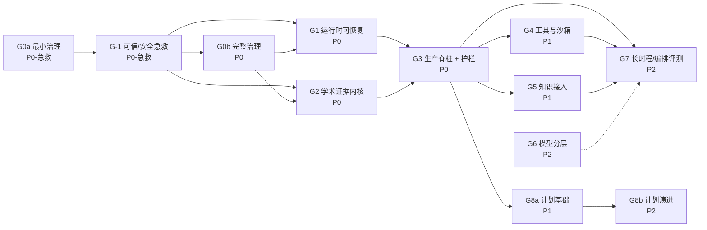

# ARC 统一学术推理基座：调研总纲与实施路线（v0.2）

> **用途**：把当前**已调研、未执行**的四份报告合并成一条可执行路线；每阶段给出目标、交付物、**可失败（能变红）的验收目标**、前置依赖与外部锚点。
>
> **不在本文范围**：已完成的代码缺口修复（`code_wiki/11–14`，PR-1..PR-6，2026-10-29 完成、CI 通过）属于**基线**，不重复排期。
>
> **口径**：本文只做"排期与验收"，不重复各报告的证据链。事实与代码行号以原报告为准。
>
> **修订**：v0.2（2026-11-06，P-003）按 [审查报告](docs/arc-roadmap-review-20261106.md) §6 订正六处——G3 的 H-4 前提（§4 G3）、§5 新增 C-9 与「生效起点」列、A2-3 的测试口径（§4 G2）、§7 标题、Q11 与 §10 的钩子数。审查报告本身仍绑定 v0.1 / `7d0e70a`，不改写。

---

## 0. 报告盘点

| 编号 | 报告 | 状态 | 在总纲中的去向 |
|---|---|---|---|
| **R-01** | `code_wiki/11-gap-remediation-research.md`、`12-remediation-acceptance-checklist.md`、`13-remediation-engineering-spec.md`、`14-decision-record.md` | **已执行**（PR-1..PR-6，2026-10-29，CI 通过） | **基线**，G1 起跑线；不重复排期 |
| **R-02** | [academic-reasoning-base-fusion.md](academic-reasoning-base-fusion.md) | 未执行；§8 M0–M5、§11 已被 R-03 部分取代 | 背景与三仓证据 → **G2 输入** |
| **R-03** | [arb-v2-decisions-research-design.md](arb-v2-decisions-research-design.md) | 未执行（D1–D5 为裁定，M0–M5 未落地） | **G0a/G0b / G2 / G3 / G6** 主来源 |
| **R-04** | [arc-knowledge-paper-textbook-integration.md](arc-knowledge-paper-textbook-integration.md) | 未执行（K0–K5 为设计） | **G5** 主来源，K5 并入 **G3** |
| **R-05** | [clawsgo-cleanroom-arc-reinforcement.md](clawsgo-cleanroom-arc-reinforcement.md) | 未执行（R0–R4、S0–S7 为设计） | **G-1 / G1 / G4 / G6 / G7** 主来源 |

**结论**：真正待执行的是 R-02（残余）→ R-03 → R-04 → R-05；经 2026-11-06 重评估（见 §0.3），合并为 **12 个阶段**，共 **106 条验收目标**。

### 0.1 优先级定义

| 级别 | 含义 | 判定规则 |
|---|---|---|
| **P0-急救** | 已在代码中证实"配置幻觉/死代码/缺字段"，不修就会产出不可信结果 | 单批次可完成、改动面 < 5 个文件 |
| **P0** | 不做就会让后续全部返工，或让"可信"不成立 | 属于状态真值、证据真值、流程准入 |
| **P1** | 不做则能力不完整，但不影响 P0 的正确性 | 属于工具边界、知识接入、成本治理 |
| **P2** | 规模化与深水区，可在 P0/P1 稳定后做 | 属于长时程、多并发、全文/推理增强 |

### 0.2 状态口径

- "已执行"= 代码合入且 CI 通过；"未执行"= 只有文档或只有部分脚手架。
- 本文的验收项一律写成 **断言**，默认包含一个**负向用例**（去掉判据必须失败）。

### 0.3 2026-11-06 重评估结论

根据 5 份专项调研（见 §11），对原 G0–G7 做如下调整：

| # | 调整 | 理由 |
|---|---|---|
| **R1** | 新增 **G-1 可信性与安全急救**（P0-急救），排在 **G0a 之后、G0b 之前** | 已证实 4 个"看起来有、实际没有"的缺口：Stage 12 缺 `returncode`、stage 级 `max_retries` 无消费点、`ClaimVerifier` 是死代码、`retrieval_degraded` 不存在 |
| **R2** | 把 G0 拆成 **G0a 最小引导** + **G0b 完整治理** | 原来 6 道钩子会阻塞急救；G0a 只需 4 道适用钩子 + 1 条决策流 |
| **R3** | **G3 升级为 P0**（原 P0→P1） | 伪造执行护栏属"可信"范畴，不能等到 P1 |
| **R4** | **G6 降级为 P2**（原 P1） | 固定模型更利于复现；成本先用预算上限控制，不需要分层路由 |
| **R5** | 把三道失败护栏拆到 **G-1（伪造执行）→ G3（循环）→ G7（漂移）** | 按"能否机械判定"排序：退出码/哈希最硬，漂移需要 embedding 校准 |
| **R6** | 新增 **G8 研究规划**，并拆成 **G8a 计划基础（P1）** + **G8b 计划演进（P2）** | 规划缺口此前只有景观、无契约；计划对象本身是 P1 能力，重规划/懒惰分解才是 P2。设计见 [research-plan-design.md](docs/research-plan-design.md) |

**净效果**：阶段数 8 → 12，但关键路径反而缩短——`G0a → G-1 → G3` 即可让"不产出假结果"成立。

---

## 1. 全景与依赖



**关键路径**：`G0a → G-1 → G2 → G3 → G7`。G1 与 G2 可并行；G6/G8b 不在关键路径上。

**最短"不产出假结果"路径**：`G0a → G-1 → G3`（跳过 G1/G2 的完整实现，只保留 G3 所需的最小契约）。

---

## 2. 全局不变量（跨阶段门禁）

任何阶段都不得破坏以下五条；违反即**回滚**，不进入下一阶段。

| # | 不变量 | 判据 |
|---|---|---|
| **I-1** | **单一真值**：`checkpoint.json` + `stage-XX/` 是权威；事件日志是投影 | 冲突时以 checkpoint 为准，并落 `consistency_warning` |
| **I-2** | **事件可重放**：同一 run 的事件链可逐条校验，断线可补拉 | `seq` 连续、`prev_sha256` 闭合 |
| **I-3** | **副作用幂等**：同一 `stage_id + inputs_digest` 只产生一次产物 | 重复执行计数 = 1 |
| **I-4** | **证据可复算**：任何主张引用的证据必须有 `source_id + locator + digest` | 断链在 Stage 20 阻断 |
| **I-5** | **模拟数据不冒充真值**：mock/demo/degraded 必须显式标记 | 论文与 UI 不得出现"已验证" |

---

## 3. 阶段总表

| 阶段 | 名称 | 优先级 | 依赖 | 主来源 | 出口（一句话） |
|---|---|---|---|---|---|
| **G0a** | 最小治理引导 | **P0-急救** | 无 | R-03 §4 | 4 道激活钩子生效，急救改动可追溯 |
| **G-1** | 可信性与安全急救 | **P0-急救** | G0a | 本次调研 | 不产出假结果；密钥不进子进程；路径不可逃逸 |
| **G0b** | 完整治理基座 | P0 | G-1 | R-03 §4 | 6 道钩子 + CI 全绿 |
| **G1** | 运行时可恢复（事件 + 续跑） | P0 | G-1,G0b | R-05 R0/R1 | kill -9 后自动续跑，事件无缺口 |
| **G2** | 学术证据内核（ClaimRecord + AR） | P0 | G-1,G0b | R-03 §1–§3 | 8 条规则可机械判红，判定内核 3.11 可跑 |
| **G3** | 生产脊柱 + 证据血缘 + 循环护栏 | **P0**（升级） | G1,G2 | R-03 M4 + 本次 AN/FC | 一条 claim 端到端可追溯；循环可停 |
| **G4** | 工具注册表与沙箱边界 | P1 | G3 | R-05 R2 | 四类逃逸全拒，工具调用可审计 |
| **G5** | 知识接入 + Grounded QA | P1 | G2,G3 | R-04 K0–K5 + 本次 GQ | 真实数据可查，引用四字段齐全 |
| **G6** | 模型分层与预算治理 | **P2**（降级） | G3 | R-05 R3 + R-03 M3 | 路由确定性、超预算前置拒绝 |
| **G7** | 长时程 + 编排评测 + 漂移护栏 | P2 | G1,G3,G4,G5 | R-05 R1/R4 + 本次 FA/OB | 72h 收敛；编排能力可测 |
| **G8a** | 研究计划基础（ResearchPlan v1） | **P1**（新增） | G3 | 本次 RP | 计划可校验、可存储、可追溯 |
| **G8b** | 计划演进（重规划/懒惰分解/局部搜索） | P2 | G8a | 本次 RP | 计划可版本化、可重放 |

> 验收总数：**G0a 4 + G-1 8 + G0b 6 + G1 12 + G2 7 + G3 17 + G4 10 + G5 14 + G6 5 + G7 15 + G8a 4 + G8b 4 = 106 条**。

---

## 4. 逐阶段详述

### G0a｜最小治理引导（P0-急救，前置：无）——**已安装（P-001，2026-11-06）**

**目标**：只做"让急救改动可追溯"的最小集，不阻塞 G-1。

**交付物**
- `SPEC_PROCESS.md` + `spec/templates/` 六模板
- `scripts/{dc_validator,spec_map,step_enforce,console_gen,rework_graph_check}.py`
- `tools/spec_runner/spec_runner.py` v1.11.0 + `sessions/specwf-p001-arc-bootstrap-20261106.jsonl`
- `.pre-commit-config.yaml`：4 道激活（dc / step / console / rework）+ 4 道 deferred（m7 / repo / blackbox / selftest）
- `docs/PROGRESS.md`、`docs/CONSOLE.md`、`docs/rework-graph.json`
- 安装四文档：`spec/arc-spec-workflow-install/`

**验收目标**

| ID | 断言 | 负向用例 |
|---|---|---|
| A0a-1 | 新建 Spec 文档缺 DC1 七字段 → 提交被拒 | 删除 `status:` 必须失败 |
| A0a-2 | 缺失 `verify` 事件 → `finalize` 被拒 | 伪造事件 id 必须失败 |
| A0a-3 | G-1 的 8 项改动全部记录在同一条决策流 | 有改动无事件即失败 |
| A0a-4 | bootstrap 提交后 `step-enforce` 全绿 | 提交后仍跳过 step-enforce 即失败 |

**安装记录**：见 [spec/arc-spec-workflow-install/](spec/arc-spec-workflow-install/)；`step-enforce` 在首个 bootstrap 提交后生效（首次允许一次 `SKIP=step-enforce`，之后禁止）。

---

### G-1｜可信性与安全急救（P0-急救，前置：G0a）

> **为什么必须在 G0b 之前**：这 8 项都是"代码里已证实存在缺口"，拖到完整治理之后会持续产出不可信结果。

**交付物与验收**

| ID | 改动 | 位置 | 断言 | 负向用例 |
|---|---|---|---|---|
| H-1 | Stage 12 写 `returncode`（区分 wrapper / experiment） | `_execution.py:575-585` | `run-1.json` 含 `returncode` | 缺字段即失败 |
| H-2 | stage 级 `max_retries` 接入 `execute_stage` | `contracts.py:25` + `executor.py:613` | 配置为 0 时不重试，为 2 时最多 3 次 | 配置仍无消费点即失败 |
| H-3 | `ClaimVerifier` 在 Stage 20/23 显式调用 | `_review_publish.py:394/2728` | 门禁报告含 claim 校验结果 | 仍为死代码即失败 |
| H-4 | `retrieval_degraded` 首次落地 | `_literature.py` + 配置 | 降级时字段为 true | 静默降级即失败 |
| H-5 | 伪造执行护栏（FB-1..FB-3） | `executor.py:613` + `_collect_experiment_results` | `completed + rc≠0` → FAILED | 放行即失败 |
| H-6 | 子进程 env **allowlist** | `sandbox.py:324`、`mcp/client.py:69` | 子进程看不到 API key/凭据 | 出现密钥即失败 |
| H-7 | `safe_join()` 路径围栏 | `_execution.py:1141-1144` | 四类逃逸全拒 | 任一逃逸成功即失败 |
| H-8 | CORS 默认收紧 | `config.py:748` | 非白名单 Origin 被拒 | 默认 `*` 即失败 |

**外锚**：MLR-Bench（arXiv 2505.19955）关于"合成/占位数据冒充真实执行"的失败模式；OWASP Path Traversal；ClawsGO 逆向报告 F2/F5（仅作为反模式，不作为实现）。

> H-6/H-7/H-8 三项来自 [clawsgo-value-extraction-spec.md](clawsgo-value-extraction-spec.md) 的 P0-1..P0-3；H-5 的详细设计见 [failure-guards-design.md](docs/failure-guards-design.md) 护栏 B。

---

### G0b｜完整治理基座（P0，前置：G-1）

**目标**：让"文档即契约"成立，后续所有改动都有准入与审计。

**交付物**
- `spec/SPEC_PROCESS.md`（标注来源版本）
- `spec/templates/` 六模板
- `scripts/spec/dc_validator.py`、`step_enforce.py`、`console_gen.py`、`rework_graph_check.py`、`m7_stats.py`、`repo_stats.py`
- `.pre-commit-config.yaml` 六道钩子
- `.github/workflows/ci.yml` 增 `spec-gates` job
- `spec/grandfather.yaml`（存量文档豁免清单）

**验收目标**

| ID | 断言 | 负向用例 |
|---|---|---|
| A0-1 | `pre-commit run --all-files` 六钩子全绿（dc/m7/repo/step/console/blackbox） | 任一钩子返回非 0 即失败 |
| A0-2 | 新建 `.md` 缺 DC1 七字段 → 提交被拒 | 删除 `status:` 后必须失败 |
| A0-3 | `step_enforce` 在缺失 `verify` 事件时拒绝 `finalize` | 伪造事件 id 必须失败 |
| A0-4 | 文档在 `verify` 之后再改正文 → digest 不匹配 → 拒绝 | 改 1 个字符即失败 |
| A0-5 | 手改 `docs/CONSOLE.md` → `console_gen --check` 非 0 | 不重生成必须失败 |
| A0-6 | `spec-gates` job 与既有 3.11–3.13 矩阵并行且全绿 | job 缺失即失败 |

**决策闸门**：Q3「touch = migrate」是否立即生效；存量豁免范围。

**外锚**：pre-commit 官方 hook 机制；Spec_Workflow v1.7.1 原仓。

---

### G1｜运行时可恢复（P0，前置：G-1、G0b）

**目标**：把"仪表盘广播"升级为"可回放控制面"，把"手动续跑"升级为"无人值守自愈"。

**来源映射**：R-05 R0（协议）+ R1（架构）。

**交付物**
- `EventEnvelope v1` + `<run>/events.jsonl`（append-only、fsync、链哈希）
- `GET /api/runs/{id}/events`（游标分页）
- `GET /api/runs/{id}/events/stream`（SSE，支持 `Last-Event-ID`）
- WS 首帧 `subscribe {run_id, after}`
- `arc supervisor` / `arc worker --run-id`
- `<run>/lease.json`（owner/pid/expires/fencing）
- 原子 checkpoint（tmp + `os.replace` + `artifacts_digest`）
- 幂等键 `stage_id + inputs_digest`

**验收目标**

| ID | 断言 | 负向用例 |
|---|---|---|
| A1-1 | 事件链 `prev_sha256` 首尾闭合，篡改任一条即校验失败 | 改 payload 1 字节必须失败 |
| A1-2 | 断线后带 `Last-Event-ID` 重连，事件**无缺口、无重复** | 关掉重连补拉必须出现 gap 检测失败 |
| A1-3 | Stage 5 执行中 `kill -9` worker → supervisor 拉起 → 续跑完成 | 不续跑或重复执行必须失败 |
| A1-4 | 同一 run 两个 worker 抢占 → 仅一个持租约，另一个退出 | 双写检测到即失败 |
| A1-5 | 损坏 `checkpoint.json` → 从事件日志重建到最后一致 seq，`recovered=true` | 直接崩溃必须失败 |
| A1-6 | 事件日志按大小/条数滚动并压缩，单 run 体积上限生效 | 无上限导致磁盘打满即失败 |
| A1-7 | worker 退出码分类：`VERSION/REVOKED/CONFIG` 不重启，`OOM/NET` 退避重启 | 不可重试错误进入退避循环即失败 |
| A1-8 | CORS 仅放行显式白名单 | 默认 `*` 或反射任意 Origin 即失败 |
| A1-9 | `StageAttempt` 子进程 + `session_id` 续接；重试不重放全部上下文 | 第二次 attempt 从零开始即失败 |
| A1-10 | Transactional outbox/effect queue：入队与 checkpoint 同事务，提交后执行；同一 `(kind,key)` 只一行 | 崩溃后重复执行或丢执行即失败 |
| A1-11 | Run / Stage / Attempt 三层分离：Attempt 退出码不直接写 Stage 状态 | Attempt 失败导致 Stage 被误判完成/失败即失败 |
| A1-12 | 恢复提示：重启后的新 Attempt 带 `resume_note`，先查产物/事件再重复外部动作 | 恢复后重复付费调用或重复副作用即失败 |

**实现约束**
- 第一版**不引入 Temporal/Restate**：保持 file-as-state；只在 `DurableBackend` 预留接口。
- SSE 仅只读；WS 双向；两通道共用同一序列化器。

**外锚**
- WHATWG HTML §9.2：`Last-Event-ID` 语义（重连补拉必须用它，而不是自定义 header）。
- OpenRigor README：fsync 事件日志、幂等键、`RUNTIME_RESTARTED` 收尾。
- OpenClaw 网关：`connect` 首帧 + `req/res + event` 信封。
- Temporal/Restate：仅作为"确定性重放"的对照，不作为实现。

---

### G2｜学术证据内核（P0，前置：G-1、G0b）

**目标**：把"学术八条"变成可机械判定的 `ClaimRecord`，并让判定内核在 ARC 的 3.11 进程内可跑。

**来源映射**：R-03 §1–§3；R-02 的 A/B/C、E1–E5、T1–T4 词表。

**交付物**
- `ClaimRecord v1`（含 `assumptions`、`evidence[]`、`reasoning_chain`、`stats_protocol`、`falsifier`、`verification_depth`）
- `AR-01..AR-08` 判据实现（纯函数 + 严重度 `downgrade/warn/fail`）
- 16 个 fixture（每条 1 正 1 反）
- vendor 到 ARC：`datatypes`（裁剪）、`verdict/policy`、`sandbox/evaluator`
- 3.12 子进程边界（完整 `proof_pipeline` / Lean 插件）

**验收目标**

| ID | 断言 | 负向用例 |
|---|---|---|
| A2-1 | 契约 JSON Schema + fixture 全通过（7 个 schema） | 缺 `claim_class` 必须失败 |
| A2-2 | AR-01..08 共 16 fixture 全绿；**变异测试**：删掉任一判据 → 对应 fixture 变红 | 判据空实现必须失败 |
| A2-3 | 判定内核在 Python 3.11 跑通「判定内核测试集」：该集合须在 G2 开工时以 `pytest --collect-only` 冻结为用例清单（禁止用文件名/关键字模糊计数）；冻结前记 `N/A` | 依赖 3.12-only 语法即失败 |
| A2-4 | `FALSIFIED/FAILED` 的 claim **无法进入** `deliverables/` | 能进入即失败 |
| A2-5 | `NUMERICALLY_VERIFIED` 可用，但论文必须带"numerically verified (N cases)"注记 | 无注记即失败 |
| A2-6 | 缺引文的 A/B 类 → 移入 `assumptions`，正文不渲染，状态降 `speculation`（**不阻断**） | 一律 fail 即违背原语义 |
| A2-7 | 无 Lean / 编译失败 / 有 sorry → 上限 `PARTIALLY_FORMALIZED`，深度 `stage2` | 冒充 `FORMALLY_VERIFIED` 即失败 |

**决策闸门**：Q1 Python 双轨（建议 B）；Q2 Lean 可选 Tier-3。

**外锚**
- W3C PROV-O：`Entity/Activity/Agent`、`used/generatedBy/wasDerivedFrom` → 映射到 `EvidenceRef`，保证跨系统可交换。
- JSON Schema 2020-12：契约版本化。
- 变异测试（mutation testing）：判据必须"能变红"。

---

### G3｜生产脊柱 + 证据血缘 + 循环护栏（P0，前置：G1、G2）

**目标**：让一条 claim 从生成到门禁到引用核验全程可追溯；让文献/综述循环能停下来。

**来源映射**：R-03 M4；R-04 K5；本次 AN（ArtifactNode）与 FC（循环护栏）。

**交付物**
- Stage 9 / 14 / 17 / 20 / 23 接入 `ClaimStatus`、`CitationLabel`
- `pipeline_summary.json` 由程序派生（不允许手写）
- Stage 20 门禁：`status != FALSIFIED/FAILED`
- Stage 23 引用核验：`ClaimRecord.evidence[].digest` 可复算
- `retrieval_degraded` 标记（**待 G-1 的 H-4 落地后**接入门禁；H-4 未落地前 A3-5 记 `N/A`，不得判绿）
- `ArtifactNode v1`（content_hash + parent_ids + type + producer + locator）
- `stage_events.jsonl` + 循环检测（连续同签名 + 0 新增 → PAUSE）

**验收目标**

| ID | 断言 | 负向用例 |
|---|---|---|
| A3-1 | 一条 claim 端到端：ClaimRecord → 证据 → 段落 → Stage20 → Stage23，三出口状态一致 | 任一处状态不一致即失败 |
| A3-2 | 手改 `pipeline_summary.json` 未重算 → 一致性检查失败 | 手改后仍通过即失败 |
| A3-3 | 断网重算证据 digest，结果与运行期一致 | 依赖运行期内存即失败 |
| A3-4 | K5 门禁：无法解析的 `tb:` / `paper:` 引用 → 阻断并给定位 | 静默通过即失败 |
| A3-5 | 检索降级（TF-IDF 回退）→ `retrieval_degraded=true`，论文标注 | 缺失标记即失败 |
| AN-1 | 每个 DONE 阶段产物均有节点，`content_hash` 可复算 | 篡改字节 → `E_ARTIFACT_HASH` |
| AN-2 | 所有 `parent_ids` 可解析、无环 | 删除父节点 → `orphan_parent` |
| AN-3 | 子节点 `inputs_digest` = 父哈希集重算 | 篡改父产物 → 子节点校验失败 |
| AN-4 | `project(node)` 与旧 evidence 字段逐字段相等 | 旧 AR-01 fixture 变红即失败 |
| AN-5 | 跨仓 pointer 带 `uri + content_hash`；snapshot 带 `materialized=true` | `inline_copy > 500` 字符 → fail |
| AN-6 | `sensitive=true` 不进 `blobs/`、不导出、不写 preview | 节点含 base64 正文 → 阻断 |
| FC-1 | `plan_sig` 连续 3 次相同且 `new_rows=0` → `PAUSED` | 继续空转即失败 |
| FC-2 | 第二轮新增 5 行 → 放行 | 有新结果却被拦即失败 |
| FC-3 | 同签名但 `screen_meta.json` 有网络错误 → 不触发 | 网络故障误判为循环即失败 |
| A3-6 | `RunMandate` 记录 policy_version/scope/strength/requester；改配置不静默撤销在跑 run | 配置变更即时改变已接受 run 的权限即失败 |
| A3-7 | 每次 LLM 请求记录 `prompt_version`；claim 可追溯到生成它的版本 | 版本变更导致历史 claim 不可复现即失败 |
| A3-8 | 越界子任务走 `StageHandback {reason, evidence}` 交回路由，不静默扩 scope | 静默扩写或丢弃即失败 |

**决策闸门**：Stage 20 是否允许 `PARTIALLY_FORMALIZED` 通过（建议允许）；ArtifactNode 是否覆盖 Stage 12 大文件（建议只存指针）。

---

### G4｜工具注册表与沙箱边界（P1，前置：G3）

**目标**：任何工具"低成本接入、可审计执行、不可越界"。

**来源映射**：R-05 R2。

**交付物**
- `tools/registry.yaml`：`name/version/inputSchema/outputSchema/scope/risk/approval/sandbox_profile`
- `GET /api/tools`；MCP 动态列工具
- 每 run 一个容器（label、默认 `--network none`、cpu/mem/pids/disk 配额、TTL 回收）
- `tool.call` / `tool.result` 事件（只落 digest + 摘要）
- 高风险工具 `approval=always`
- `HostProfile`（CPU/内存/磁盘/GPU/工具链）：**纯数据，无脚本入口**
- env allowlist 覆盖**全部**沙箱后端；`safe_join` 覆盖**全部**写入点

**验收目标**

| ID | 断言 | 负向用例 |
|---|---|---|
| A4-1 | 100% 已注册工具有 schema；缺 schema 启动即失败 | 缺 `inputSchema` 仍启动即失败 |
| A4-2 | 路径逃逸 / 符号链接逃逸 / 网络外联 / fork bomb 四类测试全部被拒 | 任一成功即失败 |
| A4-3 | 资源超限 → 退出码 137 + 落 `tool.result` | 无配额导致宿主卡死即失败 |
| A4-4 | 每个 `tool.call` 有对应 `tool.result`；缺失标记 `orphan_call` | 孤立调用不标记即失败 |
| A4-5 | `risk=high` 未审批时拒绝执行 | 直接执行即失败 |
| A4-6 | 容器 TTL 到期被回收，产物已落盘 | 残留容器即失败 |
| A4-7 | 全部沙箱后端使用 env allowlist | 任一后端仍 `os.environ` 透传即失败 |
| A4-8 | 全部产物写入点使用 `safe_join` | 存在裸 `target_dir / fname` 即失败 |
| A4-9 | `HostProfile` 只返回数据；代码路径无 `shell=True` / 外发脚本 | 存在脚本执行入口即失败 |
| A4-10 | 工具注册表与 MCP `listChanged` 一致；新增工具无需改代码 | 新增工具需改 pipeline 即失败 |

**外锚**
- MCP 2026-07-28：`tools` capability、`listChanged`、`inputSchema/outputSchema` 升级为完整 JSON Schema 2020-12。
- E2B / Daytona / Firecracker：按 run 起沙箱、快照、强隔离三档参照。
- OpenHands：runtime 与 sandbox 解耦。

**风险**：ARC 依赖 `mcp>=2.1,<3`，而 MCP 2026-07-28 被称 "MCP v2"（stateless，移除 initialize/session）。**必须在 G4 开工前做版本对齐验证**，否则会出现"按 v2 文档写、按旧 SDK 跑"。

---

### G5｜知识接入 + Grounded QA（P1，前置：G2、G3）

**目标**：Paper 的书目层与 Textbook 的图谱层真正可查、可引用、可复算；文献问答可降级。

**来源映射**：R-04 K0–K5；本次 GQ（Grounded QA）。

**交付物**
- **K0** `KnowledgeStore` 适配器（空库可查、不造假数据）
- **K1** Paper 元数据索引（2,487 条；置信度归一：分类 0–100 → 0–1）
- **K2** Textbook KG 接入（1,824 节点 / 20,235 边；补登 `prerequisite`/`example_of`/`formalized_in`）
- **K3** 技能/案例注入（5 份 skill pack；案例 ≤5/run）
- **K5** 计数与摘要同源（`m7_stats`/`repo_stats`）
- **GQ** 可选 `GroundedQA` + `NullGroundedQA` 降级（默认关闭）
- **G5-E（条件项）** K4 全文升级：**硬前置** Paper Phase 2（PDF→Markdown）完成

**验收目标**

| ID | 断言 | 负向用例 |
|---|---|---|
| A5-1 | K0 空库查询返回空结果 + `empty=true`，无伪造条目 | 返回占位假数据即失败 |
| A5-2 | K1 导入 2,487 条，重复键 = 0；`classification_confidence` 归一到 0–1 | 量纲混用即失败 |
| A5-3 | K2 节点/边数与源一致；非法边（未登记 relation）= 0；3 条抽样查询各返回 ≥3 实体且带 page | 少一条边即失败 |
| A5-4 | K3 5 份 skill pack 可加载；单次 run 注入案例 ≤5 | 超限即失败 |
| A5-5 | K5 计数重算与文档不一致时 CI 失败 | 手改数字即失败 |
| A5-6 | 检索降级必须显式（`retrieval_degraded`），不得静默 | 静默降级即失败 |
| A5-7 | K4 未就绪时 `fulltext=false`，所有全文引用被拒 | 假装有全文即失败 |
| A5-8 | `SkillPack` 带 version + digest + signature；篡改拒绝加载 | 缺版本/签名仍加载即失败 |
| GQ-1 | 默认关闭时产物与基线逐字节一致，无 `grounded_qa/` | 关闭仍产生文件即失败 |
| GQ-2 | 每条 citation 四字段齐全，`digest` 可离线复算 | digest 对不上即失败 |
| GQ-3 | 无证据时 `status=insufficient`，不得输出"已证实" | AR-03 未 fail 即失败 |
| GQ-4 | 依赖缺失/超时 → `retrieval_degraded=true`，stage 仍 DONE | stage 因可选后端失败即失败 |
| GQ-5 | 矛盾默认仅 warn；`policy=block` 时 Stage 20 阻断 | 该阻断未阻断即失败 |
| A5-9 | 文献源按 Source kind/instance 保存 read_position；重启不重放 | 重启后重复抓取即失败 |

**决策闸门**：Q6 KG 扩词表 vs 外包外部 KG；Q7 Paper 首批范围；Q4 embedding 后端。

**外锚**
- LinkML：Textbook 现有 schema 的扩展方式。
- SQLite FTS5 / BM25：Textbook 已用的检索基线。
- W3C PROV-O：把 "论文→概念→定理" 的派生关系表达为 provenance。

---

### G6｜模型分层与预算治理（P2，前置：G3）

**目标**：复刻"快/均衡/攻坚 + 子智能体"的策略，但不训练模型。

> **为什么从 P1 降到 P2**：固定模型更利于复现；成本先用"预算上限 + 前置拒绝"控制，不需要分层路由。分层路由的收益是省钱，不是可信，因此让位于 G3/G4。

**来源映射**：R-05 R3；R-03 M3（本地模型硬禁网）。

**交付物**
- `model_policy.yaml`：roles（planner/executor/reviewer/subagent）× tiers（fast/balanced/hard）× escalation triggers
- 纯函数路由器 `(stage, attempts, gate, budget_left) -> tier`
- `cost_ledger.jsonl`（`model_used` + `policy_version`）
- 预算前置拒绝
- 本地模型硬禁网（M3）

**验收目标**

| ID | 断言 | 负向用例 |
|---|---|---|
| A6-1 | 表驱动测试：同一输入 → 同一 tier（确定性） | 两次结果不同即失败 |
| A6-2 | 升级只在显式 trigger（门禁阶段 / 连续失败≥2 / 上下文>80%）发生 | 无 trigger 越级即失败 |
| A6-3 | 超 `max_cost_usd` → 前置拒绝 + `budget_exhausted` 事件 | 先调用后拒绝即失败 |
| A6-4 | 每次 LLM 响应落 `model_used` 与 `policy_version` | 缺失即失败 |
| A6-5 | `local_only=true` 时任何外部端点调用被拒 | 发生外联即失败 |

**明确不做**：权重微调、训练数据配比复现（洁净室红线）。

---

### G7｜长时程、多并发与双平面（P2，前置：G1、G3、G4、G5）

**目标**：从"单机单任务"走到"可长时间无人值守、多任务隔离、双平面一致"；并让编排能力可测。

**来源映射**：R-05 R1 的 72h soak + R4；R-03 M5 双平面；本次 FA（漂移护栏）与 OB（编排评测）。

**交付物**
- 72h soak 脚本与报告模板
- 多 run 并发（独立目录、独立租约、独立沙箱）
- 双平面（科研/生产）同 `ClaimStatus` 校验
- 事件日志轮转/归档策略
- Runbook + 观测看板（重启次数、恢复耗时、失败阶段分布）
- 并发准入（`max_concurrent_attempts` + `max_inflight_llm_calls`）
- 漂移护栏（FA-1..FA-3）
- `experiments/arc_bench/orchestration/`（OB-1..OB-5，可选）

**验收目标**

| ID | 断言 | 负向用例 |
|---|---|---|
| A7-1 | 72h 内 ≥3 次进程重启，最终收敛到同一终态 | 任一次无法收敛即失败 |
| A7-2 | 并发 N 个 run：目录/租约/沙箱互不串扰 | 出现跨 run 写即失败 |
| A7-3 | 双平面同一 claim 的 `ClaimStatus` 一致 | 不一致即失败 |
| A7-4 | 事件日志轮转后仍可按 `run_id + seq` 完整回放 | 归档后缺口即失败 |
| A7-5 | Runbook 演练：新人按文档可在 30 分钟内完成一次恢复 | 需口头指导即失败 |
| A7-6 | 超过 `max_concurrent_attempts` 时排队而非 OOM；超预算前置拒绝 | 来多少起多少即失败 |
| A7-7 | worker slot 在启动前同步预留；HITL 唤醒可用 1 个优先槽位 | 人工消息被批量任务饿死即失败 |
| FA-1 | 无关主题的 analysis → `PAUSED` | 漂移却 DONE 即失败 |
| FA-2 | `rq_cos=0.8`、`unsupported=0.1` → 正常 DONE | 正常结果被误拦即失败 |
| FA-3 | 已批准 `scope_change` 的 PIVOT → 不触发 | 合法 PIVOT 被拦即失败 |
| OB-1 | 15 任务 × 3 框架 dry-run 可复现；gold ≥10/12，单发基线 ≤7/12 | 单发基线接近 gold 即失败 |
| OB-2 | dummy adapter 经 `run_baseline.py` 产出 submission/judge_result | 需改现有 runner 即失败 |
| OB-3 | 串行却声明并行 → 委派 0 分 + 总分 0 | 虚报并行得分即失败 |
| OB-4 | 超预算落 `budget_exceeded` | 静默截断即失败 |
| OB-5 | 删除全部散文后分数变化 <0.05 | 分数依赖写作即失败 |

---

### G8a｜研究计划基础（P1，前置：G3）

**目标**：把"研究计划"从散文变成可校验、可存储、可追溯的任务图；不做自由 planner。

**来源映射**：[research-plan-design.md](docs/research-plan-design.md)。

**交付物**
- `ResearchPlan v1` schema + `validate_plan()`（12 条规则）
- `plan/plan.v1.json`、`index.json`、`plan_events.jsonl`
- Stage 2 写入 + Stage 7/8/9/14 节点生成
- `experiment` 节点与 `exp_plan.yaml` 双向一致
- `plan_digest` 可复算

**验收目标**

| ID | 断言 | 负向用例 |
|---|---|---|
| A8a-1 | Stage 2 产出合法 `plan.v1.json`：schema、DAG 无环、`owner_stage ∈ 1..23` | 缺 acceptance、有环、`owner_stage=99` → 拒绝 |
| A8a-2 | `experiment` 节点有 metric/dataset/baseline，且与 `exp_plan.yaml` 一致 | plan 3 条件、exp_plan 2 条件 → Stage 9 拒绝 |
| A8a-3 | 预算求和 ≤ run 预算；深度 ≤3、扇出 ≤8、节点 ≤40；statement 不重复 | 41 节点或重复节点 → 拒绝 |
| A8a-4 | `plan_digest` 可复算；手改 plan 未重算 → 拒绝 | digest 不符仍通过 → 失败 |

**决策闸门**：节点上限 40、深度 3 是否合适（Q15）。

---

### G8b｜计划演进（P2，前置：G8a）

**目标**：让计划可重规划、可懒惰分解、可局部搜索，且不重跑已完成工作。

**交付物**
- Progress Ledger（Magentic-One 五问）
- 版本化重规划（`preserve_completed`、diff、人工批准）
- ADaPT 式懒惰分解（失败/歧义才拆）
- Stage 9 局部树搜索（仅实验方案空间）

**验收目标**

| ID | 断言 | 负向用例 |
|---|---|---|
| A8b-1 | 重规划保留 `done` 节点，不重跑 | 重跑已完成节点 → 失败 |
| A8b-2 | 目标变更必须人工批准 | 未批准就改 `goal` → 拒绝 |
| A8b-3 | 每次重规划 version+1，且有 added/removed/changed/preserved diff | 原地改 plan → 拒绝 |
| A8b-4 | Progress Ledger 能识别循环；懒惰分解只在失败/歧义触发；Stage 9 搜索受预算约束 | 空转仍报进展、或一上来全量拆分 → 失败 |

**决策闸门**：`max_versions=3` 与预算阈值（Q15/Q16）。

---

## 5. 跨阶段一致性套件（Conformance）

所有阶段共用一套"回归闸门"；每阶段结束时，**已生效成员**必须全绿：

| ID | 套件 | 覆盖 | 生效起点（成员全部落地后） |
|---|---|---|---|
| C-1 | 事件链与回放 | I-2、A1-1、A1-2、A7-4 | G1 |
| C-2 | 幂等与续跑 | I-3、A1-3..A1-5、A1-7、A1-9..A1-12、A7-1 | G1 |
| C-3 | 证据复算与血缘 | I-4、A3-1..A3-4、A3-6..A3-8、A5-5、AN-1..AN-6 | G3 |
| C-4 | 边界、配额与密钥 | I-5、A1-8、H-6..H-8（→G-1）；A4-2、A4-3、A4-7..A4-9（→G4） | G-1 起分段生效 |
| C-5 | 契约与文档 | A0a-1..A0a-4、A0-1..A0-6、A2-1 | G0b |
| C-6 | 路由确定性 | A6-1..A6-4 | G6 |
| **C-7** | **失败护栏** | H-5（FB-1..3）、FC-1..3（→G3）；FA-1..3（→G7） | G3 起分段生效 |
| **C-8** | **计划契约** | A8a-1..A8a-4（→G8a）、A8b-1..A8b-4（→G8b） | G8a 起分段生效 |
| **C-9** | **可信执行（G-1 数据正确性）** | **H-1、H-2、H-3、H-4** | **G-1** |

**生效与判红规则**：
- 成员所属阶段尚未完成 → 记 `N/A`，**不计红**；所属阶段完成后自动转为必绿。
- C-1/C-2/C-3/C-7/C-8/C-9 任一红 → **禁止发布**；
- C-4 红 → 禁止接入新工具与外部数据；
- C-5 红 → 禁止提交；
- C-6 红 → 回退到上一版 `model_policy`（G6 降为 P2 后该项默认不阻塞）。

**覆盖范围声明（P-003）**：C 套件只回归"已实现能力"，不追求对 106 条的穷举。当前未纳入任何套件的阶段出口有 `A2-2..A2-7`、`A4-1/A4-4/A4-5/A4-6/A4-10`、`A5-6`、`GQ-1..GQ-5`、`OB-1..OB-5`；这些在对应阶段 `RESEARCH.md` 登记后决定归属，本版不补齐。

---

## 6. 顺序与并行建议

```
G0a → G-1 → G0b ─┬→ G1 ─┐
                 └→ G2 ─┴→ G3 ─┬→ G4 ─┐
                               ├→ G5 ─┼→ G7
                               ├→ G6 ─┤（可选，P2）
                               └→ G8a → G8b（P1→P2）
```

- **必须串行**：`G0a → G-1 → G0b → G2 → G3`。急救必须先于完整治理；契约与门禁必须先于脊柱。
- **可并行**：G1 与 G2（不同目录、不同测试集），都在 G0b 之后启动。
- **可并行**：G4 / G5 / G8a（P1）；G6 为 P2 可选。
- **G8b 依赖 G8a**：先有可校验的计划对象，再谈重规划与懒惰分解。
- **G7 最后**：需要 G1 的恢复、G4 的沙箱、G5 的知识；**不再依赖 G6**。
- **如果只能做三件事**：`G0a → G-1 → G3 的最小集`（伪造执行护栏 + 路径/密钥/CORS），即可让"不产出假结果"成立。

**每阶段的硬出口**：本阶段验收项全绿 + C 套件中**已生效成员**全绿 + 下一阶段前置的 `spec/` 四文档已齐。

---

## 7. 尚未裁决的 16 项

| # | 问题 | 影响阶段 | 默认建议 | 状态 |
|---|---|---|---|---|
| Q1 | Python 双轨（3.11 内核 + 3.12 子进程）还是统一 3.12 | G2 | **双轨 B** | 待确认 |
| Q2 | Lean 是否作为安装前置 | G2 | **否，可选 Tier-3** | 待确认 |
| Q3 | Spec "touch = migrate" 是否立即生效 | G0b | 新文档立即，存量入 grandfather | 待确认 |
| Q4 | Embedding 后端（OpenAI / sentence-transformers / TF-IDF） | G5 | 默认本地，缺失即降级并标记 | 待确认 |
| Q5 | R1 后端：纯文件 + supervisor vs SQLite WAL | G1 | **先纯文件**，压测后再评估 | 待确认 |
| Q6 | KG 扩词表 vs 外包外部 KG 服务 | G5 | 先扩词表（6→14），外包留接口 | 待确认 |
| Q7 | Paper 首批范围（全部 2,487 还是子集） | G5 | 先 500 条高置信度做闭环 | 待确认 |
| Q8 | 沙箱默认档（local / docker / 托管） | G4 | 开发 local，生产 docker | 待确认 |
| Q9 | 事件保留期（30 天 / 永久） | G1/G7 | 30 天 + 归档摘要永久 | 待确认 |
| Q10 | MCP 协议版本对齐（SDK 2.x vs 2026-07-28 规范） | G4 | 开工前做兼容矩阵 | 待确认 |
| **Q11** | G0a/G0b 的切分边界（4 道激活钩子是否足够） | G0a/G0b | 4 道足够（dc/step/console/rework）；G0b 再补 m7/repo/blackbox | 待确认 |
| **Q12** | G6 降为 P2 是否可接受（固定模型 vs 分层路由） | G6 | 可接受；先用预算上限 | 待确认 |
| **Q13** | 漂移护栏阈值（`rq_cos=0.35/0.45`、`p_only=0.5`） | G7 | 经验值，需 ARC-Bench 校准 | 待确认 |
| **Q14** | ArtifactNode 覆盖范围（全阶段 vs Stage 12-14/20/23） | G3 | 先覆盖实验与证据链相关阶段 | 待确认 |
| **Q15** | 研究计划 `max_versions`（默认 3）与节点上限（40） | G8a/G8b | 先用 3 / 40，按 ARC-Bench 校准 | 待确认 |
| **Q16** | 懒惰分解触发阈值（失败 2 次 / 预算 50% 且 done<30%） | G8b | 先用经验值，需校准 | 待确认 |

> 规则：未裁决项**不得进入对应阶段**；可用默认建议先行，但必须在 `spec/` 的决策流中记录为 `provisional`。

---

## 8. 风险与红线

| 风险 | 触发信号 | 处置 |
|---|---|---|
| 双真值 | 事件日志与 checkpoint 不一致 | I-1；启动一致性校验 |
| 过度工程 | 一上来接 Temporal/Celery/Redis | G1 禁止；压测后再评估 |
| 幂等假实现 | 只比文件名不比内容 | 必须 `inputs_digest`，part 级也要 |
| 沙箱"看起来隔离" | 只有 `--rm`，无配额/网络策略 | A4-2/A4-3 进 CI |
| 权限粒度失控 | 全部 `approval=always` | 按 risk 分级 |
| 模型分层破坏复现 | 同 run 两次模型不同 | 落 `model_used` + `policy_version` |
| 洁净室污染 | 参考了泄露源码/私有接口 | 只读公开资料；规格与实现分离评审 |
| 知识"假装有全文" | K4 未完成却引用全文 | A5-7 硬拒 |

**红线**：不抓私有 API、不逆向二进制、不复制 UI 资产/文案、不复现权重与训练配比、不把未证实的"11 天"当验收指标。

---

## 9. 外部锚点清单

### 9.1 标准与规范

| 锚点 | 用途 | 对应阶段 |
|---|---|---|
| WHATWG HTML §9.2（SSE / `Last-Event-ID`） | 断线补拉的唯一正确语义 | G1 |
| W3C PROV-O（PROV-DM） | 证据链可交换表达（Entity/Activity/Agent） | G2、G5 |
| JSON Schema 2020-12 | `ClaimRecord` / tool schema 版本化 | G2、G4 |
| MCP 2026-07-28 规范（tools capability） | 工具注册与发现 | G4 |
| LinkML | Textbook KG schema 扩展 | G5 |

### 9.2 开源参照

| 项目 | 借鉴点 | 阶段 |
|---|---|---|
| OpenRigor | fsync 事件日志、幂等键、`RUNTIME_RESTARTED`、完整回放 | G1 |
| OpenClaw | `connect` 首帧、`req/res + event` 信封、协议版本协商 | G1 |
| ClawGo | Secure execution / Identity+Permissions / Replay / Scheduling+Recovery 四象限 | G1、G4 |
| Claw Code / claurst | 洁净室"规格先行、实现独立"方法 | G0a/G0b 评审、G4 |
| Temporal / Restate | 确定性重放、journaled invocation、virtual object（仅对照） | G1、G7 |
| OpenHands | runtime 与 sandbox 解耦 | G4 |
| E2B / Daytona / Firecracker | 按 run 起沙箱、快照、强隔离三档 | G4、G7 |
| SQLite FTS5 / BM25 | Textbook 检索基线 | G5 |

### 9.3 学术参照

| 锚点 | 用途 | 阶段 |
|---|---|---|
| arXiv 2609.00006《Harness Engineering: … Eleven Systems》 | harness 解剖框架，校准"四层"拆解 | G1、G4 |
| `arb-v2-decisions` §3（AR-01..08） | 学术八条的机械判据 | G2 |
| `academic-reasoning-base-fusion` 的 A/B/C、E1–E5、T1–T4 | 词表不改 | G2 |
| Kosmos（arXiv 2511.02824） | 逐句引用到代码/文献；长跑后复核 | G3、G7 |
| Robin（arXiv 2505.13400） | 独立模型 pairwise judge；实验闭环 | G3 |
| ScienceClaw + Infinite（arXiv 2603.14312） | 内容哈希 + 父 ID 的 artifact DAG | G3 |
| SwarmBench（arXiv 2608.30661） | 分解/委派/聚合三维度评测 | G7 |
| MLR-Bench（arXiv 2505.19955） | "合成/占位数据冒充真实执行"的失败模式 | G-1 |
| From Copilots to Colleagues（自主研究综述） | L1–L5 分级，用于 ARC 自我定位 | G0a |

---

## 10. 一页纸总结

1. **先最小治理**（G0a）：4 道钩子即可（dc/step/console/rework），不要用 6 道钩子阻塞急救。
2. **再做急救**（G-1）：4 个"配置幻觉/死代码/缺字段" + 3 个安全洞 + 伪造执行护栏。
3. **再立真值**（G1/G2）：事件可回放 + 证据可判定。
4. **后立闭环**（G3）：claim 端到端 + ArtifactNode 血缘 + 循环护栏。
5. **再扩能力**（G4/G5）：工具边界、知识接入；G6 模型分层可选。
6. **最后规模化**（G7）：72h、并发、双平面、编排评测、漂移护栏。
7. **可选补规划**（G8a/G8b）：先做计划对象与校验（P1），再做重规划与懒惰分解（P2）。
8. **任何阶段都不许破坏 I-1..I-5**。

> 一句话：**G0a 立规矩，G-1 止血，G1/G2 立真值，G3 立闭环，G4/G5 立能力，G8a 立计划，G7 立规模，G8b 补演进；G6 退居可选。**

---

## 11. 依据文档（2026-11-06 专项调研）

| 文档 | 内容 | 并入 |
|---|---|---|
| [clawsgo-research-orchestration-landscape.md](clawsgo-research-orchestration-landscape.md) | 编排能力画像、开源案例、ARC 落档核查 | 全局背景 |
| [orchestration-capability-matrix.md](docs/orchestration-capability-matrix.md) | 6 维 × 8 系统矩阵、证据缺口、采用/拒绝清单 | G3/G4 设计输入 |
| [artifact-node-evidence-ref-design.md](docs/artifact-node-evidence-ref-design.md) | `ArtifactNode v1` + PROV-O 映射 + AN-1..AN-6 | **G3** |
| [grounded-qa-backend-design.md](docs/grounded-qa-backend-design.md) | 可选 Grounded QA + GQ-1..GQ-5 | **G5** |
| [orchestration-benchmark-plan.md](docs/orchestration-benchmark-plan.md) | 15 任务编排评测 + OB-1..OB-5 | **G7** |
| [failure-guards-design.md](docs/failure-guards-design.md) | 三道护栏 + FA-1..FC-3 | **G-1/G3/G7** |
| [dsh-superagent-absorption-analysis.md](dsh-superagent-absorption-analysis.md) | DSH 原型的运行时机制与 A1-10..A7-7 增量 | **G1/G3/G5/G7** |
| [research-plan-design.md](docs/research-plan-design.md) | `ResearchPlan v1` + 12 条校验 + 版本化重规划 + A8a/A8b | **G8a/G8b** |

**四个已核实的急救事实**（对应 H-1..H-4）：

1. Stage 12 的 `run-1.json` 未写 `returncode`（`_execution.py:575-585`）。
2. stage 级 `max_retries` 在 `contracts.py` 有定义但无消费点。
3. `ClaimVerifier` 除测试外无调用点。
4. `retrieval_degraded` 代码中不存在。

**两处证据修正**：

- "8/10 伪造执行"出自 MLR-Bench（arXiv 2505.19955，NeurIPS 2025 D&B），非 RE-Bench；且为 LLM 评审判定。
- Kosmos 没有"运行越久漂移越强"的量化结论，只有"把统计显著误当科学价值"的自述；长跑更易漂移是推断，已在护栏设计中标注。
