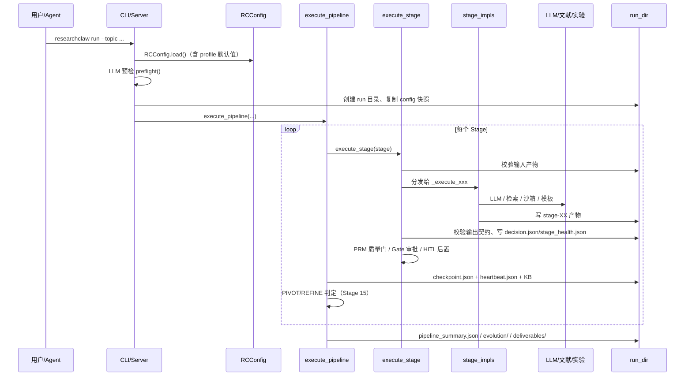
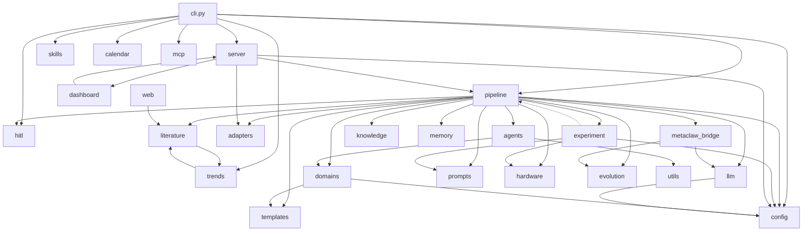

# 01 · 系统架构总览

## 1. 系统边界

AutoResearchClaw 是一个**以文件产物为中心的阶段式研究流水线**。它把一次研究任务拆成 23 个阶段，每个阶段：

1. 从前序阶段目录读取输入产物；
2. 调用 LLM、文献 API、实验沙箱或本地工具；
3. 把输出写入 `stage-XX/`；
4. 通过 `StageContract` 校验产物是否存在且非空；
5. 可选地经过门控（人工审批）、质量门（PRM）、HITL 评审；
6. 写入检查点并进入下一阶段。

系统的「大脑」是 LLM，「双手」是实验沙箱与远程执行器，「记忆」是 run 目录 + 知识库 + 演化存储，「刹车」是 Gate 与 HITL。

---

## 2. 逻辑分层

| 层 | 职责 | 主要模块 |
|----|------|----------|
| **接口层** | 接收用户意图、展示状态 | `cli.py`、`server/`、`mcp/`、`frontend-legacy/`、`adapters.py`（OpenClaw 桥） |
| **编排层** | 阶段顺序、状态迁移、门控、回滚、检查点、产物打包 | `pipeline/stages.py`、`contracts.py`、`runner.py`、`executor.py`、`stage_impls/*` |
| **研究能力层** | 文献、写作、引用、领域知识、图表 | `literature/`、`web/`、`domains/`、`templates/`、`agents/figure_agent/`、`prompts/`、`skills/` |
| **执行层** | 把实验计划变成真实运行结果 | `experiment/`、`servers/`、`hardware.py`、`docker/` |
| **智能与记忆层** | LLM 接入、多智能体、知识库、记忆、演化 | `llm/`、`agents/`、`knowledge/`、`memory/`、`evolution*.py`、`metaclaw_bridge/` |
| **协作层** | 人在回路、Co-Pilot、多人协作、日程 | `hitl/`、`copilot/`、`collaboration/`、`calendar/`、`voice/` |
| **平台支撑层** | 配置、项目、趋势、评分、报告、监控 | `config.py`、`project/`、`trends/`、`assessor/`、`quality.py`、`health.py`、`report.py`、`dashboard/` |
| **横切能力** | 适配器协议、清理、硬件检测、可选依赖 | `adapters.py`、`utils/`、`hardware.py` |

---

## 3. 运行时主链路



关键调用点：

| 步骤 | 代码位置 |
|------|----------|
| CLI 入口 `main()` | `researchclaw/cli.py:1511` |
| `run` 命令实现 | `researchclaw/cli.py:156` |
| 配置加载 `RCConfig.load()` | `researchclaw/config.py:1050` |
| 流水线执行 `execute_pipeline()` | `researchclaw/pipeline/runner.py:431` |
| 单阶段执行 `execute_stage()` | `researchclaw/pipeline/executor.py:594` |
| 阶段实现分发表 `_STAGE_EXECUTORS` | `researchclaw/pipeline/executor.py:567-591` |
| 交付物打包 `_package_deliverables()` | `researchclaw/pipeline/runner.py:915` |

---

## 4. 包级依赖关系

下图由 `researchclaw/**` 内部 import 聚合而成（箭头表示「依赖/使用」，数字为引用次数）。只保留主要边，避免噪声。



**要点：**

- `pipeline` 是最大的依赖汇：它同时依赖 15+ 个子包，因此修改任何底层接口都会影响 Stage 实现。
- `config`、`llm`、`hitl`、`adapters` 是被多方依赖的「基础设施」；`experiment` 与 `pipeline` 之间只有少量反向引用（迟到导入，避免循环依赖）。
- `pipeline` 对 `knowledge`、`memory`、`skills`、`web`、`metaclaw_bridge` 的使用大多包在 `try/except` 中，属于**可降级能力**。
- `server` 与 `dashboard` 互相引用；`literature` 与 `trends` 互相引用，均为模块内延迟导入。

完整的「包 → 职责 → 依赖 → 被谁使用」表见 [10-module-reference.md](10-module-reference.md)。

---

## 5. 核心设计原则（从代码中可观察到的约束）

### 5.1 契约优先（Contract-first）

每个阶段都在 `CONTRACTS` 中声明输入文件、输出文件、完成定义（DoD）、错误码和最大重试次数（`pipeline/contracts.py:18-207`）。`execute_stage` 在执行前检查输入、执行后检查输出，任一缺失即失败并返回 `decision="retry"`。这使得阶段实现可以「只关心自己的产物」，而不需要知道上下游细节。

### 5.2 文件即状态（Artifact-as-state）

- 阶段间不传递 Python 对象，而是通过 `stage-XX/` 下的文件交换数据；
- `checkpoint.json` 记录最后完成阶段；
- `decision.json` 记录每个阶段的状态、产物、下一步；
- `--resume` 时 `read_checkpoint()` 返回**下一个尚未完成的 Stage**；
- 回滚（PIVOT/REFINE）时通过 `stage-XX_vN` 目录保留历史版本。

### 5.3 门控 + 回滚（Gate & Rollback）

- 固定门：Stage 5（文献筛选）、9（实验设计）、20（质量门）；
- `hep_ph` profile 额外把 Stage 10（代码生成）设为门；
- 拒绝后按 `GATE_ROLLBACK` 回滚：5→4、9→8、10→9、20→16；
- Stage 15 的 `PIVOT`/`REFINE` 另有一套回滚目标（8 / 13），最多 2 次（`MAX_DECISION_PIVOTS`）。

### 5.4 优雅降级（Graceful Degradation）

`research.graceful_degradation` 默认开启。大量外部能力（真实文献 API、Web 搜索、PRM、知识库、记忆、MetaClaw）失败时只记录 warning 并继续，不阻断主流程；关键阶段（20、23）则被显式设为 critical，失败必须阻断导出（`stages.py:140-148`）。

### 5.5 反伪造（Anti-fabrication）

- `VerifiedRegistry` 登记实验真实产生的数值及其舍入/百分比变体（`pipeline/verified_registry.py:64`）；
- `paper_verifier.verify_paper()` 扫描 LaTeX 中的数字与条件名，区分严格/宽松章节（`pipeline/paper_verifier.py:143`）；
- Stage 20/22/23 会交叉核对实验结果、模板占位内容、引用真实性；
- 这些守门逻辑的设计意图是：**宁可让论文失败，也不导出伪造结果**。

### 5.6 领域可插拔（Domain Profiles）

- `domains/profiles/*.yaml` 描述一个领域的实验范式、术语、库、指标、prompt 提示、部署默认值；
- `detect_domain()` 支持关键词 → LLM → 混合三级检测，也可通过 `--profile` 强制；
- `PromptAdapter` 只对「代码生成 / 实验设计 / 结果分析 / 导出」四类提示做领域覆盖；
- `deploy.py` 按「用户配置优先、profile 只补缺」的规则合并默认值。

### 5.7 依赖注入与可选依赖

- `AdapterBundle` 把 cron/message/memory/sessions/web_fetch/browser/HITL 七类能力以 Protocol 注入（`adapters.py:121-139`）；
- 所有重依赖（Docker、SSH、scholarly、crawl4ai、PyMuPDF、anthropic、httpx）都在函数内部延迟导入；
- 可选能力缺失时返回「录制桩」或降级结果，而不是 ImportError。

---

## 6. 运行时目录与产物布局

一次运行的标准目录（`_package_deliverables` 与各 stage 实现共同决定）：

```
artifacts/rc-YYYYMMDD-HHMMSS-<topic_hash>/
├── config.yaml                  # 运行时配置快照（resume 时加时间戳）
├── checkpoint.json              # 最后完成阶段（含 HITL 检查点）
├── heartbeat.json               # sentinel.sh 看门狗使用
├── pipeline_summary.json        # 阶段统计 + 内容真实性指标
├── decision_history.json        # PIVOT/REFINE 历史（最多 2 次）
├── results.json                 # 实验结果（如产生）
├── experiment_diagnosis.json    # Stage 14 诊断
├── experiment_summary_best.json # 跨 REFINE 轮次的最佳实验摘要
├── quality_warning.txt          # 达到最大 PIVOT 后的质量警告
├── experiment_memory/           # 实验记忆（JSONL）
├── evolution/                   # 教训存储
├── stage-01/ ... stage-23/      # 每阶段产物
│   ├── <contract 输出文件>
│   ├── decision.json            # 状态/决策/next_stage
│   ├── stage_health.json        # 耗时/状态/产物数
│   ├── prm_score.json           # 可选：PRM 评分
│   └── hitl_guidance.md         # 可选：人工注入的指导
├── stage-XX_vN/                 # 回滚前的版本化快照
└── deliverables/
    ├── paper_final.md
    ├── paper.tex
    ├── references.bib
    ├── verification_report.json
    ├── sanitization_report.json # 可选：降级清洗报告
    ├── code/
    └── charts/
```

`stage-XX` 的编号与 `Stage` 枚举一一对应（`stage-01` 到 `stage-23`）。

---

## 7. 进程 / 并发模型

| 场景 | 行为 |
|------|------|
| CLI 单次运行 | 单进程顺序执行 23 个阶段 |
| Web 服务 | FastAPI 在后台线程池中调用 `execute_pipeline`，同一时刻只允许一个活跃 run（`server/routes/pipeline.py:62-129`） |
| Stage 内部 | 实验代码由 subprocess / Docker / SSH 执行，有超时与资源限制 |
| 多阶段并行 | 当前主流程**顺序**执行；HITL 分支探索（`hitl/branching.py`）与 `project/scheduler.py` 提供并行/多项目的扩展点 |
| 看门狗 | `sentinel.sh` 监控 `heartbeat.json`，PID 消失且心跳过期时重启 |

---

## 8. 扩展点（二次开发入口）

| 想扩展 | 推荐改动点 | 说明 |
|--------|------------|------|
| 新增领域 | `domains/profiles/<id>.yaml` + `domains/adapters/<id>.py` + `domains/prompt_adapter.py` 注册表 | 参见 `_generic.yaml` 与 `_example_custom.yaml.sample` |
| 新增实验后端 | `experiment/<backend>_sandbox.py` 实现 `run/run_project` + `experiment/factory.py` 分发 + `config.py` 的 `EXPERIMENT_MODES` | 参考 `ssh_sandbox.py` |
| 新增 LLM Provider | `llm/__init__.py` 的 `PROVIDER_PRESETS` + `LLMClient.from_rc_config()` | Anthropic 兼容需 `adapter: "anthropic"` |
| 新增阶段 | `pipeline/stages.py` 枚举 + `contracts.py` 契约 + `executor.py` 分发表 + `stage_impls/` 实现 | 需同步 `_analysis`/`_review_publish` 等对阶段号的假设 |
| 新增 HITL 交互通道 | `hitl/adapters/` 实现 `HITLAdapter` 协议 + `HITLSession.set_input_callback()` | CLI/WS/MCP/Scripted 是现成例子 |
| 新增内置技能 | `researchclaw/skills/builtin/<category>/<skill>/SKILL.md` | 通过 `SkillRegistry` 自动加载 |
| 新增会议模板 | `templates/conference.py` 的 `CONFERENCE_REGISTRY` | 同时提供 `.sty` 与 `templates/styles/` 资源 |
