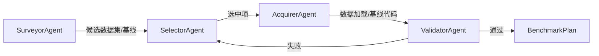

# 04 · LLM 层与多智能体

本篇覆盖 `researchclaw/llm/` 与 `researchclaw/agents/`，以及流水线中的 Debate / Tournament 引擎。

---

## 1. LLM 接入层

### 1.1 Provider 预设

`llm/__init__.py:13-57` 定义了 13 个 provider：

| provider | base_url | 适配器 |
|----------|----------|--------|
| `openai` | `https://api.openai.com/v1` | OpenAI 兼容 |
| `openrouter` | `https://openrouter.ai/api/v1` | OpenAI 兼容 |
| `deepseek` | `https://api.deepseek.com/v1` | OpenAI 兼容 |
| `atlascloud` | `https://api.atlascloud.ai/v1` | OpenAI 兼容 |
| `anthropic` | `https://api.anthropic.com` | Anthropic Messages API |
| `kimi-anthropic` | `https://api.kimi.com/coding/` | Anthropic Messages API |
| `novita` | `https://api.novita.ai/openai` | OpenAI 兼容 |
| `minimax` / `minimax-global` | MiniMax 国内 / 国际 | OpenAI 兼容 |
| `minimax-anthropic` / `-cn` | MiniMax Anthropic 端点 | Anthropic |
| `ollama` | `http://localhost:11434/v1` | OpenAI 兼容 |
| `openai-compatible` | 用户自定义 | OpenAI 兼容 |
| `acp` | — | `ACPClient`（外部 CLI Agent） |

### 1.2 工厂函数

| 函数 | 位置 | 作用 |
|------|------|------|
| `create_llm_client(config)` | `llm/__init__.py:60` | 按 `llm.provider` 返回 `LLMClient` 或 `ACPClient` |
| `build_reviewer_llm(config)` | `llm/__init__.py:88` | 构建独立评审/裁判模型；未配置 `reviewer_model` 时返回 None |
| `build_panel_llms(config)` | `llm/__init__.py:105` | 构建多模型辩论面板；需 `llm.debate_enabled` |

`create_llm_client()` 的实际路由：

```python
if provider == "acp":
    return ACPClient.from_rc_config(config)
return LLMClient.from_rc_config(config)
```

### 1.3 `LLMClient` 内部结构

| 成员 | 位置 | 说明 |
|------|------|------|
| `LLMResponse` | `llm/client.py:56` | content、model、tokens、finish_reason、truncated、raw |
| `LLMConfig` | `llm/client.py:70` | base_url、api_key、wire_api、primary/fallback models、重试、超时、额外 header、fallback URL/key |
| `LLMClient.__init__` | `llm/client.py:96` | 构造模型链 `_model_chain = [primary] + fallback` |
| `from_rc_config()` | `llm/client.py:123` | 读取 provider 预设、API key env、MetaClaw 代理覆盖、Anthropic 适配器 |
| `reviewer_from_rc_config()` | `llm/client.py:180` | 独立 reviewer（不同 provider/base/model，空 fallback 链） |
| `chat()` | `llm/client.py:239` | 主调用：模型链回退、system 注入、JSON mode、thinking 清理 |
| `preflight()` | `llm/client.py:305` | 最小连通性检查，区分 401/403/404/429/超时 |
| `_call_with_retry()` | `llm/client.py:348` | 指数退避重试（上限 300s，带 jitter），区分可重试/不可重试错误 |

### 1.4 调用语义

`LLMClient.chat(messages, *, model=None, max_tokens=None, temperature=None, json_mode=False, system=None, strip_thinking=True)`：

1. 若提供 `system`，前置一条 system 消息；
2. 未指定 `model` 时遍历 `[primary] + fallback_models`；指定 `model` 时只尝试该模型；
3. 每次调用 `_call_with_retry()`：
   - 可重试错误（429/5xx/网络）按指数退避重试；
   - 不可重试错误直接抛出，进入下一个模型；
4. 成功后默认用 `strip_thinking_tags()` 清理 `<think>` 等推理痕迹（论文/代码/JSON 中不应出现）；
5. 所有模型失败 → `RuntimeError`，附最后一个错误。

`wire_api` 支持 `chat_completions`（默认）与 `responses`（仅 Responses 网关），端点分别为 `/chat/completions` 与 `/responses`（`llm/client.py:102-116`）。

### 1.5 MetaClaw 代理

当 `metaclaw_bridge.enabled` 时，`from_rc_config()` 会把 `base_url` 指向 `metaclaw_bridge.proxy_url`，并保留原 URL/key 作为 fallback；Anthropic 适配器**始终直连原始 URL**，不走 OpenAI 兼容代理（`llm/client.py:137-177`）。

### 1.6 Anthropic 适配器

`llm/anthropic_adapter.py:31` 的 `AnthropicAdapter` 负责把消息格式转换成 Anthropic Messages API；当 provider 预设包含 `adapter: "anthropic"` 时挂载到 `LLMClient._anthropic`。可选依赖为 `pip install "researchclaw[anthropic]"`（实际依赖 `httpx`）。

---

## 2. ACP 客户端（外部 CLI Agent 作为 LLM）

`llm/acp_client.py` 通过 `acpx` 与任何 ACP 兼容 Agent（Claude Code、Codex CLI、Copilot CLI、Gemini CLI、Kimi CLI、OpenCode）通信。

| 成员 | 位置 | 说明 |
|------|------|------|
| `ACPConfig` | `acp_client.py:37` | agent、cwd、acpx_command、session_name、timeout_sec、max_turns |
| `_find_acpx()` | `acp_client.py:48` | PATH 查找，其次 `~/.openclaw/extensions/acpx/...` |
| `ACPClient` | `acp_client.py:62` | 持久命名会话；`chat()`、`preflight()`、`close()` |
| `_ensure_session()` | `acp_client.py:208` | 懒创建/复用会话 |
| `_send_prompt()` | `acp_client.py:306` | 发送提示，解析 `[done]` / `[client]` / `[tool]` 标记 |
| `_send_prompt_via_file()` | `acp_client.py:494` | 长 prompt 走临时文件，规避 CLI 参数长度限制 |

关键特性：**一个持久会话贯穿 23 个阶段**，Agent 自身保留上下文，因此不需要把前序产物反复塞入 prompt。`ACPClient.preflight()`（`acp_client.py:137`）用于启动前检查 Agent 可用性。

---

## 3. 多智能体框架

### 3.1 基类与编排器

| 类 | 位置 | 职责 |
|----|------|------|
| `AgentStepResult` | `agents/base.py:50` | success/data/error/llm_calls/token_usage |
| `BaseAgent` | `agents/base.py:65` | `_chat()` / `_chat_json()` 封装 LLM；三级 JSON 解析；每次 `_make_result()` 返回增量计数并清零 |
| `AgentOrchestrator` | `agents/base.py:189` | 协调多个子 Agent，子类实现 `orchestrate(context)` |

`BaseAgent._parse_json()`（`base.py:122`）支持三种抽取：直接解析 → JSON 代码块 → 首个平衡 `{...}` 块。

### 3.2 CodeSearcher（GitHub 代码检索）

目录：`agents/code_searcher/`。用途：为复杂实验寻找 GitHub 参考实现与模式。

| 类/函数 | 位置 | 职责 |
|---------|------|------|
| `CodeSearchAgent` | `agent.py:94` | 入口：缓存 → 查询生成 → 仓库/代码搜索 → 读取关键文件 → 模式提取 → 缓存 |
| `CodeSearchResult` | `agent.py:33` | patterns、repos、snippets，可转 prompt 上下文/缓存字典 |
| `GitHubClient` | `github_client.py:62` | GitHub API：仓库搜索、代码搜索、文件读取、速率限制处理 |
| `RepoInfo` / `CodeSnippet` / `RepoAnalysis` | `github_client.py:30/43/53` | 数据模型 |
| `SearchCache` | `cache.py:24` | 查询/结果持久缓存 |
| `generate_search_queries()` | `query_gen.py:41` | LLM 或启发式生成查询 |
| `CodePatterns` | `pattern_extractor.py:22` | 从仓库代码中提取训练循环、数据加载、模型结构等模式 |

调用链：`CodeSearchAgent.search(topic, plan)`（`agent.py:122`）→ `_analyze_repo()`（`agent.py:249`）→ `to_prompt_context()` 注入 Stage 10 的代码生成提示。

### 3.3 BenchmarkAgent（数据集/基线选择）

目录：`agents/benchmark_agent/`。用途：在 Stage 9 为实验选择合适的数据集、基线，并抓取/验证代码。

流程（`orchestrator.py:215` 的 `orchestrate()`）：



| 类 | 位置 | 职责 |
|----|------|------|
| `BenchmarkAgentConfig` | `orchestrator.py:33` | 开关、最少基线数、重试等 |
| `BenchmarkPlan` | `orchestrator.py:58` | `selected_benchmarks`、`selected_baselines`、`data_loader_code`、`baseline_code`、`experiment_notes`、`to_prompt_block()` |
| `SurveyorAgent` | `surveyor.py:48` | 调研候选数据集/基线 |
| `SelectorAgent` | `selector.py:30` | 选择最终组合 |
| `AcquirerAgent` | `acquirer.py:19` | 获取数据加载/基线代码 |
| `ValidatorAgent` | `validator.py:37` | 校验可用性，失败重试最多 2 次 |

结果写入 `stage-09/benchmark_plan.json`，Stage 10 读取并注入提示（`_code_generation.py:356-390`）。

### 3.4 FigureAgent（图表生成）

目录：`agents/figure_agent/`。用途：Stage 14 生成论文图表；Stage 22 再把已有 `charts/` 注入论文（不重新调用 FigureAgent）。

| 类 | 位置 | 职责 |
|----|------|------|
| `FigureAgentConfig` | `orchestrator.py:39` | 开关、最少/最多图数、迭代、渲染超时、Docker 图像、Nano Banana 配置 |
| `FigurePlan` | `orchestrator.py:70` | 图表计划 |
| `FigureOrchestrator` | `orchestrator.py:126` | 决策 → 代码图/图片图 → 整合 |
| `FigureDecisionAgent` | `decision.py:95` | 判断每张图应由 Matplotlib/TikZ 还是 Nano Banana 生成 |
| `PlannerAgent` | `planner.py:85` | 规划图表结构、数据来源、类型 |
| `CodeGenAgent` | `codegen.py:404` | 生成 Matplotlib / TikZ 代码 |
| `RendererAgent` | `renderer.py:52` | 在 Docker/本地执行绘图代码，输出 PNG/PDF |
| `CriticAgent` | `critic.py:23` | 检查图表质量（可读性、标签、数据一致性），失败则反馈重生成 |
| `IntegratorAgent` | `integrator.py:35` | 把图表引用整合进论文 |
| `NanoBananaAgent` | `nano_banana.py:61` | 调用 Gemini 图像模型生成架构/流程图 |

代码图流程：`_run_code_pipeline()`（`orchestrator.py:310`）= Planner → CodeGen → Renderer → Critic，可重试并修正失败图表。
图片图流程：Decision 判定为 image 时走 Nano Banana，生成后同样经 Critic/Integrator。

---

## 4. Debate 引擎

实现：`pipeline/debate.py`，入口 `run_debate()`（`debate.py:80`）。

设计（模块 docstring）：

1. **多模型多角色**：面板模型轮流扮演不同角色；
2. **可选反驳轮**：每个角色看到其他人的上一轮观点后进行反驳；
3. **独立裁判**：judge 给各视角打分排名；
4. **综合**：由 judge 或指定的更强 synthesizer 依据排名合成最终文本。

关键参数：

| 参数 | 说明 |
|------|------|
| `panel` | `build_panel_llms(config)` 返回的客户端列表 |
| `roles` | 来自 PromptManager 的 `debate_roles_hypothesis()` / `debate_roles_analysis()` |
| `rounds` | 反驳轮数，默认 `llm.debate_rounds=1`；环境变量 `ARC_DEBATE_ROUNDS` 可覆盖 |
| `synth_prompt` | 合成子提示名（如 `hypothesis_synthesize`） |
| `out_dir` | 每轮对话落盘目录 |

单模型面板会退化为「单模型多角色 + 裁判」，与旧行为兼容。所有调用失败都不会抛出到流水线（最多丢掉一个视角）。

使用位置：Stage 8（假设生成）、Stage 14（结果分析）、Stage 18（评审）均有接入点。

---

## 5. Tournament（Best-of-N）

实现：`pipeline/tournament.py`，入口 `run_tournament()`（`tournament.py:91`）。

流程：

1. `candidate_prompts` 提供 N 组 `(system, user)`；
2. 生成器按 `i % len(generators)` 轮询，生成 N 个候选；
3. 空输出/异常候选被丢弃（避免空内容“赢”得比赛）；
4. 独立 judge 按 `rank_prompt` 打分排序；
5. 返回 winner 文本与 `tournament_record.json`。

环境变量 `ARC_ABL_DISABLE_TOURNAMENT=1` 可把候选数折叠为 1，用于消融实验。

使用位置：Stage 8 假设生成（`config.llm.tournament_enabled`）、论文写作中的候选选择。

---

## 6. 模型角色分工（推荐理解）

| 角色 | 来源 | 用途 |
|------|------|------|
| 生成模型 | `llm.primary_model` + fallbacks | 正常阶段生成 |
| Reviewer 模型 | `llm.reviewer_model`（可独立 provider） | Stage 18 评审、Stage 20 质量门、Debate judge |
| Debate 面板 | primary + reviewer + fallbacks（去重） | Stage 8/14/18 多视角 |
| 合成模型 | 通常是主模型 | Debate 最终文本 |

配置详见 `09-interfaces-and-ops.md` 的 `llm` 配置段。

---

## 7. 关键类/函数索引

| 名称 | 位置 | 作用 |
|------|------|------|
| `PROVIDER_PRESETS` | `llm/__init__.py:13` | Provider 预设表 |
| `create_llm_client()` | `llm/__init__.py:60` | LLM 客户端工厂 |
| `build_reviewer_llm()` | `llm/__init__.py:88` | 独立评审模型 |
| `build_panel_llms()` | `llm/__init__.py:105` | 辩论面板 |
| `LLMClient` | `llm/client.py:93` | OpenAI 兼容客户端 |
| `LLMClient.chat()` | `llm/client.py:239` | 带模型回退的对话 |
| `LLMClient.preflight()` | `llm/client.py:305` | 连通性预检 |
| `AnthropicAdapter` | `llm/anthropic_adapter.py:31` | Anthropic Messages API |
| `ACPClient` | `llm/acp_client.py:62` | ACP CLI Agent 客户端 |
| `BaseAgent` | `agents/base.py:65` | 子 Agent 基类 |
| `AgentOrchestrator` | `agents/base.py:189` | 多 Agent 编排基类 |
| `CodeSearchAgent` | `agents/code_searcher/agent.py:94` | GitHub 代码检索 |
| `BenchmarkOrchestrator` | `agents/benchmark_agent/orchestrator.py:163` | 数据集/基线选择 |
| `FigureOrchestrator` | `agents/figure_agent/orchestrator.py:126` | 图表生成 |
| `run_debate()` | `pipeline/debate.py:80` | 多模型辩论 |
| `run_tournament()` | `pipeline/tournament.py:91` | Best-of-N 选择 |
