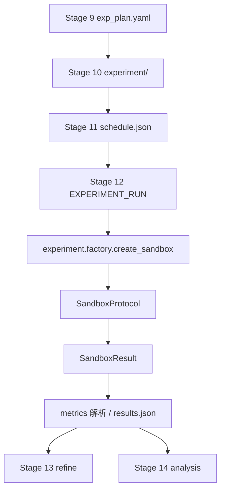

# 05 · 实验执行与领域适配

本篇覆盖 `researchclaw/experiment/`、`researchclaw/domains/`、`researchclaw/servers/` 与 `hardware.py`。

---

## 1. 实验执行总览



核心抽象：

```python
class SandboxProtocol(Protocol):
    def run(self, code: str, *, timeout_sec: int = 300) -> SandboxResult: ...
    def run_project(self, project_dir: Path, *, entry_point="main.py",
                    timeout_sec=300, args=None, env_overrides=None) -> SandboxResult: ...
```

`SandboxResult`（`experiment/sandbox.py:282-288`）：`returncode`、`stdout`、`stderr`、`elapsed_sec`、`metrics`、`timed_out`。

---

## 2. 九种实验模式

`EXPERIMENT_MODES`（`config.py:98-108`）：

| 模式 | 后端类 | 位置 | 执行方式 |
|------|--------|------|----------|
| `simulated` | — | Stage 12 分支 | 不执行代码，按 schedule 生成占位结果 |
| `sandbox` | `ExperimentSandbox` | `sandbox.py:307` | 本地 Python subprocess |
| `docker` | `DockerSandbox` | `docker_sandbox.py:93` | Docker 容器，支持 GPU 直通、网络策略、依赖安装 |
| `ssh_remote` | `SshRemoteSandbox` | `ssh_sandbox.py:31` | scp 上传 + SSH 远端执行 |
| `colab_drive` | `ColabDriveSandbox` | `colab_sandbox.py:120` | 通过 Google Drive 挂载与 Colab worker 通信 |
| `agentic` | `AgenticSandbox` | `agentic_sandbox.py:51` | Docker + 编码 Agent（PR-4 已接线，见 §2.1） |
| `collider_agent` | `ColliderAgentSandbox` | `collider_agent_sandbox.py:49` | Claude Code + ColliderAgent 技能，跑完整 HEP 链 |
| `biology_agent` | `BiologyAgentSandbox` | `biology_agent_sandbox.py:58` | Claude Code + Biology-Agent（COBRApy/FBA/FVA） |
| `stat_agent` | `StatAgentSandbox` | `stat_agent_sandbox.py:52` | Claude Code + stat_research_agent（统计模拟） |

工厂分发：`experiment/factory.py:18-108`：

```
mode == docker        → DockerSandbox（Docker 不可用时回退本地 sandbox）
mode == ssh_remote    → SshRemoteSandbox（要求 host 且 SSH 连通）
mode == colab_drive   → ColabDriveSandbox（并写 colab_worker.py）
mode == collider_agent→ ColliderAgentSandbox
mode == biology_agent → BiologyAgentSandbox
mode == stat_agent    → StatAgentSandbox
mode == sandbox       → ExperimentSandbox
其他                  → RuntimeError
```

`create_agentic_sandbox()`（`factory.py:111`）是独立入口，要求 Docker 可用；Stage 12 的 `agentic` 分支调用它。

### 2.1 Agent 模式的 Stage 10 / 12 契约（PR-4）

| 模式 | Stage 10 产物 | Stage 12 执行 | Stage 13 |
|------|---------------|---------------|----------|
| `collider_agent` | `collider_plan.md` | `ColliderAgentSandbox.run(plan)` | 跳过（复制结果） |
| `biology_agent` | `biology_plan.md` | `BiologyAgentSandbox.run(plan)` | 跳过 |
| `stat_agent` | `stat_plan.md` | `StatAgentSandbox.run(plan)` | 跳过 |
| `agentic` | `agent_plan.md` | `create_agentic_sandbox()` + `run_agent_session()` | 跳过 |

- 计划生成统一入口：`_execute_agent_plan_generation()`（`stage_impls/_code_generation.py`），规格表 `_AGENT_PLAN_SPECS`；
- Stage 12 分派：`_execute_agent_experiment()`（`stage_impls/_execution.py`），规格表 `_AGENT_EXPERIMENT_SPECS`；
- 计划缺失 → `FAILED` + `decision="upstream_blocked"`，不回退到通用 `ExperimentRunner`；
- run 产物 `runs/run-1.json`（schema v1）：`schema_version/mode/status/returncode/elapsed_sec/timed_out/metrics/workspace/stdout/stderr/timestamp`；
- `status` ∈ `completed|partial|timed_out|failed`；超时且无指标 → `FAILED`，不伪造 metrics；
- 同时把 agent workspace 的 `results.json` 复制到 `runs/results.json` 供下游解析。

---

## 3. 本地 Sandbox

### 3.1 执行

`ExperimentSandbox.run()`（`sandbox.py:314`）：

1. 分配脚本路径（`_next_script_path()`）；
2. 写入代码，设置 `PYTHONUNBUFFERED=1`；
3. `subprocess.run(capture_output=True, timeout=...)`，工作目录为 sandbox workdir；
4. 把 completed/timeout/exception 统一转成 `SandboxResult`；
5. 按需清理脚本（`_should_cleanup`）。

`run_project()` 用于多文件工程：校验入口点、复制工程到 staging、在 staging 中执行。

### 3.2 安全校验

| 函数 | 位置 | 作用 |
|------|------|------|
| `validate_entry_point()` | `sandbox.py:21` | 必须是相对路径，禁止空值与 `..` |
| `validate_entry_point_resolved()` | `sandbox.py:39` | 复制后解析路径，禁止逃逸 staging（含符号链接） |

### 3.3 指标解析

`parse_metrics(stdout)`（`sandbox.py:89`）支持多种行格式：

- `metric: value`
- `condition=<name> metric: value`
- `condition=<name> [regime=...] [H=...] [seed=...] metric: value`
- `condition=<name> metric: value: 3/5`（比例）
- `SUMMARY condition=X metric=Y mean=M std=S [success_rate=R]`
- 多指标条件行（同一行多个 `metric: value`）

解析后过滤 `NaN/Inf`，并同时生成 `condition/metric`、`metric_mean`、`metric_std` 等扁平键（`sandbox.py:89-198`）。

---

## 4. Docker / SSH / Colab

### 4.1 DockerSandbox

- 镜像默认 `researchclaw/experiment:latest`，可 `docker build -t ... researchclaw/docker/`；
- 容器入口 `entrypoint.sh` 依次执行：`pip install -r requirements.txt` → `python3 setup.py` → `python3 <entry_point>`；
- **网络策略**（`docker_sandbox.py:104-108`）：
  - `none`：全程无网络；
  - `setup_only`：Phase 0+1 有网络，Phase 2 前用 iptables 断开；
  - `pip_only`：仅 Phase 0 有网络（legacy，等价 setup_only）；
  - `full`：全程有网络；
- 资源限制：内存、shm、GPU 设备、容器保留策略（`DockerSandboxConfig`，`config.py:301-315`）。

### 4.2 SshRemoteSandbox

执行模型（`ssh_sandbox.py:37-43`）：创建远端唯一目录 → scp 上传代码/harness → 可选 setup commands → ssh 执行 → 解析 stdout → 清理远端目录。支持可选 `use_docker`，在远端容器内运行。

### 4.3 ColabDriveSandbox

通过本地 Google Drive 挂载目录与 Colab 端 worker 交换任务/结果；`factory` 首次会写 `colab_worker.py` 到 Drive 根目录，用户在 Colab 中运行该 worker。轮询间隔与超时可配。

### 4.4 Agent 领域后端

| 后端 | 输入 | 输出 |
|------|------|------|
| ColliderAgentSandbox | `collider_plan.md` 物理分析 prompt | `results.json`、`output/figures/`、模型/事件目录 |
| BiologyAgentSandbox | `biology_plan.md` 代谢建模 prompt | `results.json`、图表、FBA/FVA 结果 |
| StatAgentSandbox | 统计研究 prompt | `results.json`、模拟研究结果 |

三者都通过 `claude -p ...` 调用 Claude Code，并把外部 Agent 的 `skills/`、`agents/` 复制进工作区/`~/.claude` 以加载技能。外部 Agent 目录在 `external/agents/`（Biology、Stat 已 vendored；Collider 需 clone）。

---

## 5. 实验循环与安全校验

### 5.1 ExperimentRunner

`experiment/runner.py:104`：

| 方法 | 位置 | 行为 |
|------|------|------|
| `run_experiment()` | `runner.py:128` | 调 sandbox；取 `metric_key`；比较历史最佳；标记 `improved/kept`；记录超时/进程错误 |
| `run_loop()` | `runner.py:181` | 可选 git 分支；先跑 baseline；最多 `max_iterations` 轮 LLM 改码；连续 3 轮无改进提前停止；返回 `ExperimentHistory` |

`ExperimentHistory`（`runner.py:35`）保存所有 `ExperimentResult` 与最佳结果。

### 5.2 代码安全与静态校验

`experiment/validator.py`：

| 项 | 位置 | 说明 |
|----|------|------|
| `ValidationIssue` | `validator.py:21` | severity/category/message/line/col |
| `CodeValidation` | `validator.py:32` | `ok`、`errors`、`warnings`、`summary()` |
| `DANGEROUS_CALLS` | `validator.py:67` | 禁止 `os.system/popen/exec*`、`subprocess.*`、`shutil.rmtree` 等 |
| `DANGEROUS_BUILTINS` | `validator.py:94` | 禁止 `eval/exec/compile/__import__` 等 |
| `_SecurityVisitor` | `validator.py:209` | AST 遍历检测危险调用/导入 |
| `validate_code()` | `validator.py`（导出函数） | 语法 + 安全 + 导入检查，返回 `CodeValidation` |

Stage 10 在生成后调用 `validate_code()`，错误会反馈给 LLM 修复；Stage 12 执行前还有一次入口点验证。

### 5.3 统一指标容器

`experiment/metrics.py`：

| 类 | 位置 | 说明 |
|----|------|------|
| `MetricType` | `metrics.py:27` | scalar/table/convergence/learning_curve/confusion/structured/pareto |
| `ExperimentResults` | `metrics.py:38` | scalars、conditions、convergence、regression_table、structured、元数据；`to_flat_metrics()` 兼容旧接口 |
| `UniversalMetricParser` | `metrics.py:103` | 按 JSON → CSV → stdout 顺序解析 run 目录 |

---

## 6. 远程资源调度

`researchclaw/servers/` 提供多机调度（与 `experiment/ssh_sandbox` 的区别：这里是「任务级」调度，支持 Slurm 与云）。

| 类 | 位置 | 职责 |
|----|------|------|
| `ServerEntry` | `registry.py:11` | 名称、host、类型、GPU、显存、优先级、成本、调度器、云厂商 |
| `ServerRegistry` | `registry.py:68` | 增删查、可用性、`get_best_match(requirements, prefer_free)` |
| `ServerMonitor` | `monitor.py:14` | GPU 使用率、缓存状态 |
| `TaskDispatcher` | `dispatcher.py:18` | `dispatch()` 选最佳服务器；`execute_task()` 按 `slurm` / `ssh` 选执行器；支持 failover |
| `SSHExecutor` | `ssh_executor.py:16` | SSH 远端执行 |
| `SlurmExecutor` | `slurm_executor.py:15` | 生成 sbatch 脚本并提交 |
| `CloudExecutor` | `cloud_executor.py:13` | 云实例执行 |

配置：`compute_servers`（`ServersConfig`，`config.py:781-789`）。

---

## 7. 硬件检测

`hardware.py`：

| 成员 | 位置 | 说明 |
|------|------|------|
| `HardwareProfile` | `hardware.py:30` | gpu_type/name/vram、has_gpu、tier、warning、`to_dict()` |
| `detect_hardware(ssh_config=None)` | `hardware.py:44` | 本地或远端检测 NVIDIA/MPS/CPU |
| `_detect_nvidia_remote()` | `hardware.py:98` | 远端 nvidia-smi |
| `_detect_nvidia()` / `_detect_mps()` | `hardware.py:153/207` | 本地检测 |
| `ensure_torch_available()` | `hardware.py:246` | 按 GPU 类型安装/检查 PyTorch |
| `is_metric_name()` | `hardware.py:303` | 指标名过滤（供解析器使用） |

Stage 1 写入 `hardware_profile.json`；Stage 10 据此选择包提示与实验规模；Stage 9 注入算力预算提示。

---

## 8. 领域系统

### 8.1 DomainProfile

`domains/detector.py:85-146` 定义领域画像，字段分为：

| 分组 | 字段 |
|------|------|
| 身份 | `domain_id`、`display_name`、`parent_domain` |
| 实验范式 | `experiment_paradigm`（comparison/convergence/progressive_spec/simulation/ablation_study） |
| 术语 | `condition_terminology`（baseline/proposed/variant/input/metric 的本地叫法） |
| 代码结构 | `typical_file_structure`、`entry_point` |
| 依赖 | `core_libraries`、`docker_image`、`gpu_required`、`pip_packages` |
| 指标/评估 | `metric_types`、`standard_baselines`、`evaluation_protocol`、`statistical_tests` |
| 输出 | `output_formats`、`figure_types` |
| 检索 | `github_search_terms`、`paper_keywords` |
| Prompt 指导 | `compute_budget_guidance`、`dataset_guidance`、`hp_reporting_guidance`、`code_generation_hints`、`result_analysis_hints` |
| 部署默认值 | `preferred_experiment_mode`、`preferred_project_mode`、`preferred_target_conference`、默认时间/迭代/指标 |

Profile 文件：`researchclaw/domains/profiles/*.yaml`（29 个，含 `_generic.yaml`）。

### 8.2 领域检测

`detect_domain(topic, hypotheses, literature, domains)`（`detector.py:490`）：

1. **关键词匹配**（`_KEYWORD_RULES`，`detector.py:245`）：快速命中已知领域；
2. **LLM 分类**：关键词不确定时调用 LLM；
3. **混合解析**：如 “physics-informed neural networks” 同时命中 physics 与 ML，取主领域并标记次领域。

`set_forced_profile(profile_id)`（`detector.py:40`）可强制所有阶段使用同一 profile（`--profile` / `project.profile`）；`detect_domain_id()`（`detector.py:614`）只做关键词检测。

### 8.3 PromptAdapter

`domains/prompt_adapter.py`：

| 类 | 位置 | 说明 |
|----|------|------|
| `PromptBlocks` | `prompt_adapter.py:27` | 代码生成/实验设计/结果分析/导出四类提示块 |
| `PromptAdapter` | `prompt_adapter.py:52` | 抽象基类；`get_*_blocks()`、`get_blueprint_context()`、`get_condition_terminology()` |
| `MLPromptAdapter` | `prompt_adapter.py:117` | 返回空块，保证 ML 行为零回归 |
| `GenericPromptAdapter` | `prompt_adapter.py:138` | 用 DomainProfile 字段构造通用提示 |
| `get_adapter(domain)` | `prompt_adapter.py:354` | 按 domain_id/前缀查注册表；未知领域回退 Generic/ML |

具体适配器：`biology.py`（+ `BiologyMetabolicPromptAdapter`）、`chemistry.py`、`economics.py`、`hep_ph.py`、`math.py`、`medical_observational.py`、`ml.py`、`neuroscience.py`、`physics.py`、`robotics.py`、`security.py`。

### 8.4 Profile 部署

`domains/deploy.py`：

- `profile_search_dirs()`（`deploy.py:49`）：显式目录 → `./profiles/` → `~/.researchclaw/profiles/`（或 `RESEARCHCLAW_PROFILES_DIR`）→ 包内 profiles；
- `resolve_profile_path()` / `load_profile_yaml()` / `list_deployable_profiles()`；
- `apply_profile_defaults(data, profile_id)`（`deploy.py:281`）：**用户配置优先，profile 只补缺**；
- `validate_profile_data()` / `validate_profile_id()`：CLI `researchclaw profile validate` 使用；
- `schema_vocabularies()` / `library_suggestions()` / `keyword_suggestions()`：`profile create` 交互向导使用。

### 8.5 通用实验计划

`domains/experiment_schema.py`：

| 类型 | 位置 | 说明 |
|------|------|------|
| `ConditionRole` | `experiment_schema.py:17` | baseline/proposed/ablation/... |
| `ExperimentType` | `experiment_schema.py:24` | comparison/convergence/... |
| `Condition` | `experiment_schema.py:33` | 条件定义 |
| `MetricSpec` | `experiment_schema.py:44` | 指标定义 |
| `EvaluationSpec` | `experiment_schema.py:53` | 评估协议 |
| `UniversalExperimentPlan` | `experiment_schema.py:63` | 跨领域实验计划 |

---

## 9. 已知边界与缺口

1. **Docker 镜像缺失**：`mode: docker` 要求本地已有 `researchclaw/experiment:latest`；`factory` 不会自动构建，只抛错并提示 `docker build`。
2. **Agent 模式依赖外部 CLI**：`biology_agent` / `stat_agent` / `agentic` 需要 Claude Code（或等价 agent CLI）与相应技能目录；`agentic` 还需 Docker。

### 9.1 默认模式与模拟数据（PR-4 已修复）

- `ExperimentConfig.mode` 默认 `"sandbox"`；配置缺少 `experiment.mode` 时 `validate_config()` 追加 warning 并记录日志；
- `simulated` 只能显式开启；
- `pipeline_summary.data_origin` ∈ `real|simulated|mixed|unknown`，由 `pipeline/_helpers.py::detect_data_origin()` 推导；
- Stage 20：`data_origin == "simulated"` 且未设 `research.allow_simulated_paper` → `FAILED` + `E20_SIMULATED_DATA`，写 `stage-20/quality_warning.txt`；
- Stage 22：显式放行时 Markdown 前缀 `> **SIMULATED DATA — NOT FOR SUBMISSION**`，LaTeX 在 `\begin{document}` 后插入同义 banner，`sanitization_report.json` 记录 `data_origin` 与 `allow_simulated_paper`。

---

## 10. 关键类/函数索引

| 名称 | 位置 | 作用 |
|------|------|------|
| `SandboxResult` / `SandboxProtocol` | `experiment/sandbox.py:282/291` | 统一结果与接口 |
| `ExperimentSandbox` | `experiment/sandbox.py:307` | 本地 subprocess |
| `parse_metrics()` | `experiment/sandbox.py:89` | 多格式 stdout 指标解析 |
| `validate_entry_point()` | `experiment/sandbox.py:21` | 入口点路径安全 |
| `DockerSandbox` | `experiment/docker_sandbox.py:93` | Docker 执行 |
| `SshRemoteSandbox` | `experiment/ssh_sandbox.py:31` | SSH 执行 |
| `ColabDriveSandbox` | `experiment/colab_sandbox.py:120` | Colab Drive 执行 |
| `ColliderAgentSandbox` | `experiment/collider_agent_sandbox.py:49` | HEP Agent |
| `BiologyAgentSandbox` | `experiment/biology_agent_sandbox.py:58` | 生物 Agent |
| `StatAgentSandbox` | `experiment/stat_agent_sandbox.py:52` | 统计 Agent |
| `AgenticSandbox` | `experiment/agentic_sandbox.py:51` | Docker+Agent（Stage 12 已接线） |
| `_execute_agent_experiment()` | `stage_impls/_execution.py` | biology/stat/agentic 的 Stage 12 分派 |
| `_execute_agent_plan_generation()` | `stage_impls/_code_generation.py` | 四类 agent 模式的 Stage 10 计划生成 |
| `detect_data_origin()` / `simulated_paper_allowed()` | `pipeline/_helpers.py` | 数据来源判定与模拟论文放行 |
| `create_sandbox()` | `experiment/factory.py:18` | 后端工厂 |
| `ExperimentRunner` | `experiment/runner.py:104` | 执行—评估—改进循环 |
| `validate_code()` / `CodeValidation` | `experiment/validator.py` | AST 安全校验 |
| `ExperimentResults` / `UniversalMetricParser` | `experiment/metrics.py:38/103` | 统一结果解析 |
| `detect_hardware()` | `hardware.py:44` | GPU/MPS/CPU 检测 |
| `DomainProfile` | `domains/detector.py:85` | 领域画像 |
| `detect_domain()` | `domains/detector.py:490` | 三级领域检测 |
| `PromptAdapter` / `get_adapter()` | `domains/prompt_adapter.py:52/354` | 领域提示适配 |
| `apply_profile_defaults()` | `domains/deploy.py:281` | profile 配置叠加 |
| `TaskDispatcher` | `servers/dispatcher.py:18` | 多机任务调度 |
