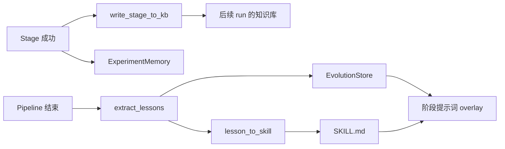

# 06 · 知识、记忆与演化

本篇覆盖 `knowledge/`、`memory/`、`evolution.py`、`evolution_aevolve.py`、`metaclaw_bridge/`，以及 `quality.py`、`health.py`、`report.py`、`assessor/`。

---

## 1. 知识库（Knowledge Base）

### 1.1 数据模型

`knowledge/base.py:32-47`：

```python
@dataclass
class KBEntry:
    category: str          # questions | literature | experiments | findings | decisions | reviews
    entry_id: str
    title: str
    content: str           # Markdown 正文
    source_stage: str      # 如 "01-topic_init"
    run_id: str
    evidence_refs: list[str] | None
    tags: list[str] | None
    links: list[str] | None  # Obsidian wikilinks
```

6 个类别目录由 `KB_SUBDIRS` 固定（`config.py:88-95`）。

### 1.2 写入

| 函数 | 位置 | 作用 |
|------|------|------|
| `write_kb_entry()` | `knowledge/base.py:86` | 写 YAML frontmatter + Markdown 正文；obsidian 后端追加 `#tags` 与 `[[links]]` |
| `write_stage_to_kb()` | `knowledge/base.py:146` | 根据阶段号选类别，读取阶段产物（单个文件截断 5000 字符）生成条目 |
| `KB_CATEGORY_MAP` | `knowledge/base.py:120` | 阶段号 → KB 类别映射 |
| `generate_weekly_report()` | `knowledge/base.py:213` | 汇总知识库生成周报 |

映射关系（`KB_CATEGORY_MAP`）：

| 阶段 | 类别 |
|------|------|
| 1–2 | `questions` |
| 3、9、11、15、20、21 | `decisions` |
| 4–6 | `literature` |
| 7、14 | `findings` |
| 10、12、13 | `experiments` |
| 8 | `questions` |
| 16–19、22 | `reviews` |

Pipeline 在每阶段成功后调用 `write_stage_to_kb()`（`runner.py:644-658`），失败被吞掉，不影响主流程。后端由 `knowledge_base.backend` 选择：`markdown` 或 `obsidian`。

### 1.3 知识图谱

`knowledge/graph/` 是一个不依赖 NetworkX 的轻量图结构。

| 类 | 位置 | 说明 |
|----|------|------|
| `EntityType` | `entities.py:10` | paper/method/dataset/metric/author/concept |
| `Entity` | `entities.py:22` | id、type、name、attributes |
| `RelationType` | `relations.py:10` | cites/extends/outperforms/uses_dataset/applies_method/... |
| `Relation` | `relations.py:24` | source_id、target_id、type、attributes |
| `KnowledgeGraphBuilder` | `builder.py:16` | `add_entity`、`add_relation`、按类型/关系查询；容量上限 10000；重复实体合并属性 |
| `KnowledgeGraphQuery` | `query.py:16` | `find_research_gaps()`、`find_trending_methods()`、方法对比、主题建议 |
| `export_to_dot()` | `visualizer.py:26` | Graphviz DOT 导出 |
| `export_to_json_cytoscape()` | `visualizer.py:59` | Cytoscape JSON |
| `graph_summary()` | `visualizer.py:102` | 文本摘要 |

查询逻辑示例：`find_research_gaps()`（`query.py:26`）找「被少于 2 个方法使用的数据集」作为潜在机会；`find_trending_methods()`（`query.py:60`）按被引用/被扩展/被应用的关系数排序。

---

## 2. 记忆系统（Memory）

### 2.1 存储

`memory/store.py`：

| 项 | 位置 | 说明 |
|----|------|------|
| `MemoryEntry` | `store.py:22` | id、category、content、metadata、embedding、confidence、created_at、last_accessed、access_count |
| `VALID_CATEGORIES` | `store.py:55` | `ideation` / `experiment` / `writing` |
| `MemoryStore` | `store.py:58` | JSONL 持久化；按类别分文件；`add/recall/update/prune/save/load`；默认每类上限 500、置信度阈值 0.3 |

### 2.2 检索与衰减

| 项 | 位置 | 说明 |
|----|------|------|
| `MemoryRetriever` | `retriever.py:43` | 综合打分权重：语义相似度、时间衰减、置信度、访问频率 |
| `recall()` | `retriever.py:69` | 余弦相似度 + 衰减 + 置信度 + 访问频率；把 top 结果标记为已访问 |
| `time_decay_weight()` | `decay.py:9` | 基于 `half_life_days` 与 `max_age_days` 计算 `[0,1]` 权重 |
| `EmbeddingProvider` | `embeddings.py:36` | 可插拔向量化；无嵌入时退化为词面相似度 |

### 2.3 三类专用记忆

| 类 | 位置 | 用途 |
|----|------|------|
| `IdeationMemory` | `ideation_memory.py:16` | 记录/检索假设与创意 |
| `ExperimentMemory` | `experiment_memory.py:17` | 记录每次实验的条件、指标、失败模式、依赖、超参 |
| `WritingMemory` | `writing_memory.py:16` | 记录写作风格与评审反馈 |

Pipeline 在 Stage 12/13 成功后写入 `ExperimentMemory`（`runner.py:601-623`），目录为 `run_dir/experiment_memory/`（JSONL）。

---

## 3. 演化（Evolution）

### 3.1 教训模型

`evolution.py`：

| 项 | 位置 | 说明 |
|----|------|------|
| `LessonCategory` | `evolution.py:77` | system / experiment / writing / analysis / literature / pipeline |
| `LessonEntry` | `evolution.py:89` | stage_name、stage_num、category、severity、description、timestamp、run_id |
| `_classify_error()` | `evolution.py:143` | 按关键词把错误归类 |
| `extract_lessons()` | `evolution.py:173` | 从阶段结果/错误/决策理由中抽取教训 |
| `_extract_decision_rationale()` | `evolution.py:247` | 从 `decision.md` 抽取决策理由 |
| `_extract_runtime_lessons()` | `evolution.py:298` | 运行时警告/异常 |
| `_time_weight()` | `evolution.py:363` | 时间衰减权重 |
| `EvolutionStore` | `evolution.py:387` | JSONL 追加、读取、按时间加权检索 |

Pipeline 在结束时调用 `extract_lessons()` 并写入 `run_dir/evolution/`（`runner.py:868-877`）；阶段提示词可通过 `_get_evolution_overlay()`（`_helpers.py:816`）注入历史教训。

### 3.2 A-Evolve

`evolution_aevolve.py`：

| 类 | 位置 | 说明 |
|----|------|------|
| `Observation` | `evolution_aevolve.py:39` | 观察记录 |
| `Mutation` | `evolution_aevolve.py:55` | 变异（对 prompt/策略的候选修改） |

该模块实现「观察 → 变异 → 选择」的轻量演化模型，与主 `EvolutionStore` 互补。

---

## 4. MetaClaw 桥（跨运行学习）

`metaclaw_bridge/` 把「流水线失败」转成「可复用技能」，并可注入 PRM 质量门。

| 模块 | 关键项 | 位置 | 作用 |
|------|--------|------|------|
| `config.py` | `PRMConfig` | `config.py:9` | PRM 开关、API、模型、票数、门控阶段 |
| | `LessonToSkillConfig` | `config.py:23` | 最小严重度、每轮最大技能数 |
| | `MetaClawBridgeConfig` | `config.py:32` | enabled、proxy_url、skills_dir、fallback |
| `session.py` | `MetaClawSession` | `session.py:15` | 会话头：run_id、stage、done 信号；供技能进化/RL 数据采集 |
| `stage_skill_map.py` | `STAGE_SKILL_MAP` | `stage_skill_map.py:13` | 每个阶段 → MetaClaw task_type / 推荐技能 / top_k |
| `prm_gate.py` | `ResearchPRMGate` | `prm_gate.py:111` | 多票 LLM-as-judge；`evaluate_stage()` 返回 `1/0/-1` |
| `lesson_to_skill.py` | `lesson_to_skill()` | `lesson_to_skill.py:137` | 筛选高严重度教训 → LLM 生成 `SKILL.md` |
| `skill_feedback.py` | `SkillEffectivenessRecord` / `SkillFeedbackStore` | `skill_feedback.py:19/29` | 记录技能使用效果，反馈进化 |

接入点：

- `execute_stage()` 在阶段成功后可选调用 `ResearchPRMGate.evaluate_stage()`，分数为 -1 时把阶段标记失败（`executor.py:707-767`）；
- `execute_pipeline()` 结束后调用 `_metaclaw_post_pipeline()`，把教训转技能（`runner.py:879-883`）；
- LLM 客户端在 `metaclaw_bridge.enabled` 时走 MetaClaw 代理，并保留直连 fallback（`llm/client.py:137-155`）。

---

## 5. 质量、健康、报告与评分

### 5.1 内容质量（AI-slop 检测）

`quality.py` 不是 LLM 评分，而是**模板/占位内容检测**：

| 项 | 位置 | 说明 |
|----|------|------|
| `TemplateMatch` | `quality.py:46` | 命中的模式、行号、片段 |
| `QualityReport` | `quality.py:55` | 行数/字符数/命中/模板占比 |
| `detect_template_content()` | `quality.py:91` | 扫描 `[INSERT ...]`、`TODO`、Lorem ipsum、模板化章节等 |
| `compute_template_ratio()` | `quality.py:118` | 命中行字符数 / 总字符数 |
| `assess_quality()` | `quality.py:146` | 完整评估 |
| `check_strict_quality()` | `quality.py:169` | 超过阈值（默认 0.05）即失败 |

Stage 17 的 `draft_quality.json` 与 Stage 20 的质量门都会使用该指标。

### 5.2 环境体检

`health.py`：

| 项 | 位置 | 说明 |
|----|------|------|
| `CheckResult` | `health.py:26` | 名称、状态、详情、修复建议 |
| `DoctorReport` | `health.py:34` | 检查列表、总体状态、可执行修复 |
| `check_python_version()` | `health.py:61` | Python ≥3.11 |
| 其他检查 | `health.py` | Docker、LaTeX、API key、路径、依赖等（`researchclaw doctor`） |

### 5.3 运行报告

`report.py:15` 的 `generate_report(run_dir)` 读取 `pipeline_summary.json`，输出 Markdown 报告：概览、论文、实验、引用、警告。对应 CLI `researchclaw report --run-dir ...`。

### 5.4 论文评分

`assessor/`：

| 类 | 位置 | 说明 |
|----|------|------|
| `Rubric` / `RUBRICS` | `rubrics.py:9/18` | 5 维：novelty、rigor、clarity、impact、experiments，1–10 分 |
| `PaperScorer` | `scorer.py:15` | 按 rubric 调用 LLM 评分 |
| `HistoryComparator` | `comparator.py:14` | 与历史版本比较分数 |
| `VenueRecommender` | `venue_recommender.py:8` | 根据分数/主题推荐投稿 venue |

---

## 6. 数据流小结



---

## 7. 关键类/函数索引

| 名称 | 位置 | 作用 |
|------|------|------|
| `KBEntry` / `write_kb_entry()` | `knowledge/base.py:33/86` | 知识条目与写入 |
| `write_stage_to_kb()` | `knowledge/base.py:146` | 阶段产物入库 |
| `KnowledgeGraphBuilder` | `knowledge/graph/builder.py:16` | 知识图谱 |
| `KnowledgeGraphQuery` | `knowledge/graph/query.py:16` | 图谱查询 |
| `MemoryEntry` / `MemoryStore` | `memory/store.py:22/58` | 记忆存储 |
| `MemoryRetriever` | `memory/retriever.py:43` | 记忆检索打分 |
| `time_decay_weight()` | `memory/decay.py:9` | 时间衰减 |
| `IdeationMemory` / `ExperimentMemory` / `WritingMemory` | `memory/*.py:16/17/16` | 三类记忆 |
| `LessonEntry` / `extract_lessons()` | `evolution.py:89/173` | 教训抽取 |
| `EvolutionStore` | `evolution.py:387` | 教训存储 |
| `ResearchPRMGate` | `metaclaw_bridge/prm_gate.py:111` | PRM 质量门 |
| `LessonToSkill` 流程 | `metaclaw_bridge/lesson_to_skill.py:137` | 失败转技能 |
| `STAGE_SKILL_MAP` | `metaclaw_bridge/stage_skill_map.py:13` | 阶段技能映射 |
| `assess_quality()` / `check_strict_quality()` | `quality.py:146/169` | 模板内容检测 |
| `DoctorReport` | `health.py:34` | 环境体检 |
| `generate_report()` | `report.py:15` | 运行报告 |
| `PaperScorer` / `VenueRecommender` | `assessor/scorer.py:15`、`venue_recommender.py:8` | 论文评分与投稿推荐 |
