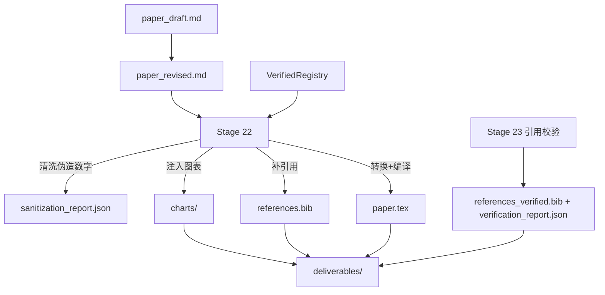

# 08 · 文献、写作与出版链路

本篇覆盖 `literature/`、`web/`、`pipeline/verified_registry.py`、`pipeline/paper_verifier.py`、`templates/`、`overleaf/`，以及图表与交付物组装。

---

## 1. 文献数据模型

`literature/models.py`：

| 类 | 位置 | 字段 |
|----|------|------|
| `Author` | `models.py:16` | `name`、`affiliation`；`last_name()` ASCII 归一化 |
| `Paper` | `models.py:33` | `paper_id`、`title`、`authors`、`year`、`abstract`、`venue`、`citation_count`、`doi`、`arxiv_id`、`url`、`source` |

`Paper.cite_key`（`models.py:58`）生成 `lastname<year><keyword>` 形式的引用键（如 `smith2024transformer`），供 BibTeX 与正文 `\cite{}` 使用。

---

## 2. 多源检索

### 2.1 入口

| 函数 | 位置 | 作用 |
|------|------|------|
| `search_papers()` | `search.py:104` | 单查询多源检索、去重、按引用数排序 |
| `search_papers_multi_query()` | `search.py:246` | 多查询并行/串行聚合（Stage 4 使用） |
| `papers_to_bibtex()` | `search.py:378` | 生成 BibTeX 文本 |
| `_deduplicate()` | `search.py:289` | DOI → arXiv ID → 归一化标题三级去重，保留引用数更高者 |

各源客户端：

| 模块 | 入口 | 说明 |
|------|------|------|
| `openalex_client.py` | `search_openalex()`（`openalex_client.py:49`） | OpenAlex API，支持 mailto 与 API key |
| `semantic_scholar.py` | `search_semantic_scholar()`（`semantic_scholar.py:148`）、`batch_fetch_papers()`（`:277`） | S2 Graph API |
| `arxiv_client.py` | `search_arxiv()`（`arxiv_client.py:135`）、`get_paper_by_id()`（`:207`）、`download_pdf()`（`:222`）、`search_arxiv_advanced()`（`:265`） | arXiv Atom API |

### 2.2 缓存

`literature/cache.py`：

| 项 | 位置 | 说明 |
|----|------|------|
| `_DEFAULT_CACHE_DIR` | `cache.py:19` | `.researchclaw_cache/literature` |
| `_SOURCE_TTL` | `cache.py:24` | arXiv 24h、S2/OpenAlex 3 天、引用验证 ~1 年 |
| `cache_key()` | `cache.py:38` | query+source+limit 的 SHA256 前 16 位 |
| `get_cached()` / `put_cache()` | `cache.py:44/98` | 读/写缓存，支持 TTL |
| `clear_cache()` / `cache_stats()` | `cache.py:122/132` | 清理与统计 |

### 2.3 新颖性评估

`literature/novelty.py`：

- `check_novelty()`（`novelty.py:185`）：抽取主题+假设关键词 → 多查询检索 → 计算相似度 → 输出 `novelty_score`、`assessment`、`recommendation`、相似论文列表。
- 阈值默认 `similarity_threshold=0.25`。

### 2.4 趋势分析

`literature/trends.py:11` 的 `LiteratureTrendAnalyzer` 分析时间窗口内的论文主题/引用趋势，供 `trends/` 与选题使用。

---

## 3. 引用校验（4 层）

`literature/verify.py` 是 Stage 23 的核心。

### 3.1 状态与结果

| 项 | 位置 | 说明 |
|----|------|------|
| `VerifyStatus` | `verify.py:43` | VERIFIED / SUSPICIOUS / HALLUCINATED / SKIPPED |
| `CitationResult` | `verify.py:53` | cite_key、title、status、confidence、method、matched_paper、relevance_score |
| `VerificationReport` | `verify.py:87` | 计数、结果列表、`integrity_score` |

### 3.2 四层验证

| 层 | 函数 | 位置 | 方法 |
|----|------|------|------|
| L1 | `verify_by_arxiv_id()` | `verify.py:201` | 用 arXiv API `id_list` 查询，比较标题相似度 |
| L2 | `verify_by_doi()` | `verify.py:376` | DOI → CrossRef/DataCite/OpenAlex |
| L3 | `verify_by_openalex()` | `verify.py:472` | 标题匹配 OpenAlex |
| L3' | `verify_by_title_search()` | `verify.py:595` | 标题搜索（S2/ arXiv 等） |
| L4 | LLM 相关性 | Stage 23 内调用 LLM | 过滤「真实但与研究无关」的引用 |

聚合入口 `verify_citations()`（`verify.py:681`）按上述顺序尝试，输出 `VerificationReport`。

### 3.3 清理与标注

| 函数 | 位置 | 作用 |
|------|------|------|
| `parse_bibtex_entries()` | `verify.py:143` | 解析 BibTeX 条目 |
| `title_similarity()` | `verify.py:176` | 标题相似度 |
| `filter_verified_bibtex()` | `verify.py:885` | 移除 HALLUCINATED 条目，生成 `references_verified.bib` |
| `annotate_paper_hallucinations()` | `verify.py:922` | 在正文中标注可疑引用 |

Stage 23 的输出：

- `verification_report.json`：总数/verified/suspicious/hallucinated/skipped/integrity_score；
- `references_verified.bib`：清洗后的参考文献；
- `paper_final_verified.md`：带标注/清理的最终论文。

---

## 4. Web 检索与安全

`web/` 是文献 API 的补充，用于抓取网页、Scholar、PDF。

| 类/函数 | 位置 | 说明 |
|---------|------|------|
| `SearchResult` / `WebSearchResponse` | `web/search.py:27/49` | 搜索结果模型 |
| `WebSearchClient` | `web/search.py:63` | Tavily/通用搜索（可选依赖 `tavily-python`） |
| `WebCrawler` | `web/crawler.py:46` | 页面抓取（可选 `crawl4ai`） |
| `GoogleScholarClient` | `web/scholar.py:76` | Scholar 抓取（可选 `scholarly`） |
| `PDFContent` / `PDFExtractor` | `web/pdf_extractor.py:36/56` | PDF 文本抽取（可选 `PyMuPDF`） |
| `WebSearchAgentResult` / `WebSearchAgent` | `web/agent.py:35/134` | 搜索 + 抓取 + 摘要的 Agent 封装 |
| `check_url_ssrf()` | `web/_ssrf.py:21` | SSRF 防护 |

`check_url_ssrf()` 会校验：

- scheme 只允许 http/https；
- 禁止 userinfo（`user:pass@host`）与反斜杠；
- 解析域名/IP，阻止私有、回环、链路本地、保留、未指定、组播地址。

所有 Web 能力在依赖缺失时降级（返回空结果/跳过），不会阻断流水线。

---

## 5. 写作防伪链路

### 5.1 VerifiedRegistry

`pipeline/verified_registry.py` 是论文数字的「事实登记簿」。

| 项 | 位置 | 说明 |
|----|------|------|
| `ConditionResult` | `verified_registry.py:39` | 单条件的 per-seed 值、mean/std、n_seeds |
| `VerifiedRegistry` | `verified_registry.py:64` | `values`（数值 → 来源）、`condition_names`、`conditions`、`primary_metric`、`training_config` |
| `add_value()` | `verified_registry.py:75` | 登记数值及其舍入（1–4 位小数）、×100、÷100 变体 |
| `is_verified()` / `lookup()` | `verified_registry.py:107/119` | 相对容差 1% 匹配 |
| `verify_condition()` | `verified_registry.py:131` | 条件名是否真实运行过 |
| `from_experiment()` | `verified_registry.py:136` | 从 `experiment_summary` / `refinement_log` 构建 |

### 5.2 PaperVerifier

`pipeline/paper_verifier.py` 扫描 LaTeX：

| 项 | 位置 | 说明 |
|----|------|------|
| `UnverifiedNumber` | `paper_verifier.py:101` | 未登记数值、行号、上下文、章节、是否表格 |
| `FabricatedCondition` | `paper_verifier.py:112` | 正文出现但实验未运行的条件名 |
| `VerificationResult` | `paper_verifier.py:121` | PASS/WARN/REJECT、未验证数、伪造条件、严格/宽松违规数 |
| `verify_paper()` | `paper_verifier.py:143` | 主校验；区分严格章节（Results 等）与宽松章节（Related Work 等） |
| `verify_paper_file()` | `paper_verifier.py:277` | 文件级封装 |
| `_check_condition_names()` | `paper_verifier.py:390` | 条件名核对 |
| `_check_training_config()` | `paper_verifier.py:484` | 训练配置核对 |

### 5.3 结果表与图表

| 模块 | 位置 | 作用 |
|------|------|------|
| `LatexTable` / `build_results_tables()` | `templates/results_table_builder.py:23/34` | 从 `VerifiedRegistry` 生成结果表 |
| `build_condition_whitelist()` | `results_table_builder.py:238` | 生成条件白名单 |
| FigureAgent | `agents/figure_agent/` | 生成数据图/示意图，详见 [04-llm-and-agents.md](04-llm-and-agents.md) |
| `experiment/visualize.py` | `experiment/visualize.py` | 实验数据可视化辅助 |

### 5.4 写作知识库

`writing_guide.py` 内置会议写作最佳实践（标题、摘要、Figure 1、引言、实验、常见拒稿原因、rebuttal），`format_writing_tips()`（`writing_guide.py:56`）可把选中的类别格式化为提示块，在不改 YAML 的情况下更新写作指导。

---

## 6. LaTeX 模板与编译

### 6.1 会议模板

`templates/conference.py`：

| 项 | 位置 | 说明 |
|----|------|------|
| `ConferenceTemplate` | `conference.py:21` | 名称、风格包、作者格式、参考文献样式、preamble 组装 |
| `CONFERENCE_REGISTRY` | `conference.py:515` | 模板注册表 |
| `get_template(name)` | `conference.py:551` | 取模板（未知名称回退默认） |
| `list_conferences()` | `conference.py:564` | 列出可用模板 |

已注册：`neurips_2024/2025`、`iclr_2025/2026`、`icml_2025/2026`、`jhep`、`prd`，以及短名 `neurips`/`iclr`/`icml`。模板样式文件位于 `researchclaw/templates/styles/`。

### 6.2 Markdown → LaTeX

`templates/converter.py:52` 的 `markdown_to_latex(paper_md, template, title=..., authors=..., bib_file=...)`：

- 预处理 Markdown、舍入原始指标；
- 解析章节、摘要、标题；
- 正文转换（标题、列表、表格、公式、图、交叉引用、`\cite{}`）；
- 去重表格；
- 完整性检查（`check_paper_completeness()`，`converter.py:1610`）。

### 6.3 编译与修复

`templates/compiler.py`：

| 项 | 位置 | 说明 |
|----|------|------|
| `CompileResult` | `compiler.py:43` | success、log、errors、warnings、fixes、attempts |
| `compile_latex()` | `compiler.py:54` | pdflatex 编译，默认最多 3 次「编译→修复」循环 |
| `fix_common_latex_errors()` | `compiler.py:164` | 常见 LaTeX 错误修复 |
| `QualityCheckResult` / `check_compiled_quality()` | `compiler.py:400/417` | 编译后质量检查 |
| `remove_missing_figures()` | `compiler.py:514` | 移除缺失图片引用 |

若 `pdflatex` 不在 PATH，返回失败结果而不是抛异常。

---

## 7. Overleaf 双向同步

`overleaf/`：

| 类 | 位置 | 说明 |
|----|------|------|
| `OverleafSync` | `sync.py:17` | `setup()` clone/pull Overleaf Git 仓库；`push_paper()` 复制 tex/bib/图并提交推送 |
| `LatexFormatter` | `formatter.py:9` | LaTeX 格式化 |
| `FileWatcher` | `watcher.py:13` | 轮询变更 |
| `ConflictResolver` | `conflict.py:20` | 冲突处理 |

配置：`overleaf.enabled/git_url/branch/auto_push/auto_pull/poll_interval_sec`（`config.py:802-811`）。CLI：`researchclaw overleaf --sync/--status --run-dir ...`。

---

## 8. 最终交付物如何组装

Stage 22 + `_package_deliverables()` 的组合：

`deliverables/` 的最终文件：

| 文件 | 来源 |
|------|------|
| `paper_final.md` | Stage 23 verified Markdown > Stage 22 |
| `paper.tex` | Stage 22（若已清洗）或从 verified Markdown 重新生成 |
| `references.bib` | Stage 23 verified bib > Stage 22 |
| `verification_report.json` | Stage 23 |
| `sanitization_report.json` | Stage 22（可选） |
| `code/` | Stage 22 |
| `charts/` | Stage 22 |

---

## 9. 关键类/函数索引

| 名称 | 位置 | 作用 |
|------|------|------|
| `Paper` / `Author` | `literature/models.py:33/16` | 论文模型 |
| `search_papers()` / `search_papers_multi_query()` | `literature/search.py:104/246` | 多源检索 |
| `_deduplicate()` | `literature/search.py:289` | 去重 |
| `papers_to_bibtex()` | `literature/search.py:378` | BibTeX 生成 |
| `get_cached()` / `put_cache()` | `literature/cache.py:44/98` | 检索缓存 |
| `check_novelty()` | `literature/novelty.py:185` | 新颖性评估 |
| `VerifyStatus` / `CitationResult` / `VerificationReport` | `literature/verify.py:43/53/87` | 引用验证模型 |
| `verify_citations()` | `literature/verify.py:681` | 四层验证入口 |
| `filter_verified_bibtex()` / `annotate_paper_hallucinations()` | `literature/verify.py:885/922` | 清理与标注 |
| `WebSearchClient` / `WebCrawler` / `GoogleScholarClient` / `PDFExtractor` | `web/*` | Web 能力 |
| `check_url_ssrf()` | `web/_ssrf.py:21` | SSRF 防护 |
| `VerifiedRegistry` | `pipeline/verified_registry.py:64` | 真实数值登记 |
| `verify_paper()` | `pipeline/paper_verifier.py:143` | 论文数字/条件核验 |
| `build_results_tables()` | `templates/results_table_builder.py:34` | 结果表生成 |
| `ConferenceTemplate` / `get_template()` | `templates/conference.py:21/551` | 会议模板 |
| `markdown_to_latex()` | `templates/converter.py:52` | Markdown→LaTeX |
| `compile_latex()` | `templates/compiler.py:54` | pdflatex 编译与修复 |
| `OverleafSync` | `overleaf/sync.py:17` | Overleaf 同步 |
| `format_writing_tips()` | `writing_guide.py:56` | 写作提示注入 |
