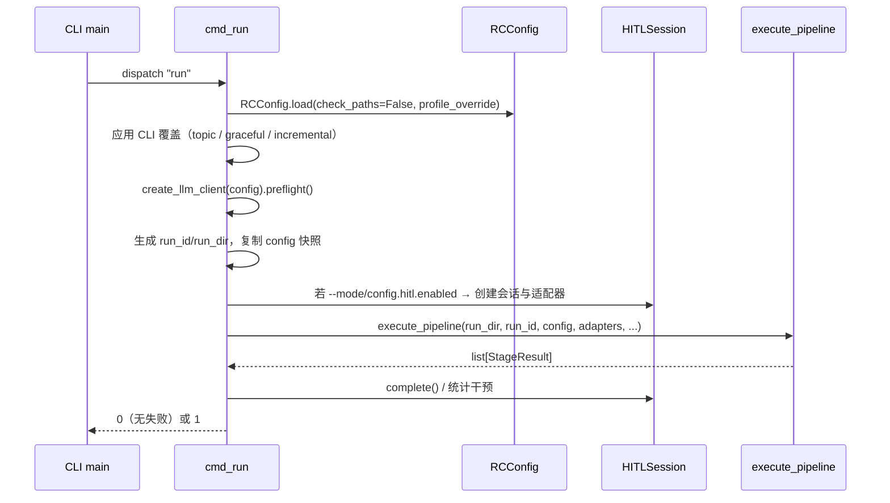

# 09 · 接口、配置与运维

本篇覆盖 CLI、FastAPI 服务、前端、MCP、OpenClaw 桥、技能管理、配置系统、安装运行、Docker 与测试。

---

## 1. CLI

### 1.1 入口

- 控制台脚本：`researchclaw = researchclaw.cli:main`（`pyproject.toml:32`）
- 模块入口：`python -m researchclaw`（`__main__.py:1-6`）
- `main()`（`cli.py:1511-1563`）解析后按 `args.command` 分发到 22 个 `cmd_*` 函数。

### 1.2 命令清单

| 命令 | 作用 | 实现 |
|------|------|------|
| `run` | 运行 23 阶段流水线 | `cmd_run` `cli.py:156` |
| `validate` | 校验配置文件 | `cmd_validate` `cli.py:462` |
| `doctor` | 环境/配置体检，可输出 JSON | `cmd_doctor` `cli.py:498` |
| `info` | 展示解析后的 profile、prompt bank、阶段列表 | `cmd_info` `cli.py:512` |
| `init` | 从示例生成 `config.arc.yaml` | `cmd_init` `cli.py:821` |
| `setup` | 检查/安装 OpenCode，检查 Docker/LaTeX | `cmd_setup` `cli.py:947` |
| `report` | 从 run 目录生成 Markdown 报告 | `cmd_report` `cli.py:990` |
| `serve` | 启动 FastAPI 服务 | `cmd_serve` `cli.py:702` |
| `dashboard` | 只启动仪表盘（无流水线控制） | `cmd_dashboard` `cli.py:728` |
| `wizard` | 交互式配置向导 | `cmd_wizard` `cli.py:754` |
| `project` | 多项目管理（list/status/create/switch/compare） | `cmd_project` `cli.py:594` |
| `mcp` | 启动 MCP 服务 | `cmd_mcp` `cli.py:642` |
| `overleaf` | Overleaf 同步/状态 | `cmd_overleaf` `cli.py:664` |
| `trends` | 日报/趋势/选题建议 | `cmd_trends` `cli.py:1012` |
| `profile` | 领域 profile 管理（list/show/path/dirs/schema/create/validate/edit/delete） | `cmd_profile` `cli.py:1880` |
| `skills` | 技能列表/安装/校验 | `cmd_skills` `cli.py:1088` |
| `calendar` | 会议 DDL 与投稿计划 | `cmd_calendar` `cli.py:1066` |
| `attach` | 附加到暂停中的流水线 | `cmd_attach` `cli.py:2186` |
| `status` | 查看流水线/HITL 状态 | `cmd_status` `cli.py:2234` |
| `approve` | 批准当前门 | `cmd_hitl_approve` `cli.py:2270` |
| `reject` | 拒绝当前门 | `cmd_hitl_reject` `cli.py:2287` |
| `guide` | 向指定阶段注入指导 | `cmd_hitl_guide` `cli.py:2304` |

子命令注册位置：`build_parser()`（`cli.py:1193-1508`）。

### 1.3 `run` 关键参数

| 参数 | 作用 |
|------|------|
| `--topic/-t` | 覆盖配置中的研究主题 |
| `--config/-c` | 指定配置文件（默认自动查找） |
| `--output/-o` | 输出目录（默认 `artifacts/<run_id>`） |
| `--from-stage` / `--to-stage` | 起止阶段（支持局部重跑） |
| `--auto-approve` | 自动通过门控 |
| `--incremental-experiment` | HEP collider 增量重入 |
| `--mode/-m` | HITL 模式：`full-auto`、`gate-only`、`checkpoint`、`step-by-step`、`co-pilot`、`express`、`thorough`、`learning` |
| `--skip-preflight` | 跳过 LLM 连通性预检 |
| `--resume` | 从最近检查点继续 |
| `--skip-noncritical-stage` | 非关键阶段失败时跳过 |
| `--no-graceful-degradation` | 质量门失败时直接中止 |
| `--interventions` | 脚本化 HITL 干预 JSON |
| `--profile/-p` | 指定领域 profile（并提供配置默认值） |

### 1.4 `run` 的调用链



关键行号：

- `cmd_run` 开始：`cli.py:156`
- 配置加载：`cli.py:175-177`
- LLM 预检：`cli.py:228-239`
- HITL 会话创建/适配器：`cli.py:304-400`
- `execute_pipeline` 调用：`cli.py:426-437`

---

## 2. 配置系统

### 2.1 查找与加载

| 项 | 位置 | 说明 |
|----|------|------|
| `CONFIG_SEARCH_ORDER` | `config.py:16` | `config.arc.yaml` → `config.yaml` |
| `resolve_config_path()` | `config.py:68` | 显式路径优先，否则按顺序找第一个存在的文件 |
| `RCConfig.load()` | `config.py:1050` | 读 YAML → 应用 profile 默认值 → `from_dict()` |
| `RCConfig.from_dict()` | `config.py:911` | 校验 → 逐段构造 dataclass |
| `validate_config()` | `config.py:1104` | 必填字段、路径、枚举、类型校验，返回 `ValidationResult` |
| `to_dict()` | `config.py:908` | 序列化 |

### 2.2 优先级

从代码可确认的顺序（高 → 低）：

1. **CLI 参数**：`--topic`、`--profile`、`--mode`、`--auto-approve` 等通过 `dataclasses.replace()` 覆盖；
2. **配置文件**：用户 YAML；
3. **Profile 默认值**：仅填充用户未设置的键（`apply_profile_defaults`，用户永远优先）；
4. **dataclass 默认值**；
5. **环境变量**：主要用于 API key（`api_key_env`）与 MetaClaw/OpenAlex/S2 的可选 key；不覆盖普通配置项。

### 2.3 配置分组

`RCConfig`（`config.py:869-906`）包含以下分组：

| 分组 | 数据类 | 主要内容 |
|------|--------|----------|
| `project` | `ProjectConfig` | 名称、模式、profile |
| `research` | `ResearchConfig` | 主题、领域、每日论文数、质量阈值、优雅降级 |
| `runtime` | `RuntimeConfig` | 时区、并行数、审批超时、重试上限 |
| `notifications` | `NotificationsConfig` | 通道、目标、阶段开始/失败/门控通知 |
| `knowledge_base` | `KnowledgeBaseConfig` | 后端（markdown/obsidian）、根目录、vault |
| `openclaw_bridge` | `OpenClawBridgeConfig` | 6 个能力开关 |
| `llm` | `LlmConfig` | provider、base_url、wire_api、key、模型、reviewer、debate、tournament、ACP |
| `literature_search` | `LiteratureSearchConfig` | 源顺序、每查询上限、延迟、OpenAlex/S2 key |
| `security` | `SecurityConfig` | 门控阶段、无审批发布、日志脱敏 |
| `experiment` | `ExperimentConfig` | 模式（默认 `sandbox`，`simulated` 需显式）、时间预算、指标、sandbox/docker/ssh/colab/agent/code_agent/opencode/benchmark/figure_agent/repair/cli_agent |
| `export` | `ExportConfig` | 目标会议、作者、bib 文件名 |
| `prompts` | `PromptsConfig` | 自定义 YAML、每阶段额外提示 |
| `web_search` | `WebSearchConfig` | Tavily、Scholar、crawler、PDF 开关与上限 |
| `metaclaw_bridge` | `MetaClawBridgeConfig` | 代理、技能目录、PRM、lesson_to_skill |
| `memory` | `MemoryConfig` | 记忆存储与检索参数 |
| `skills` | `SkillsConfig` | 内置/自定义/外部技能目录、自动匹配 |
| `knowledge_graph` | `KnowledgeGraphConfig` | 图谱开关与上限 |
| `multi_project` | `MultiProjectConfig` | 项目目录、并发数、共享知识 |
| `compute_servers` | `ServersConfig` | 多机条目、优先级、failover |
| `mcp` | `MCPIntegrationConfig` | 服务端开关/端口/传输、外部服务器 |
| `overleaf` | `OverleafConfig` | Git URL、分支、push/pull |
| `server` | `ServerConfig` | host/port/CORS/auth/voice |
| `dashboard` | `DashboardConfig` | 刷新间隔、日志行数、浏览器通知 |
| `trends` | `TrendsConfig` | 领域、日报时间、来源 |
| `copilot` | `CoPilotConfig` | 模式、门控暂停、分支 |
| `quality_assessor` | `QualityAssessorConfig` | 评分维度、venue 推荐、历史 |
| `calendar` | `CalendarConfig` | 目标会议、提醒天数、自动计划 |
| `hitl` | `HITLConfig`（惰性） | 模式、预算、策略、超时、协作 |

### 2.4 必填字段与枚举

`REQUIRED_FIELDS`（`config.py:79-87`）：`project.name`、`research.topic`、`runtime.timezone`、`notifications.channel`、`knowledge_base.root`、`llm.base_url`、`llm.api_key_env`。

`EXPERIMENT_MODES`（`config.py:98-108`）与 `PROJECT_MODES = {"docs-first","semi-auto","full-auto"}`（`config.py:96`）。

### 2.5 示例配置

根目录 `config.researchclaw.example.yaml` 覆盖：project/research/runtime/notifications/knowledge_base/openclaw_bridge/llm/literature_search/security/experiment（sandbox/docker/ssh/colab/opencode/figure_agent）/prompts/metaclaw_bridge。server/dashboard/memory/skills 等分组需按 dataclass 字段自行补充。

---

## 3. Web 服务

### 3.1 应用工厂

`server/app.py:25` 的 `create_app(config, *, dashboard_only=False, monitor_dir=None)`：

- 创建 FastAPI（title/version 0.5.0）；
- CORS 来自 `config.server.cors_origins`；
- 若 `config.server.auth_token` 非空，挂 `TokenAuthMiddleware`；
- 创建 `ConnectionManager` 用于 WebSocket；
- `/api/health`、`/api/config`；
- 挂载 pipeline/projects 路由；非 dashboard-only 时挂 chat/voice；
- `/ws/events` 事件流；
- 若存在可解析的前端目录（`frontend/`、`frontend-legacy/`、`RESEARCHCLAW_FRONTEND_DIR`）则挂载静态文件与根路径；
- 启动 dashboard 广播循环与 15s 心跳。

### 3.2 HTTP / WebSocket 端点

| 端点 | 方法 | 说明 |
|------|------|------|
| `/api/health` | GET | 健康检查 |
| `/api/config` | GET | 配置摘要 |
| `/api/pipeline/start` | POST | 启动一次 run（后台线程池执行） |
| `/api/pipeline/stop` | POST | 停止当前 run |
| `/api/pipeline/status` | GET | 当前 run 状态 |
| `/api/pipeline/stages` | GET | 23 阶段定义 |
| `/api/runs` | GET | 历史 run 列表（最多 50） |
| `/api/runs/{run_id}` | GET | run 详情、完成阶段、论文文件 |
| `/api/runs/{run_id}/metrics` | GET | `results.json` 指标 |
| `/api/projects` | GET | artifacts 项目列表 |
| `/api/voice/transcribe` | POST | Whisper 转写（需 voice 依赖与开关） |
| `/ws/events` | WS | 仪表盘事件流 |
| `/ws/chat` | WS | 对话式研究聊天 |

`run_id` 必须是 `rc-YYYYMMDD-HHMMSS-<hex>`，并限制在 `artifacts/` 下（`server/routes/pipeline.py:16-28`）。

### 3.3 鉴权

`TokenAuthMiddleware`（`server/middleware/auth.py:12`）：

- token 为空时完全放行；
- 豁免 `/api/health`、`/docs`、`/openapi.json`、`/static`；
- WebSocket 通过 query param 携带 token（`/ws` 开头）。

### 3.4 事件

`EventType`（`server/websocket/events.py:12`）：连接/心跳/错误、流水线开始/完成、阶段开始/完成/失败、指标更新、日志行、论文就绪、聊天响应/输入中/建议、run 发现/状态变化。

### 3.5 对话路由

`server/dialog/`：

- `classify_intent()`（`intents.py:54`）把消息分类为 help/status/start/topic/config/results/paper/general；
- `route_message()`（`router.py:18`）分发到对应 handler。

### 3.6 前端

`frontend-legacy/`：

- 纯原生 JS，无构建步骤（`package.json` 注明）；
- `index.html` + `src/app.js` + 组件（Dashboard、PipelineView、ExperimentMonitor、PaperPreview、ChatPanel、ProjectList、WizardFlow）+ `services/api.js`、`services/websocket.js`；
- 设计为挂在 `/static` 并由根路径返回 `index.html`。

`website/` 是独立静态宣传站（index/features/pipeline/papers/getting-started），不参与运行时。

---

## 4. MCP

| 组件 | 位置 | 说明 |
|------|------|------|
| `TOOL_DEFINITIONS` | `mcp/tools.py` | 6 个工具：`run_pipeline`、`get_pipeline_status`、`get_experiment_results`、`search_literature`、`review_paper`、`get_paper` |
| `get_tool_schema()` / `list_tool_names()` | `mcp/tools.py` | 供服务端与 CLI 使用 |
| `ResearchClawMCPServer` | `mcp/server.py` | 基于官方 SDK v2 `MCPServer`，用 `@mcp.tool()` 注册 6 个工具 |
| `MCPClient` | `mcp/client.py` | 官方 SDK `Client`；支持 stdio 子进程与 `in_memory()` |
| `MCPServerRegistry` | `mcp/registry.py` | 外部 MCP 服务器注册；`close_all()` 逆序关闭 |
| `MCPTransport` / `StdioTransport` / `SSETransport` | `mcp/transport.py` | 底层传输工具；服务端不再自研协议循环 |

现状（PR-3 已实现）：

- 协议：官方 `mcp>=2.1,<3`（2.3.0 验证）高层 `MCPServer`；默认 stdio，其他 transport 显式报 `NotImplementedError`。
- `run_pipeline`：校验 topic 长度，返回真实 `rc-YYYYMMDD-HHMMSS-<hash>` run_id；`asyncio.to_thread` 后台执行 `execute_pipeline`；同一时刻只允许 1 个活跃 run，第二个返回 `RUN_IN_PROGRESS`。
- `get_pipeline_status`：统一走 `run_state.read_run_state()`，返回 stage/stage_name/status/is_active/updated_at。
- `get_experiment_results`：`stage-14/experiment_summary.json` → `stage-12/runs/results.json` → `stage-12/results.json` → 根 `results.json`。
- `get_paper`：markdown `stage-23/paper_final_verified.md` → `stage-22/paper_final.md` → `stage-17/paper_draft.md`；latex `stage-22/paper.tex` → `deliverables/paper.tex`。
- `search_literature`：真实调用 `literature.search_papers()`，失败返回 `UPSTREAM_ERROR`。
- `review_paper`：复用 `pipeline/review_service.py`（Stage 18 同一评审核心）；`paper_path` 与 `run_id` 二选一；无 LLM 配置返回 `CONFIG_REQUIRED`。
- 错误：工具失败返回 `isError=true` + `error_code`（`INVALID_ARGUMENT`、`RUN_NOT_FOUND`、`NO_RESULTS`、`PAPER_NOT_FOUND`、`CONFIG_REQUIRED`、`UPSTREAM_ERROR`、`INTERNAL_ERROR` 等），不返回假成功。
- `run_id` 正则 `^rc-\d{8}-\d{6}-[a-f0-9]{6,64}$`；`run_dir`/`paper_path` 必须位于 `artifacts/` 内。

启动：`researchclaw mcp --start --config <config.yaml>`（`--config` 可选）；stdio 模式下 stdout 只用于协议，诊断信息走 stderr。`researchclaw mcp` 不带 `--start` 时列出工具名。

---

## 5. OpenClaw 桥与 ACP

### 5.1 适配器协议

`adapters.py` 定义 6 个 Protocol + 录制桩：

| 能力 | Protocol | 真实实现 |
|------|----------|----------|
| 定时恢复 | `CronAdapter` | `RecordingCronAdapter`、外部 OpenClaw |
| 消息通知 | `MessageAdapter` | `RecordingMessageAdapter`、`MCPMessageAdapter` |
| 记忆 | `MemoryAdapter` | `RecordingMemoryAdapter` |
| 子会话 | `SessionsAdapter` | `RecordingSessionsAdapter` |
| Web 抓取 | `WebFetchAdapter` | `RecordingWebFetchAdapter`、`MCPWebFetchAdapter` |
| 浏览器 | `BrowserAdapter` | `RecordingBrowserAdapter` |

`AdapterBundle`（`adapters.py:121-139`）把七类能力（含 `hitl`）打包注入 `execute_pipeline`；`from_config()` 在 MCP server 开启时把 message/web_fetch 替换为 MCP 实现。

配置开关：`openclaw_bridge.use_cron/use_message/use_memory/use_sessions_spawn/use_web_fetch/use_browser`。

### 5.2 ACP

`llm.acp.agent` 指定 CLI Agent（`claude`/`codex`/`gh`/`gemini`/`opencode`/`kimi`），`provider: "acp"` 即启用。详见 [04-llm-and-agents.md](04-llm-and-agents.md)。

### 5.3 Agent 引导文件

根目录 `RESEARCHCLAW_AGENTS.md` 与 `RESEARCHCLAW_CLAUDE.md` 是给外部 AI Agent 读取的编排说明（角色、安装、阶段、门控），配合 OpenClaw/Claude Code 使用。

---

## 6. 技能管理

| 项 | 位置 | 说明 |
|----|------|------|
| `Skill` | `skills/schema.py:42` | name/description/triggers/stage/priority/content/metadata |
| `SkillRegistry` | `skills/registry.py:18` | 加载 builtin + custom + external，按名称注册/查询 |
| `load_skill_from_skillmd()` | `skills/loader.py:18` | 解析 agentskills.io 格式 frontmatter |
| `load_skills_from_directory()` | `skills/loader.py:156` | `SKILL.md` 优先于 legacy YAML/JSON |
| `match_skills()` | `skills/matcher.py:25` | 按 stage/keyword/description/priority 打分，返回 top-k |
| `format_skills_for_prompt()` | `skills/matcher.py:95` | 截断后注入提示 |

内置技能 20 个，位于 `researchclaw/skills/builtin/{domain,experiment,tooling}/`；`.claude/skills/` 另有 9 个供 Claude Code 使用的技能（含 `researchclaw`、`a-evolve`）。

CLI：`researchclaw skills list|install|validate`（`cmd_skills` `cli.py:1088`）。

---

## 7. 安装与运行

### 7.1 安装

```bash
python3 -m venv .venv
source .venv/bin/activate            # Windows: .venv\Scripts\activate
pip install -e .                     # 核心依赖
pip install -e ".[all]"              # 全部可选能力
pip install -e ".[dev]"              # pytest 等
```

可选 extras（`pyproject.toml:15-29`）：

| extra | 内容 |
|-------|------|
| `anthropic` | `httpx` |
| `server` | `fastapi`、`uvicorn[standard]` |
| `mcp` | `mcp>=2.1,<3` |
| `voice` | `httpx` |
| `web` | `scholarly`、`crawl4ai`、`tavily-python` |
| `pdf` | `PyMuPDF` |
| `all` | 上述全部 + huggingface-hub、matplotlib、scipy |
| `dev` | pytest、pytest-asyncio、httpx、build、hatchling |

### 7.2 初始化

```bash
researchclaw setup          # 检查 OpenCode/Docker/LaTeX
researchclaw init           # 交互式生成 config.arc.yaml
# 或 cp config.researchclaw.example.yaml config.arc.yaml
export OPENAI_API_KEY="sk-..."
```

### 7.3 运行

```bash
# 全自动
researchclaw run --config config.arc.yaml --topic "..." --auto-approve

# Co-Pilot
researchclaw run --topic "..." --mode co-pilot

# 断点续跑
researchclaw run --resume --topic "..." --auto-approve

# 只跑到阶段 9
researchclaw run --topic "..." --to-stage EXPERIMENT_DESIGN --auto-approve
```

### 7.4 环境变量

| 变量 | 用途 |
|------|------|
| `OPENAI_API_KEY` 等（由 `llm.api_key_env` 指定） | LLM 密钥 |
| `S2_API_KEY`、`OPENALEX_API_KEY` | 文献 API 密钥 |
| `TAVILY_API_KEY` | Web 搜索 |
| `GEMINI_API_KEY` | Nano Banana 图像生成 |
| `HITL_INTERVENTIONS_FILE` | 脚本化 HITL 干预 |
| `ARC_DEBATE_ROUNDS` | 覆盖辩论轮数 |
| `ARC_ABL_DISABLE_TOURNAMENT=1` | 关闭 Best-of-N（消融） |
| `RESEARCHCLAW_PROFILES_DIR` | 自定义 profile 目录 |

---

## 8. Docker、远程执行与看门狗

### 8.1 实验镜像

```bash
docker build -t researchclaw/experiment:latest researchclaw/docker/
```

`researchclaw/docker/` 提供：

- `Dockerfile`（CUDA 12.4 + Python 3.11 + ML 栈）
- `Dockerfile.generic`、`Dockerfile.biology`、`Dockerfile.chemistry`、`Dockerfile.economics`、`Dockerfile.math`、`Dockerfile.physics`
- `entrypoint.sh`（依赖安装 → setup → 入口）

### 8.2 远程执行

- `experiment.mode: ssh_remote` + `ssh_remote.host/user/key_path/gpu_ids/remote_python/setup_commands`；
- `use_docker: true` 可在远端容器中执行；
- `experiment.mode: colab_drive` + 本地 Drive 挂载目录，配合 `colab_worker.py`。

### 8.3 看门狗

`sentinel.sh <run_dir> [--python <path>]`：

- 监控 `heartbeat.json`；
- 默认每 60s 检查，心跳 >300s 视为过期；
- PID 死亡且心跳过期时重启，最多 5 次，连续 3 次失败后冷却 360s（脚本头注释）。

环境变量：`SENTINEL_CHECK_INTERVAL`、`SENTINEL_STALE_THRESHOLD`、`SENTINEL_MAX_RETRIES`、`SENTINEL_COOLDOWN`。

### 8.4 示例脚本

| 脚本 | 用途 |
|------|------|
| `run_hep_pipeline.sh` | HEP 端到端示例（含 API key/Anthropic/Collider 环境变量） |
| `sentinel.sh` | 看门狗 |
| `scripts/metaclaw_start.sh` | 启动 MetaClaw |
| `scripts/test_beast_mode_e2e.py` | Beast Mode 端到端 |
| `scripts/test_codegen_v2.py` | 代码生成 v2 |
| `scripts/test_code_agent_live.py` / `test_code_agent_sandbox.py` | CodeAgent 联调 |
| `scripts/plot_iteration_showcase.py` | 迭代结果展示图 |

---

## 9. 测试体系

- 目录：`tests/`，共 101 个 Python 文件（96 个 `test_*.py`，含 `tests/test_metaclaw_bridge/` 子包；另有 2 个 e2e 脚本、`conftest.py` 与包 `__init__.py`）。
- 覆盖：配置/CLI/执行器/阶段/契约、LLM、HITL 全系列、Docker/SSH/Colab、论文验证、引用校验、图表、BenchmarkAgent、CodeAgent、技能、MCP、Overleaf、Web、趋势、日历、项目管理等。
- 运行：

```bash
pytest tests/ -q
pytest tests/test_rc_stages.py -q
```

- `tests/conftest.py` 仅一行注释，没有共享 fixture；测试多为自包含。
- `tests/e2e_docker_sandbox.py`、`tests/e2e_real_llm.py` 是端到端脚本，依赖 Docker/真实 API，通常手动运行。
- 仓库未提供 `[tool.pytest.ini_options]` 或 `pytest.ini`；默认发现规则即可。

---

## 10. 已知缺口与排障

> 逐项复现、社区案例与修复方案见 [11-gap-remediation-research.md](11-gap-remediation-research.md)。

### 10.1 缺失/未接线的模块（代码中有引用但文件不存在）

以下导入都包在 `try/except` 中，缺失时只记录 debug 日志，不阻断主流程：

| 模块 | 引用位置 | 影响 |
|------|----------|------|
| `researchclaw.cost_tracker` | `runner.py:510` | 无全局成本跟踪，预算检查被跳过 |
| `researchclaw.pipeline.event_log` | `runner.py:463` | 无事件日志 |
| `researchclaw.pipeline.experiment_spec` | `runner.py:554/564` | 无实验规格生成/校验 |
| `researchclaw.pipeline.pitfall_detector` | `runner.py:584` | 无陷阱检测报告 |

### 10.2 打包/依赖不一致

| 问题 | 证据 | 状态 |
|------|------|------|
| **标准 wheel 构建失败**：`force-include` 把 `researchclaw/templates/styles` 映射到包内同一路径，Hatchling 报 “A second file is being added …” | 详见 11 §G1 | ✅ 已修复（PR-1：删除 `force-include`） |
| `pyproject.toml` 的 wheel packages 包含 `sibyl`、`arc`，但仓库不存在这两个目录 | `pyproject.toml` | ✅ 已修复（PR-1：仅保留 `researchclaw`） |
| `serve`/`dashboard` 依赖 FastAPI/uvicorn，但未在 `dependencies` 或 extras 中声明 | `cli.py:713-747` | ✅ 已修复（PR-1：新增 `server` extra，提示同步） |
| `voice` 路由提示安装 `researchclaw[voice]`，但 pyproject 无该 extra | `server/routes/voice.py` | ✅ 已修复（PR-1：新增 `voice` extra） |
| 服务端期望 `frontend/` 目录，实际目录名为 `frontend-legacy/` | `server/app.py:26-57` | ✅ 已修复（PR-2：`_resolve_frontend_dir()` 支持 env + `frontend` + `frontend-legacy` + 打包 dist） |
| Dashboard/Projects 读取旧 checkpoint 字段 `stage/stage_name/status`，与 runner 写入的 `last_completed_stage` 不一致 | `dashboard/collector.py`、`server/routes/projects.py` | ✅ 已修复（PR-2：统一走 `researchclaw/run_state.py`） |
| README 的 Python API 示例 `from researchclaw.pipeline import Runner` 不存在 | `pipeline/__init__.py` | ⏳ 待修（PR-6） |

### 10.3 实验模式边界

- `agentic` 声明但未接入主流水线（`create_agentic_sandbox()` 无调用方）；
- `biology_agent` / `stat_agent` 在 Stage 12 无专用分支，见 [05-experiment-and-domains.md](05-experiment-and-domains.md) §9；
- `ExperimentConfig.mode` 默认 `simulated`，不显式设置为 `sandbox`/`docker` 会得到假数据。

### 10.4 常见排障

| 现象 | 排查 |
|------|------|
| `preflight` 失败 | 检查 `llm.base_url/api_key_env`、模型名、网络；`--skip-preflight` 可跳过 |
| 阶段卡在 BLOCKED_APPROVAL | 用 `approve`/`reject` 或 `--auto-approve`；检查 `security.hitl_required_stages` |
| `Missing input: ...` | 前序阶段未产出；用 `--from-stage` 从正确阶段重跑 |
| Docker 模式报镜像不存在 | `docker build -t researchclaw/experiment:latest researchclaw/docker/` |
| LaTeX 编译失败 | 安装 `pdflatex`；`compile_latex()` 会自动修复常见错误，最多 3 次 |
| 引用被清空 | 正常防伪行为：Stage 23 移除 HALLUCINATED 条目，详见 `verification_report.json` |
| 前端打不开 | 已支持 `frontend/`、`frontend-legacy/`、`RESEARCHCLAW_FRONTEND_DIR`；若都缺失，服务端会记录 error 日志 |

---

## 11. 关键入口索引

| 名称 | 位置 | 作用 |
|------|------|------|
| `main()` | `cli.py:1511` | CLI 分发 |
| `cmd_run()` | `cli.py:156` | 运行流水线 |
| `build_parser()` | `cli.py:1193` | 参数定义 |
| `CONFIG_SEARCH_ORDER` | `config.py:16` | 配置搜索顺序 |
| `RCConfig.load()` | `config.py:1050` | 配置加载 |
| `validate_config()` | `config.py:1104` | 配置校验 |
| `create_app()` | `server/app.py:25` | FastAPI 工厂 |
| `TokenAuthMiddleware` | `server/middleware/auth.py:12` | 鉴权 |
| `ResearchClawMCPServer` | `mcp/server.py:29` | MCP 服务端 |
| `SkillRegistry` | `skills/registry.py:18` | 技能注册 |
| `QuickStartWizard` | `wizard/quickstart.py:11` | 配置向导 |
