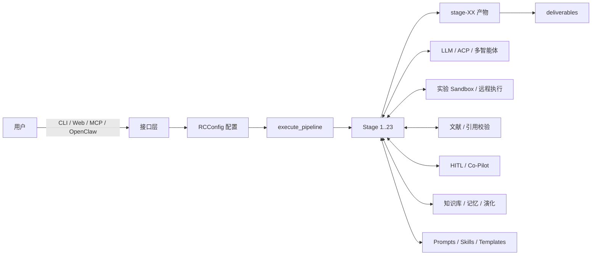

# AutoResearchClaw Code Wiki

> 本 Wiki 基于仓库 `d:\AutoResearchClaw-main\AutoResearchClaw-main`（`researchclaw` v0.5.0）的实际代码整理，面向需要理解、二次开发或运维该系统的工程师。
>
> 文档中的行号均对应当前工作区代码；若后续代码变动，请以文件内容为准。

---

## 1. 项目速览

| 维度 | 事实 |
|------|------|
| 项目定位 | 将一句研究主题自动推进为「可编译论文」的自治研究流水线，支持全自动与 Human-in-the-Loop（HITL）协作 |
| 包名 / 版本 | `researchclaw` / `0.5.0`（`pyproject.toml:2`、`researchclaw/__init__.py:3`） |
| 控制台入口 | `researchclaw = researchclaw.cli:main`（`pyproject.toml:32`） |
| 运行时要求 | Python `>=3.11` |
| 必需依赖 | `pyyaml`、`rich`、`arxiv`、`numpy` |
| 可选依赖 | `anthropic`（Anthropic Messages API）、`web`（scholarly / crawl4ai / tavily）、`pdf`（PyMuPDF）、`all`、`dev` |
| 代码规模 | `researchclaw/` 275 个 Python 文件、约 81,520 行；`tests/` 101 个文件、约 38,848 行 |
| 流水线 | 23 个阶段、8 个 Phase、3 个审批门（Stage 5 / 9 / 20） |
| 领域支持 | `researchclaw/domains/profiles/` 下 29 个 YAML（28 个具体领域 + `_generic.yaml`，另有自定义示例模板） |
| 实验执行模式 | `simulated`、`sandbox`、`docker`、`ssh_remote`、`colab_drive`、`agentic`、`collider_agent`、`biology_agent`、`stat_agent`（`config.py:98-108`） |
| 最终交付 | `deliverables/`：`paper_final.md`、`paper.tex`、`references.bib`、`code/`、`charts/`、`verification_report.json` |

---

## 2. 一分钟理解



核心事实：**流水线的状态不在内存里，而在 run 目录的文件里**。每个 Stage 读取前序 Stage 的产物、写出自己的产物，`checkpoint.json` 记录最后完成的阶段，`--resume` 据此继续。

---

## 3. 仓库目录（带注释）

```
AutoResearchClaw-main/
├── researchclaw/                 # Python 主包（275 个 .py）
│   ├── cli.py                    # 22 个 CLI 子命令与 dispatch（87 KB）
│   ├── config.py                 # RCConfig 及 40+ 配置 dataclass（67 KB）
│   ├── adapters.py               # OpenClaw/MCP 适配器协议与录制桩
│   ├── hardware.py               # GPU/MPS/CPU 检测
│   ├── health.py                 # doctor 环境体检
│   ├── quality.py                # 模板/占位内容检测（AI-slop）
│   ├── report.py                 # 从 run 目录生成 Markdown 报告
│   ├── evolution.py              # 教训提取与时间衰减存储
│   ├── evolution_aevolve.py      # A-Evolve 变异/观察模型
│   ├── pipeline/                 # 23 阶段状态机 + 执行器 + 守卫
│   ├── experiment/               # 9 种实验后端 + 指标/校验/可视化
│   ├── domains/                  # 领域画像、检测、PromptAdapter、deploy
│   ├── agents/                   # CodeSearcher / BenchmarkAgent / FigureAgent
│   ├── llm/                      # OpenAI 兼容客户端 + Anthropic + ACP
│   ├── literature/               # OpenAlex / S2 / arXiv 检索与引用校验
│   ├── web/                      # Web 搜索 / 抓取 / Scholar / PDF（含 SSRF 防护）
│   ├── knowledge/                # Markdown/Obsidian 知识库 + 知识图谱
│   ├── memory/                   # ideation/experiment/writing 三类记忆
│   ├── hitl/                     # 6 种干预模式、会话、适配器、工坊、分支
│   ├── copilot/                  # CoPilot 控制器（与 HITL 并行的一套模式）
│   ├── collaboration/            # 研究仓库、产物发布/订阅、去重
│   ├── metaclaw_bridge/          # MetaClaw 技能注入 / PRM / 失败转技能
│   ├── prompts/                  # PromptManager + ml/hep_ph/biology 提示库
│   ├── skills/                   # SKILL.md 加载、注册、匹配（20 个内置技能）
│   ├── templates/                # 会议模板、Markdown→LaTeX、编译、结果表
│   ├── overleaf/                 # Overleaf Git 双向同步
│   ├── server/                   # FastAPI 应用、路由、WebSocket、对话
│   ├── dashboard/                # 运行指标采集与广播
│   ├── assessor/                 # 5 维评分、历史对比、投稿推荐
│   ├── project/                  # 多项目、Idea 池、调度器
│   ├── trends/                   # 趋势抓取、日报、自动选题
│   ├── calendar/                 # 会议 DDL 与提醒
│   ├── voice/                    # Whisper 转写 / TTS
│   ├── wizard/                   # 配置向导
│   ├── mcp/                      # MCP 服务端 / 客户端 / 传输
│   ├── servers/                  # 多机调度（SSH / Slurm / 云）
│   ├── utils/                    # thinking 标签清理、文件名清洗
│   ├── data/                     # 数据集/基准/预训练论文 YAML
│   └── docker/                   # 实验与各领域 Dockerfile
├── tests/                        # 101 个测试文件（pytest）
├── experiments/arc_bench/        # ARC-Bench 55 主题基准
├── external/agents/              # 外部领域 Agent（Biology/Stat vendored，Collider 指针）
├── frontend-legacy/              # 无构建步骤的原生 JS 仪表盘
├── website/                      # 静态宣传站
├── docs/                         # 既有用户文档（HITL/集成/领域指南）
├── scripts/                      # 端到端与 Beast Mode 验证脚本
├── config.researchclaw.example.yaml
├── prompts.default.yaml
├── RESEARCHCLAW_AGENTS.md        # OpenClaw/CLI Agent 的编排说明
├── sentinel.sh                   # 心跳看门狗重启脚本
└── run_hep_pipeline.sh           # HEP 端到端运行示例
```

---

## 4. Wiki 文档地图

| 文档 | 内容 | 适合读者 |
|------|------|----------|
| [01-overview.md](01-overview.md) | 系统架构、分层、包依赖、运行时数据流、设计原则 | 所有人 |
| [02-pipeline-core.md](02-pipeline-core.md) | Stage 状态机、契约、Runner/Executor、检查点、PIVOT/REFINE | 后端/流水线开发者 |
| [03-stage-reference.md](03-stage-reference.md) | 23 个阶段的输入/输出/DoD/实现/回退逐条说明 | 流水线开发者、领域适配者 |
| [04-llm-and-agents.md](04-llm-and-agents.md) | LLM 客户端、ACP、多智能体、Debate、Tournament | 模型接入/Agent 开发者 |
| [05-experiment-and-domains.md](05-experiment-and-domains.md) | 9 种实验后端、指标解析、安全校验、领域画像与适配 | 实验执行/领域开发者 |
| [06-knowledge-memory-evolution.md](06-knowledge-memory-evolution.md) | 知识库、知识图谱、记忆检索、演化闭环、MetaClaw | 平台/知识层开发者 |
| [07-hitl-and-collaboration.md](07-hitl-and-collaboration.md) | HITL 六模式、会话生命周期、适配器、工坊、CoPilot | 产品/HITL 开发者 |
| [08-literature-and-publishing.md](08-literature-and-publishing.md) | 文献检索、4 层引用校验、写作防伪、图表、LaTeX、Overleaf | 写作/出版链路开发者 |
| [09-interfaces-and-ops.md](09-interfaces-and-ops.md) | CLI、FastAPI、WebSocket、前端、MCP、配置、安装、Docker、测试 | 运维/集成开发者 |
| [10-module-reference.md](10-module-reference.md) | 全模块职责表、关键类/函数索引、依赖矩阵、已知缺口 | 查阅型读者 |
| [11-gap-remediation-research.md](11-gap-remediation-research.md) | 实际缺口复现、社区案例、修复方案、实施顺序与验收清单 | 维护者/技术负责人 |
| [12-remediation-acceptance-checklist.md](12-remediation-acceptance-checklist.md) | 逐缺口验收命令、负向/回归检查、发布门与签署表 | 维护者/QA/评审人 |
| [13-remediation-engineering-spec.md](13-remediation-engineering-spec.md) | 修复接口契约、版本矩阵、数据 schema、测试用例与 TDD 顺序 | 实现者/架构评审人 |
| [14-decision-record.md](14-decision-record.md) | §15 八项决策的裁定、外部证据锚点、影响与实施顺序 | 评审人/技术负责人 |

---

## 5. 最短运行路径

```bash
# 1. 安装（仓库根目录）
python3 -m venv .venv && source .venv/bin/activate   # Windows: .venv\Scripts\activate
pip install -e .

# 2. 初始化配置（交互式，生成 config.arc.yaml）
researchclaw init
# 或：cp config.researchclaw.example.yaml config.arc.yaml

# 3. 设置 API Key（示例为 OpenAI 兼容端点）
export OPENAI_API_KEY="sk-..."

# 4. 全自动跑完 23 个阶段
researchclaw run --config config.arc.yaml --topic "Your research idea" --auto-approve

# 5. 需要人机协作时
researchclaw run --topic "Your research idea" --mode co-pilot
```

输出目录：`artifacts/rc-YYYYMMDD-HHMMSS-<topic_hash>/`，最终文件在 `deliverables/`。

---

## 6. 推荐阅读顺序

- **第一次接触**：`01-overview` → `02-pipeline-core` → `03-stage-reference` → `09-interfaces-and-ops`。
- **要改某个 Stage**：`02-pipeline-core` → `03-stage-reference` 对应阶段 → `04/05/08` 中该阶段依赖的子系统。
- **要接新领域**：`05-experiment-and-domains` → `03-stage-reference`（Stage 9/10/12/22）→ `docs/DOMAIN_INTEGRATION_GUIDE.md`。
- **要接新模型/Agent**：`04-llm-and-agents.md` → `09-interfaces-and-ops.md` 的配置章节。
- **要部署/排障**：`09-interfaces-and-ops.md` → `10-module-reference.md` 的「已知缺口」。

---

## 7. 文档约定与免责说明

1. **事实来源**：所有模块职责、类名、函数名、行号均来自当前仓库代码；README 中的宣传性数字（如测试全部通过）未被当作事实引用。
2. **可选模块**：部分代码通过 `try/except ImportError` 引用不存在的模块（如 `researchclaw.cost_tracker`、`pipeline.event_log`），属于**可选/缺失依赖**，不会阻断主流程；详见 `10-module-reference.md` 的「已知缺口」。
3. **配置默认值**：`ExperimentConfig.mode` 的 dataclass 默认值是 `"simulated"`，而示例配置写的是 `"sandbox"`。生产使用务必显式设置 `experiment.mode: sandbox`（或 `docker`），否则不会真实执行实验。
