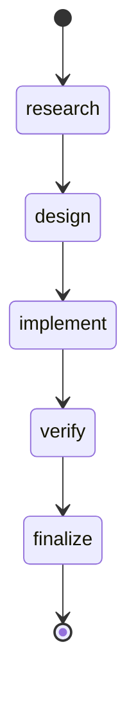
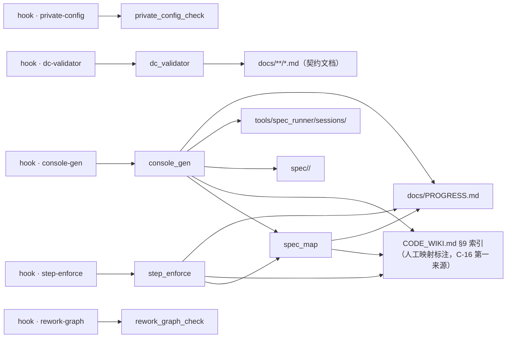

# CONSOLE｜项目控制台（派生视图）
<!-- GENERATED by scripts/console_gen.py —— 纯派生产物，请勿手改；重跑即刷新 -->
> 生成基准：源最大 ts = 2026-11-09T16:00:00+08:00；P 行 = 9；session = 9；feature = 9
> 状态词表 = PROGRESS 原词（I-7）；本视图不重贴标签，只补派生依据与行动档

## 当前状态（compact）
| 项 | 值 |
|---|---|
| 在册批次 | 9（done 9 · pending 0 · in-progress 0 · blocked 0） |
| 最近批次 | P-009 done（2026-11-09） |
| session 覆盖 | 9 个 P（最近 specwf-p009-arc-private-endpoint-hygiene · 2026-11-09T16:00:00+08:00） |
| 行动队列 | Needs Attention 0 · Ready to Verify 0 · Recommended 0 |
| feature 阶段 | 9（调研 0 · 设计 0 · 实施 0 · 验收 9 · 未启动 0） |

## ⚑ 需要你 / NEXT
**Needs Attention**（0 项）
> DoR：`blocked`；或执行态但无 session（决策链缺失） · DoD：阻塞解除（状态列改判）或决策链补齐（首个决策事件落盘）
（无）

**Ready to Verify**（0 项）
> DoR：最新轮含 gate exit 2（软性存疑）；或五步完整待收（最远 step = `finalize`） · DoD：新轮消解存疑（重跑 gate exit 0 或用户裁决）或收束（进已完成段）
（无）

**Recommended**（0 项）
> DoR：未开工（`pending` 且无决策流）；或推进中（最远 step 未到链尾） · DoD：推进至链尾（最远 step = `finalize`）或状态列改判（`blocked` / `done`）
（无）

## feature 视图（分组键）
| feature | 描述 | 制品链 R/D/I/C | 阶段 | 关联 P | 最远 step |
|---------|------|---------------|------|--------|----------|
| arc-b-station-endpoint | B 站 LLM 端点与 Claude Code 接入 | ✓✓✓✓ | 验收 | P-007 | finalize |
| arc-b-station-live | B 站端点 live 覆盖扩展 | ✓✓✓✓ | 验收 | P-008 | finalize |
| arc-g1-hardening | G-1 急救项落地依据 | ✓✓✓✓ | 验收 | P-006 | finalize |
| arc-private-endpoint-hygiene | 私有端点信息入库卫生 | ✓✓✓✓ | 验收 | P-009 | finalize |
| arc-roadmap-fix | 总纲审查结论的修复范围界定 | ✓✓✓✓ | 验收 | P-003 | finalize |
| arc-roadmap-gaps | 总纲完备度与执行盲区 | ✓✓✓✓ | 验收 | P-004 | finalize |
| arc-roadmap-review | ARC 总纲及关联调研文档审查 | ✓✓✓✓ | 验收 | P-002 | finalize |
| arc-roadmap-verdict | D-1/D-2 裁决依据确认 | ✓✓✓✓ | 验收 | P-005 | finalize |
| arc-spec-workflow-install | Spec_Workflow 与 Spec_Runner 接入 ARC | ✓✓✓✓ | 验收 | P-001 | finalize |

## 事项视图（卡片键 · 活动区上限 7）
（无——PROGRESS 无活动事项）

## 决策链状态机

各 step 到达数（由 sessions 决策链机械重数）：research 9 / design 9 / implement 9 / verify 9 / finalize 9

## 架构与流程

> 口径（RESEARCH C-12）：① `hook → script`（entry 直读）② `script → 真值源`（**显式架构契约**，Layer-0 声明于 DESIGN §6）③ `import` 边（`ast` 提取，**有则绘、无则不占位**）。
- **仓内 import 边**：`console_gen` → `spec_map`；`step_enforce` → `spec_map`
- **动态 import（字面量补提取）**：（无）
- **未声明关系的脚本（I-8 显式缺口）**：`plot_iteration_showcase`、`roadmap_coverage_check`、`test_beast_mode_e2e`、`test_code_agent_live`、`test_code_agent_sandbox`、`test_codegen_v2`、`spec_runner`
- **hook 链**（`.pre-commit-config.yaml` 直读）：

- **private-config** —— Private endpoint / credential guard
  - 命令：`python scripts/private_config_check.py`
  - 触发范围（`files` 正则）：`\.(py|yaml|yml|md|json|jsonl|txt|env)$`
  - 传入文件名（`pass_filenames`）：未设（pre-commit 默认「是」）
- **dc-validator** —— DC contract validator (DC1-DC5 + R7)
  - 命令：`python scripts/dc_validator.py`
  - 触发范围（`files` 正则）：`^(spec/.*\.md|docs/(PROGRESS|CONSOLE)\.md)$`
  - 传入文件名（`pass_filenames`）：未设（pre-commit 默认「是」）
- **step-enforce** —— Step decision-stream enforcement (PROGRESS + sessions)
  - 命令：`python scripts/step_enforce.py`
  - 触发范围（`files` 正则）：`^(spec/[a-z0-9-]+/(?:[A-Z0-9_]+_)?(?:RESEARCH|DESIGN|IMPLEMENTATION|CHECKLIST(?:_FUNC)?)\.md|tools/spec_runner/sessions/.*\.jsonl|docs/PROGRESS\.md)$`
  - 传入文件名（`pass_filenames`）：未设（pre-commit 默认「是」）
- **console-gen** —— Project console generator (derived view)
  - 命令：`python scripts/console_gen.py --stage`
  - 触发范围（`files` 正则）：`^(docs/PROGRESS\.md|tools/spec_runner/sessions/.*\.jsonl|spec/.*(?:RESEARCH|DESIGN|IMPLEMENTATION|CHECKLIST)\.md)$`
  - 传入文件名（`pass_filenames`）：否
- **rework-graph** —— Rework graph check
  - 命令：`python scripts/rework_graph_check.py`
  - 触发范围（`files` 正则）：`^docs/rework-graph\.json$`
  - 传入文件名（`pass_filenames`）：否

### per-feature 流程（默认折叠）
> **默认展示上方「项目级」架构与流程**；下列 per-feature 流程各自独立折叠，点击摘要行展开。交互形态 = Markdown 原生折叠元素（`details` / `summary`）+ 锚点跳转，**不含 Mermaid `click`**（C-10：默认 `strict` 禁用，`loose` 属 XSS 载体）。

锚点目录：[arc-b-station-endpoint](#feat-arc-b-station-endpoint) · [arc-b-station-live](#feat-arc-b-station-live) · [arc-g1-hardening](#feat-arc-g1-hardening) · [arc-private-endpoint-hygiene](#feat-arc-private-endpoint-hygiene) · [arc-roadmap-fix](#feat-arc-roadmap-fix) · [arc-roadmap-gaps](#feat-arc-roadmap-gaps) · [arc-roadmap-review](#feat-arc-roadmap-review) · [arc-roadmap-verdict](#feat-arc-roadmap-verdict) · [arc-spec-workflow-install](#feat-arc-spec-workflow-install)

<b>arc-b-station-endpoint</b> ｜ 验收 ｜ P-007

**派生状态**：`done` —— PROGRESS 状态列 = done

**步骤级动态描述**（C-14；来源 = 决策链事件流）：

| 步骤 | 制品 | 主题（本步做什么） | 创建时间 | 简要描述（本步结论） | 修改历史 |
|------|------|--------------------|---------|--------------------|---------|
| research | RESEARCH.md ✓ | 界定 B 站端点接入面与测试基座形态 | 2026-11-09 11:00 | P-007 = preset×2 + CLI choice 11 + env_extra 注入 … | #1 2026-11-09 |
| design | DESIGN.md ✓ | 设计四条不变量：默认零变化、占位 key、env 通用化、思考回退仅空 content | 2026-11-09 11:10 | DESIGN §2 七处改动面 + §3 双层测试策略 | #1 2026-11-09 |
| implement | IMPLEMENTATION.md ✓ | 落地接入与思考模型兼容修复 | 2026-11-09 11:30 | 7 处改动落地；空 content 缺口修复 | #1 2026-11-09 |
| verify | CHECKLIST.md ✓ | 离线 + live + 回归三层验证 | 2026-11-09 11:50 | V1/V2/V3 全部通过 | #1 2026-11-09 |
| finalize | —（finalize 不新增制品） | 登记 P-007 并收口 | 2026-11-09 12:00 | P-007 done；B 站端点与 Claude Code 接入入库 | #1 2026-11-09 |

**决策链**（sessions 机械重数）：research → design → implement → verify → finalize

<b>arc-b-station-live</b> ｜ 验收 ｜ P-008

**派生状态**：`done` —— PROGRESS 状态列 = done

**步骤级动态描述**（C-14；来源 = 决策链事件流）：

| 步骤 | 制品 | 主题（本步做什么） | 创建时间 | 简要描述（本步结论） | 修改历史 |
|------|------|--------------------|---------|--------------------|---------|
| research | RESEARCH.md ✓ | 确定 live 覆盖扩展的断言口径 | 2026-11-09 13:00 | 扩展 7 个 live + 1 个 cache 计费离线用例；修 usage 汇总 | #1 2026-11-09 |
| design | DESIGN.md ✓ | 设计结构性断言与双闸 skip 策略 | 2026-11-09 13:10 | DESIGN §2 七行用例矩阵 + §3 cache 汇总公式 | #1 2026-11-09 |
| implement | IMPLEMENTATION.md ✓ | 落地 8 个用例与适配器计费修复 | 2026-11-09 13:30 | 7 live + 1 离线 + adapter 修复落地 | #1 2026-11-09 |
| verify | CHECKLIST.md ✓ | 离线 + live + 回归三层验证 | 2026-11-09 13:50 | V1/V2/V3 全部通过 | #1 2026-11-09 |
| finalize | —（finalize 不新增制品） | 登记 P-008 并收口 | 2026-11-09 14:00 | P-008 done；B 站 live 覆盖 9 用例 | #1 2026-11-09 |

**决策链**（sessions 机械重数）：research → design → implement → verify → finalize

<b>arc-g1-hardening</b> ｜ 验收 ｜ P-006

**派生状态**：`done` —— PROGRESS 状态列 = done

**步骤级动态描述**（C-14；来源 = 决策链事件流）：

| 步骤 | 制品 | 主题（本步做什么） | 创建时间 | 简要描述（本步结论） | 修改历史 |
|------|------|--------------------|---------|--------------------|---------|
| research | RESEARCH.md ✓ | 确认 H-1..H-8 的真实缺口与 Q18/Q19/Q20 裁决依据 | 2026-11-08 14:00 | 裁决 Q18=A、Q19=A、Q20=A′；H-1..H-8 按修正后的落点实施 | #1 2026-11-08 |
| design | DESIGN.md ✓ | 设计最小改动面与测试先行策略 | 2026-11-08 14:10 | DESIGN §2 列出 11 个改动文件与 8 个测试文件 | #1 2026-11-08 |
| implement | IMPLEMENTATION.md ✓ | 落地 H-1..H-8 代码与 8 个测试文件 | 2026-11-08 14:30 | 11 个代码文件 + 8 个测试文件落地 | #1 2026-11-08 |
| verify | CHECKLIST.md ✓ | 运行新测试与既有回归 | 2026-11-08 14:50 | V1/V2/V3 全部通过；无新增回归 | #1 2026-11-08 |
| finalize | —（finalize 不新增制品） | 登记 P-006 并收口 | 2026-11-08 15:00 | P-006 done；H-1..H-8 与 Q19 代码入库 | #1 2026-11-08 |

**决策链**（sessions 机械重数）：research → design → implement → verify → finalize

<b>arc-private-endpoint-hygiene</b> ｜ 验收 ｜ P-009

**派生状态**：`done` —— PROGRESS 状态列 = done

**步骤级动态描述**（C-14；来源 = 决策链事件流）：

| 步骤 | 制品 | 主题（本步做什么） | 创建时间 | 简要描述（本步结论） | 修改历史 |
|------|------|--------------------|---------|--------------------|---------|
| research | RESEARCH.md ✓ | 盘点私有端点泄漏面并界定处理范围 | 2026-11-09 15:00 | 采纳 A0+A1+A2：清当前树、端点改配置/环境变量、加扫描门禁；历史不重写 | #1 2026-11-09 |
| design | DESIGN.md ✓ | 设计端点解析优先级与 fail-closed 门禁 | 2026-11-09 15:10 | DESIGN §1-§4 落定解析链、模板占位符、扫描规则与 gitignore | #1 2026-11-09 |
| implement | IMPLEMENTATION.md ✓ | 落地去地址、解析链、脚本与钩子 | 2026-11-09 15:30 | E-1..E-8 全部落地；扫描 0 违规 | #1 2026-11-09 |
| verify | CHECKLIST.md ✓ | 扫描、离线、live、回归四层验证 | 2026-11-09 15:50 | V1-V4 全部通过 | #1 2026-11-09 |
| finalize | —（finalize 不新增制品） | 登记 P-009 并收口 | 2026-11-09 16:00 | P-009 done；私有端点卫生门禁生效 | #1 2026-11-09 |

**决策链**（sessions 机械重数）：research → design → implement → verify → finalize

<b>arc-roadmap-fix</b> ｜ 验收 ｜ P-003

**派生状态**：`done` —— PROGRESS 状态列 = done

**步骤级动态描述**（C-14；来源 = 决策链事件流）：

| 步骤 | 制品 | 主题（本步做什么） | 创建时间 | 简要描述（本步结论） | 修改历史 |
|------|------|--------------------|---------|--------------------|---------|
| research | RESEARCH.md ✓ | 界定审查结论中哪些项在本批修复、哪些剔除 | 2026-11-06 14:00 | 本批修 P1-01/P1-02/P2-07/P3-01..03；P2-01 剔除为本地维护项；A… | #1 2026-11-06 |
| design | DESIGN.md ✓ | 设计 C 套件的生效语义与订正落点 | 2026-11-06 14:05 | 六处订正 D-1..D-6 定稿；C-9 生效起点 = G-1 | #1 2026-11-06 |
| implement | IMPLEMENTATION.md ✓ | 对 arc-master-roadmap.md 执行 E-1..E-8 | 2026-11-06 14:10 | roadmap 升为 v0.2；未触碰代码、未触碰已忽略的调研文档与 P-002 归档件 | #1 2026-11-06 |
| verify | CHECKLIST.md ✓ | 运行 V1..V6 六条机械判据 | 2026-11-06 14:15 | 全部退出码 0；106 计数不变；H-1..H-4 覆盖 4/4 | #1 2026-11-06 |
| finalize | —（finalize 不新增制品） | 收口 P-003 并声明后续约束 | 2026-11-06 14:20 | P-003 收口；总纲 v0.2 生效；待用户授权提交 | #1 2026-11-06 |

**决策链**（sessions 机械重数）：research → design → implement → verify → finalize

<b>arc-roadmap-gaps</b> ｜ 验收 ｜ P-004

**派生状态**：`done` —— PROGRESS 状态列 = done

**步骤级动态描述**（C-14；来源 = 决策链事件流）：

| 步骤 | 制品 | 主题（本步做什么） | 创建时间 | 简要描述（本步结论） | 修改历史 |
|------|------|--------------------|---------|--------------------|---------|
| research | RESEARCH.md ✓ | 界定盲区调研的边界：落档上一轮审计，还是直接改总纲 | 2026-11-07 10:00 | 本批定位为调研批次：产缺口-锚点-处置三件套，不改总纲、不改代码 | #1 2026-11-07 |
| design | DESIGN.md ✓ | 设计产出结构：补全方案是否在本批执行 | 2026-11-07 10:10 | D-1..D-7 写入 DESIGN §3；本批交付边界锁定为文档 | #1 2026-11-07 |
| implement | IMPLEMENTATION.md ✓ | 写入四文档与 12 项外部锚点 | 2026-11-07 10:20 | RESEARCH/DESIGN/IMPLEMENTATION/CHECKLIST 四文档写入；1… | #1 2026-11-07 |
| verify | CHECKLIST.md ✓ | 机检与事实复核 | 2026-11-07 10:30 | V1-V5 全部通过；CHECKLIST 四节勾选 | #1 2026-11-07 |
| finalize | —（finalize 不新增制品） | 登记 P-004 并收口 | 2026-11-07 10:40 | P-004 done；本批不触发任何阶段开工 | #1 2026-11-07 |

**决策链**（sessions 机械重数）：research → design → implement → verify → finalize

<b>arc-roadmap-review</b> ｜ 验收 ｜ P-002

**派生状态**：`done` —— PROGRESS 状态列 = done

**步骤级动态描述**（C-14；来源 = 决策链事件流）：

| 步骤 | 制品 | 主题（本步做什么） | 创建时间 | 简要描述（本步结论） | 修改历史 |
|------|------|--------------------|---------|--------------------|---------|
| research | RESEARCH.md ✓ | 审查 ARC 总纲及 14 份关联文档的事实底座、外部引用与依赖闭合 | 2026-11-06 15:10 | 确认事实底座可信，同时定位 H-4 已落地矛盾与 C 套件覆盖缺口 | #1 2026-11-06 |
| design | DESIGN.md ✓ | 定义审查的规则映射、E1-E5 取证矩阵与 P1/P2/P3 分级 | 2026-11-06 15:12 | 形成 DESIGN.md 的规则映射表、取证矩阵与边界声明 | #1 2026-11-06 |
| implement | IMPLEMENTATION.md ✓ | 落地可重放取证命令与产出清单 | 2026-11-06 15:14 | IMPLEMENTATION.md 记录 8 组 rg 命令、2 组源数据直读命令与未执行项 | #1 2026-11-06 |
| verify | CHECKLIST.md ✓ | 核对覆盖完整性、规则合规与机检结果 | 2026-11-06 15:16 | CHECKLIST 全部通过，审查报告可归档 | #1 2026-11-06 |
| finalize | —（finalize 不新增制品） | 归档审查报告并登记 P-002 | 2026-11-06 15:18 | P-002 归档完成，不修改被审文档 | #1 2026-11-06 |

**决策链**（sessions 机械重数）：research → design → implement → verify → finalize

<b>arc-roadmap-verdict</b> ｜ 验收 ｜ P-005

**派生状态**：`done` —— PROGRESS 状态列 = done

**步骤级动态描述**（C-14；来源 = 决策链事件流）：

| 步骤 | 制品 | 主题（本步做什么） | 创建时间 | 简要描述（本步结论） | 修改历史 |
|------|------|--------------------|---------|--------------------|---------|
| research | RESEARCH.md ✓ | 确认 D-1/D-2 裁决依据并界定执行批次范围 | 2026-11-08 10:00 | 批次 = 总纲 v0.4（E-01..E-14）+ 覆盖率脚本与 CI（E-15/E-16） | #1 2026-11-08 |
| design | DESIGN.md ✓ | 设计编辑图与三条不变量 | 2026-11-08 10:10 | DESIGN §2 给出 E-01..E-16 编辑图 | #1 2026-11-08 |
| implement | IMPLEMENTATION.md ✓ | 执行总纲 16 处编辑、覆盖率脚本与 CI job | 2026-11-08 10:30 | E-01..E-16 全部落地；roadmap_coverage_check 诊断模式输出 ac… | #1 2026-11-08 |
| verify | CHECKLIST.md ✓ | 六项机检与勘误登记 | 2026-11-08 10:40 | V1-V6 全部通过；勘误表落在 IMPLEMENTATION §3 | #1 2026-11-08 |
| finalize | —（finalize 不新增制品） | 登记 P-005 并收口 | 2026-11-08 10:50 | P-005 done；总纲 v0.4 随本批提交 | #1 2026-11-08 |

**决策链**（sessions 机械重数）：research → design → implement → verify → finalize

<b>arc-spec-workflow-install</b> ｜ 验收 ｜ P-001

**派生状态**：`done` —— PROGRESS 状态列 = done

**步骤级动态描述**（C-14；来源 = 决策链事件流）：

| 步骤 | 制品 | 主题（本步做什么） | 创建时间 | 简要描述（本步结论） | 修改历史 |
|------|------|--------------------|---------|--------------------|---------|
| research | RESEARCH.md ✓ | 评估 Spec_Workflow 与 Spec_Runner 是否能无修改接入 ARC | 2026-11-06 09:00 | 接入可行；采用 v1.11.0 为唯一引擎；m7/repo/blackbox 三道钩子因无载体登… | #1 2026-11-06 |
| design | DESIGN.md ✓ | 确定 ARC 的 Layer-0 资产与 Layer-1 门禁集合 | 2026-11-06 09:05 | 设计确定：5 道激活 + 3 道 deferred；session 命名沿用 specwf-pN… | #1 2026-11-06 |
| implement | IMPLEMENTATION.md ✓ | 复制框架文件并创建 ARC 侧载体 | 2026-11-06 09:10 | 文件已落盘；未修改任何框架源码 | #1 2026-11-06 |
| verify | CHECKLIST.md ✓ | 运行五类门禁与 runner 自测 | 2026-11-06 09:15 | 验证结果记录在 CHECKLIST §2；未通过项必须修复后重跑 | #1 2026-11-06 |
| finalize | —（finalize 不新增制品） | 收口 P-001 并声明后续批次强制规则 | 2026-11-06 09:20 | P-001 收口；Spec_Workflow 成为 ARC 后续开发的强制流程 | #1 2026-11-06 |

**决策链**（sessions 机械重数）：research → design → implement → verify → finalize

## 追溯覆盖
- 活动事项 0 / 有 session 0 / 五步完整 0
- 决策链缺失：无
- 未开工（立项已登记，无决策流）：无
- **缺映射（I-8 显式缺口）**：（无——9 个 feature 全部有映射）
- 证据账本与三通道真值不在此复制（I-6 不增真值）：[M7 证据账本](./M7_EVIDENCE_LOG.md)（由 `scripts/m7_stats.py` 看护）；契约/命名空间/视图层对账见 `scripts/dc_validator.py` + `scripts/repo_stats.py`

## ✅ 已完成（最近 8 条）
| P | 事项 | 最远 step | 上次事件 | 优先级 |
|---|------|----------|---------|--------|
| P-002 | 审查 ARC 总纲及 14 份关联文档的事实底座、引用可信度与路线可行性 | finalize | 2026-11-06 | P0 |
| P-003 | 按审查结论订正总纲至 v0.2（H-4 前提、C-9 与生效起点、A2-3 口径、钩子数） | finalize | 2026-11-06 | P0 |
| P-004 | 落档总纲完备度审计，产出 12 项外部锚点与 7 项补全方案（未执行） | finalize | 2026-11-07 | P1 |
| P-005 | 裁决落地：总纲 v0.4（D-1=A、D-2=C）+ D-3..D-7 + 覆盖率 CI 门禁 | finalize | 2026-11-08 | P0 |
| P-006 | G-1 急救落地：Q18/Q19/Q20 裁决 + H-1..H-8 代码与 8 个测试 | finalize | 2026-11-08 | P0 |
| P-007 | B 站（集群节点 B）LLM 端点与 Claude Code 接入（preset×2 + CLI 菜单 + env 注入 + 思考模型兼容修复） | finalize | 2026-11-09 | P1 |
| P-008 | B 站 live 覆盖扩展（health/JSON/系统提示/多轮/用量/preflight）+ Anthropic cache 计费修复 | finalize | 2026-11-09 | P2 |
| P-009 | 私有端点卫生：清私网地址、端点改配置/环境变量、新增泄漏扫描门禁 | finalize | 2026-11-09 | P1 |
| … | **另有 1 条已完成折叠** | — | — | — |

## ⑂ fork / 支线
- 本地分支属**环境态**，不纳入派生视图（保证跨环境可复现；P-070 追加轮方案 A）
- 回写支线真值源见 `docs/rework-graph.json`
- 登记返工支线：（无）
