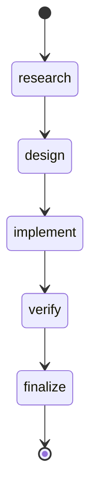
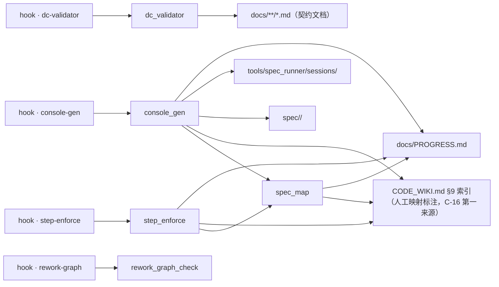

# CONSOLE｜项目控制台（派生视图）
<!-- GENERATED by scripts/console_gen.py —— 纯派生产物，请勿手改；重跑即刷新 -->
> 生成基准：源最大 ts = 2026-11-06T09:20:00+08:00；P 行 = 1；session = 1；feature = 1
> 状态词表 = PROGRESS 原词（I-7）；本视图不重贴标签，只补派生依据与行动档

## 当前状态（compact）
| 项 | 值 |
|---|---|
| 在册批次 | 1（done 1 · pending 0 · in-progress 0 · blocked 0） |
| 最近批次 | P-001 done（2026-11-06） |
| session 覆盖 | 1 个 P（最近 specwf-p001-arc-bootstrap-20261106 · 2026-11-06T09:20:00+08:00） |
| 行动队列 | Needs Attention 0 · Ready to Verify 0 · Recommended 0 |
| feature 阶段 | 1（调研 0 · 设计 0 · 实施 0 · 验收 1 · 未启动 0） |

## ⚑ 需要你 / NEXT
**Needs Attention**（0 项）
> DoR：`blocked`；或执行态但无 session（决策链缺失） · DoD：阻塞解除（状态列改判）或决策链补齐（首个决策事件落盘）
（无）

**Ready to Verify**（0 项）
> DoR：最新轮含 gate exit 2（软性存疑）；或五步完整待收（最远 step = `finalize`） · DoD：新轮消解存疑（重跑 gate exit 0 或用户裁决）或收束（进已完成段）
（无）

**Recommended**（0 项）
> DoR：未开工（`pending` 且无决策流）；或推进中（最远 step 未到链尾） · DoD：推进至链尾（最远 step = `finalize`）或状态列改判（`blocked` / `done`）
（无）

## feature 视图（分组键）
| feature | 描述 | 制品链 R/D/I/C | 阶段 | 关联 P | 最远 step |
|---------|------|---------------|------|--------|----------|
| arc-spec-workflow-install | Spec_Workflow 与 Spec_Runner 接入 ARC | ✓✓✓✓ | 验收 | P-001 | finalize |

## 事项视图（卡片键 · 活动区上限 7）
（无——PROGRESS 无活动事项）

## 决策链状态机

各 step 到达数（由 sessions 决策链机械重数）：research 1 / design 1 / implement 1 / verify 1 / finalize 1

## 架构与流程

> 口径（RESEARCH C-12）：① `hook → script`（entry 直读）② `script → 真值源`（**显式架构契约**，Layer-0 声明于 DESIGN §6）③ `import` 边（`ast` 提取，**有则绘、无则不占位**）。
- **仓内 import 边**：`console_gen` → `spec_map`；`step_enforce` → `spec_map`
- **动态 import（字面量补提取）**：（无）
- **未声明关系的脚本（I-8 显式缺口）**：`plot_iteration_showcase`、`test_beast_mode_e2e`、`test_code_agent_live`、`test_code_agent_sandbox`、`test_codegen_v2`、`spec_runner`
- **hook 链**（`.pre-commit-config.yaml` 直读）：

- **dc-validator** —— DC contract validator (DC1-DC5 + R7)
  - 命令：`python scripts/dc_validator.py`
  - 触发范围（`files` 正则）：`^(spec/.*\.md|docs/(PROGRESS|CONSOLE)\.md)$`
  - 传入文件名（`pass_filenames`）：未设（pre-commit 默认「是」）
- **step-enforce** —— Step decision-stream enforcement (PROGRESS + sessions)
  - 命令：`python scripts/step_enforce.py`
  - 触发范围（`files` 正则）：`^(spec/[a-z0-9-]+/(?:[A-Z0-9_]+_)?(?:RESEARCH|DESIGN|IMPLEMENTATION|CHECKLIST(?:_FUNC)?)\.md|tools/spec_runner/sessions/.*\.jsonl|docs/PROGRESS\.md)$`
  - 传入文件名（`pass_filenames`）：未设（pre-commit 默认「是」）
- **console-gen** —— Project console generator (derived view)
  - 命令：`python scripts/console_gen.py --stage`
  - 触发范围（`files` 正则）：`^(docs/PROGRESS\.md|tools/spec_runner/sessions/.*\.jsonl|spec/.*(?:RESEARCH|DESIGN|IMPLEMENTATION|CHECKLIST)\.md)$`
  - 传入文件名（`pass_filenames`）：否
- **rework-graph** —— Rework graph check
  - 命令：`python scripts/rework_graph_check.py`
  - 触发范围（`files` 正则）：`^docs/rework-graph\.json$`
  - 传入文件名（`pass_filenames`）：否

### per-feature 流程（默认折叠）
> **默认展示上方「项目级」架构与流程**；下列 per-feature 流程各自独立折叠，点击摘要行展开。交互形态 = Markdown 原生折叠元素（`details` / `summary`）+ 锚点跳转，**不含 Mermaid `click`**（C-10：默认 `strict` 禁用，`loose` 属 XSS 载体）。

锚点目录：[arc-spec-workflow-install](#feat-arc-spec-workflow-install)

<b>arc-spec-workflow-install</b> ｜ 验收 ｜ P-001

**派生状态**：`done` —— PROGRESS 状态列 = done

**步骤级动态描述**（C-14；来源 = 决策链事件流）：

| 步骤 | 制品 | 主题（本步做什么） | 创建时间 | 简要描述（本步结论） | 修改历史 |
|------|------|--------------------|---------|--------------------|---------|
| research | RESEARCH.md ✓ | 评估 Spec_Workflow 与 Spec_Runner 是否能无修改接入 ARC | 2026-11-06 09:00 | 接入可行；采用 v1.11.0 为唯一引擎；m7/repo/blackbox 三道钩子因无载体登… | #1 2026-11-06 |
| design | DESIGN.md ✓ | 确定 ARC 的 Layer-0 资产与 Layer-1 门禁集合 | 2026-11-06 09:05 | 设计确定：5 道激活 + 3 道 deferred；session 命名沿用 specwf-pN… | #1 2026-11-06 |
| implement | IMPLEMENTATION.md ✓ | 复制框架文件并创建 ARC 侧载体 | 2026-11-06 09:10 | 文件已落盘；未修改任何框架源码 | #1 2026-11-06 |
| verify | CHECKLIST.md ✓ | 运行五类门禁与 runner 自测 | 2026-11-06 09:15 | 验证结果记录在 CHECKLIST §2；未通过项必须修复后重跑 | #1 2026-11-06 |
| finalize | —（finalize 不新增制品） | 收口 P-001 并声明后续批次强制规则 | 2026-11-06 09:20 | P-001 收口；Spec_Workflow 成为 ARC 后续开发的强制流程 | #1 2026-11-06 |

**决策链**（sessions 机械重数）：research → design → implement → verify → finalize

## 追溯覆盖
- 活动事项 0 / 有 session 0 / 五步完整 0
- 决策链缺失：无
- 未开工（立项已登记，无决策流）：无
- **缺映射（I-8 显式缺口）**：（无——1 个 feature 全部有映射）
- 证据账本与三通道真值不在此复制（I-6 不增真值）：[M7 证据账本](./M7_EVIDENCE_LOG.md)（由 `scripts/m7_stats.py` 看护）；契约/命名空间/视图层对账见 `scripts/dc_validator.py` + `scripts/repo_stats.py`

## ✅ 已完成（最近 8 条）
| P | 事项 | 最远 step | 上次事件 | 优先级 |
|---|------|----------|---------|--------|
| P-001 | 安装 Spec_Workflow + Spec_Runner，接入 ARC 并启用门禁 | finalize | 2026-11-06 | P0 |

## ⑂ fork / 支线
- 本地分支属**环境态**，不纳入派生视图（保证跨环境可复现；P-070 追加轮方案 A）
- 回写支线真值源见 `docs/rework-graph.json`
- 登记返工支线：（无）
