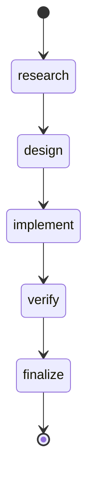
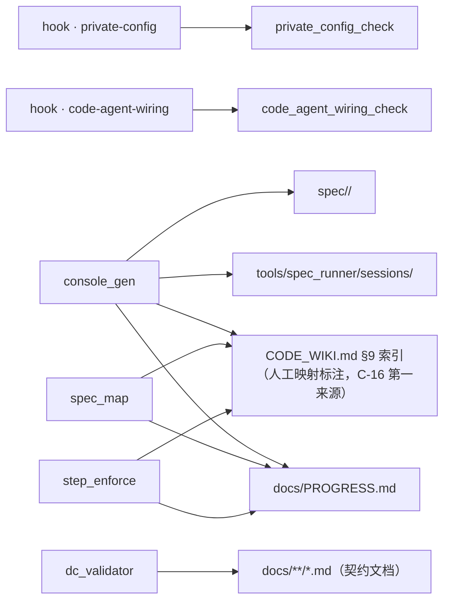

# CONSOLE｜项目控制台（派生视图）
<!-- GENERATED by scripts/console_gen.py —— 纯派生产物，请勿手改；重跑即刷新 -->
> 生成基准：源最大 ts = 2026-11-11T16:40:00+08:00；P 行 = 45；session = 45；feature = 34
> 状态词表 = PROGRESS 原词（I-7）；本视图不重贴标签，只补派生依据与行动档

## 当前状态（compact）
| 项 | 值 |
|---|---|
| 在册批次 | 45（done 45 · pending 0 · in-progress 0 · blocked 0） |
| 最近批次 | P-045 done（2026-11-11） |
| session 覆盖 | 45 个 P（最近 specwf-p036-arc-g1c-frontend-closure · 2026-11-11T16:40:00+08:00） |
| 行动队列 | Needs Attention 0 · Ready to Verify 0 · Recommended 0 |
| feature 阶段 | 34（调研 4 · 设计 0 · 实施 0 · 验收 30 · 未启动 0） |

## ⚑ 需要你 / NEXT
**Needs Attention**（0 项）
> DoR：`blocked`；或执行态但无 session（决策链缺失） · DoD：阻塞解除（状态列改判）或决策链补齐（首个决策事件落盘）
（无）

**Ready to Verify**（0 项）
> DoR：最新轮含 gate exit 2（软性存疑）；或五步完整待收（最远 step = `finalize`） · DoD：新轮消解存疑（重跑 gate exit 0 或用户裁决）或收束（进已完成段）
（无）

**Recommended**（0 项）
> DoR：未开工（`pending` 且无决策流）；或推进中（最远 step 未到链尾） · DoD：推进至链尾（最远 step = `finalize`）或状态列改判（`blocked` / `done`）
（无）

## feature 视图（分组键）
| feature | 描述 | 制品链 R/D/I/C | 阶段 | 关联 P | 最远 step |
|---------|------|---------------|------|--------|----------|
| arc-a1-9-session-resume | A1-9 attempt 级会话续接的接线条件 | ✓✓✓✓ | 验收 | P-037 | finalize |
| arc-b-station-endpoint | B 站 LLM 端点与 Claude Code 接入 | ✓✓✓✓ | 验收 | P-007 | finalize |
| arc-b-station-live | B 站端点 live 覆盖扩展 | ✓✓✓✓ | 验收 | P-008 | finalize |
| arc-belief-revision-propagation | 想法被推翻的回写/回退，与外部信息注入的多步传播 | ✓✓✓✓ | 验收 | P-014 | finalize |
| arc-cli-agent-followups | CLI 代理未决项收口与前移 | ✓✓✓✓ | 验收 | P-013 | finalize |
| arc-cli-agent-seam | R-3 统一接缝的实施输入 | ✓✓✓✓ | 验收 | P-012 | finalize |
| arc-cli-agent-wiring | CLI 代码代理接线断裂 | ✓✓✓✓ | 验收 | P-011 | finalize |
| arc-g0b-governance-base | G0b 完整治理基座的可落地路径 | ✓✓✓✓ | 验收 | P-017 | finalize |
| arc-g0b-implementation | G0b 实施前的现状复核与设计前提 | ✓✓✓✓ | 验收 | P-021 | finalize |
| arc-g1-closeout | G1 遗留收口 | ✓✓✓✓ | 验收 | P-033 | finalize |
| arc-g1-hardening | G-1 急救项落地依据 | ✓✓✓✓ | 验收 | P-006 | finalize |
| arc-g1-readiness-research | G1 前置决策 Q5（事件后端）与 Q9 | ✓✓✓✓ | 验收 | P-022 | finalize |
| arc-g1-residual-analysis | G1 两项「外部条件」遗留的目的与可解性 | ✓——— | 调研 | P-035 | finalize |
| arc-g1-review-fixes | G1 异基座复审三缺陷的复现与修法边界 | ✓✓✓✓ | 验收 | P-040 | finalize |
| arc-g1a-event-core | G1a 事件内核的实施前提 | ✓✓✓✓ | 验收 | P-027 | finalize |
| arc-g1b-implementation | G1b 实施前的三缺口解决方案 | ✓✓✓✓ | 验收 | P-029 | finalize |
| arc-g1b-supervisor-protocol | G1b 自愈与协议面 | ✓✓✓✓ | 验收 | P-028 | finalize |
| arc-g1c-event-protocol | 事件协议面（A1-2）的实施前提 | ✓✓✓✓ | 验收 | P-031 | finalize |
| arc-g1c-frontend-closure | P-031 前端联调闭环条件 | ✓✓✓✓ | 验收 | P-036 | finalize |
| arc-g2-decisions | G2 前置 Q1（证据内核形态）/ Q2（vendor 边界）裁决 | ✓——— | 调研 | P-044 | finalize |
| arc-g2-py311-env | G2 的 Python 3.11 隔离环境与沙箱兼容性 | ✓——— | 调研 | P-045 | finalize |
| arc-history-scrub | 历史提交脱敏 | ✓✓✓✓ | 验收 | P-010 | finalize |
| arc-private-endpoint-hygiene | 私有端点信息入库卫生 | ✓✓✓✓ | 验收 | P-009 | finalize |
| arc-q3-grandfather-policy | Q3“touch = migrate”与存量 grandfather 策略 | ✓✓✓✓ | 验收 | P-019 | finalize |
| arc-q5-decision-method | Q5 的决策方法 | ✓——— | 调研 | P-025 | finalize |
| arc-r3-engine-impact | R-3 重型方案的影响面与可控性 | ✓✓✓✓ | 验收 | P-015 | finalize |
| arc-roadmap-fix | 总纲审查结论的修复范围界定 | ✓✓✓✓ | 验收 | P-003 | finalize |
| arc-roadmap-gaps | 总纲完备度与执行盲区 | ✓✓✓✓ | 验收 | P-004 | finalize |
| arc-roadmap-review | ARC 总纲及关联调研文档审查 | ✓✓✓✓ | 验收 | P-002 | finalize |
| arc-roadmap-v06 | 总纲 v0.6 状态同步的必要性 | ✓✓✓✓ | 验收 | P-016 | finalize |
| arc-roadmap-v07 | 总纲 v0.7 纳入 G0b 调研结论 | ✓✓✓✓ | 验收 | P-018 | finalize |
| arc-roadmap-verdict | D-1/D-2 裁决依据确认 | ✓✓✓✓ | 验收 | P-005 | finalize |
| arc-spec-workflow-install | Spec_Workflow 与 Spec_Runner 接入 ARC | ✓✓✓✓ | 验收 | P-001 | finalize |
| arc-step-enforce-branch-consistency | step_enforce 两分支的 feature 绑定门槛不一致 | ✓✓✓✓ | 验收 | P-024 | finalize |

## 事项视图（卡片键 · 活动区上限 7）
（无——PROGRESS 无活动事项）

## 决策链状态机


各 step 到达数（由 sessions 决策链机械重数）：research 45 / design 45 / implement 45 / verify 45 / finalize 45

## 架构与流程


> 口径（RESEARCH C-12）：① `hook → script`（entry 直读）② `script → 真值源`（**显式架构契约**，Layer-0 声明于 DESIGN §6）③ `import` 边（`ast` 提取，**有则绘、无则不占位**）。
- **仓内 import 边**：（无仓内 import 边）
- **动态 import（字面量补提取）**：（无）
- **未声明关系的脚本（I-8 显式缺口）**：`plot_iteration_showcase`、`rework_graph_check`、`roadmap_coverage_check`、`test_beast_mode_e2e`、`test_code_agent_live`、`test_code_agent_sandbox`、`test_codegen_v2`、`spec_runner`
- **hook 链**（`.pre-commit-config.yaml` 直读）：

- **dc-validator** —— DC contract validator (DC1-DC5 + R7, grandfather policy)
  - 命令：`python scripts/spec/grandfather_gate.py`
  - 触发范围（`files` 正则）：`^(spec/.*\.md|docs/(PROGRESS|CONSOLE)\.md)$`
  - 传入文件名（`pass_filenames`）：未设（pre-commit 默认「是」）
- **m7-stats** —— M7 evidence ledger structure guard
  - 命令：`python scripts/spec/m7_stats.py`
  - 触发范围（`files` 正则）：`^docs/M7_EVIDENCE_LOG\.md$`
  - 传入文件名（`pass_filenames`）：否
- **repo-stats** —— Repo stats derived-view guard
  - 命令：`python scripts/spec/repo_stats.py --check`
  - 触发范围（`files` 正则）：`^(docs/(REPO_STATS|PROGRESS)\.md|researchclaw/.*\.py|tests/.*\.py)$`
  - 传入文件名（`pass_filenames`）：否
- **step-enforce** —— Step decision-stream enforcement (PROGRESS + sessions)
  - 命令：`python scripts/spec/step_enforce.py`
  - 触发范围（`files` 正则）：`^(spec/[a-z0-9-]+/(?:[A-Z0-9_]+_)?(?:RESEARCH|DESIGN|IMPLEMENTATION|CHECKLIST(?:_FUNC)?)\.md|tools/spec_runner/sessions/.*\.jsonl|docs/PROGRESS\.md)$`
  - 传入文件名（`pass_filenames`）：未设（pre-commit 默认「是」）
- **console-gen** —— Project console generator (derived view)
  - 命令：`python scripts/spec/console_gen.py --stage`
  - 触发范围（`files` 正则）：`^(docs/PROGRESS\.md|tools/spec_runner/sessions/.*\.jsonl|spec/.*(?:RESEARCH|DESIGN|IMPLEMENTATION|CHECKLIST)\.md)$`
  - 传入文件名（`pass_filenames`）：否
- **blackbox-check** —— CLI blackbox smoke (python -m researchclaw --help)
  - 命令：`python scripts/spec/blackbox_check.py`
  - 触发范围（`files` 正则）：`^(researchclaw/.*\.py|pyproject\.toml)$`
  - 传入文件名（`pass_filenames`）：否
- **private-config** —— Private endpoint / credential guard
  - 命令：`python scripts/private_config_check.py`
  - 触发范围（`files` 正则）：`\.(py|yaml|yml|md|json|jsonl|txt|env)$`
  - 传入文件名（`pass_filenames`）：未设（pre-commit 默认「是」）
- **code-agent-wiring** —— CLI code agent wiring / transport guard
  - 命令：`python scripts/code_agent_wiring_check.py`
  - 触发范围（`files` 正则）：`^(researchclaw/(config|health)\.py|researchclaw/experiment/code_agent\.py|researchclaw/pipeline/(code_agent|stage_impls/_code_generation|stage_impls/_execution)\.py|scripts/code_agent_wiring_check\.py)$`
  - 传入文件名（`pass_filenames`）：否
- **rework-graph** —— Rework graph check
  - 命令：`python scripts/spec/rework_graph_check.py`
  - 触发范围（`files` 正则）：`^docs/rework-graph\.json$`
  - 传入文件名（`pass_filenames`）：否

### per-feature 流程（默认折叠）
> **默认展示上方「项目级」架构与流程**；下列 per-feature 流程各自独立折叠，点击摘要行展开。交互形态 = Markdown 原生折叠元素（`details` / `summary`）+ 锚点跳转，**不含 Mermaid `click`**（C-10：默认 `strict` 禁用，`loose` 属 XSS 载体）。

锚点目录：[arc-a1-9-session-resume](#feat-arc-a1-9-session-resume) · [arc-b-station-endpoint](#feat-arc-b-station-endpoint) · [arc-b-station-live](#feat-arc-b-station-live) · [arc-belief-revision-propagation](#feat-arc-belief-revision-propagation) · [arc-cli-agent-followups](#feat-arc-cli-agent-followups) · [arc-cli-agent-seam](#feat-arc-cli-agent-seam) · [arc-cli-agent-wiring](#feat-arc-cli-agent-wiring) · [arc-g0b-governance-base](#feat-arc-g0b-governance-base) · [arc-g0b-implementation](#feat-arc-g0b-implementation) · [arc-g1-closeout](#feat-arc-g1-closeout) · [arc-g1-hardening](#feat-arc-g1-hardening) · [arc-g1-readiness-research](#feat-arc-g1-readiness-research) · [arc-g1-residual-analysis](#feat-arc-g1-residual-analysis) · [arc-g1-review-fixes](#feat-arc-g1-review-fixes) · [arc-g1a-event-core](#feat-arc-g1a-event-core) · [arc-g1b-implementation](#feat-arc-g1b-implementation) · [arc-g1b-supervisor-protocol](#feat-arc-g1b-supervisor-protocol) · [arc-g1c-event-protocol](#feat-arc-g1c-event-protocol) · [arc-g1c-frontend-closure](#feat-arc-g1c-frontend-closure) · [arc-g2-decisions](#feat-arc-g2-decisions) · [arc-g2-py311-env](#feat-arc-g2-py311-env) · [arc-history-scrub](#feat-arc-history-scrub) · [arc-private-endpoint-hygiene](#feat-arc-private-endpoint-hygiene) · [arc-q3-grandfather-policy](#feat-arc-q3-grandfather-policy) · [arc-q5-decision-method](#feat-arc-q5-decision-method) · [arc-r3-engine-impact](#feat-arc-r3-engine-impact) · [arc-roadmap-fix](#feat-arc-roadmap-fix) · [arc-roadmap-gaps](#feat-arc-roadmap-gaps) · [arc-roadmap-review](#feat-arc-roadmap-review) · [arc-roadmap-v06](#feat-arc-roadmap-v06) · [arc-roadmap-v07](#feat-arc-roadmap-v07) · [arc-roadmap-verdict](#feat-arc-roadmap-verdict) · [arc-spec-workflow-install](#feat-arc-spec-workflow-install) · [arc-step-enforce-branch-consistency](#feat-arc-step-enforce-branch-consistency)

<a name="feat-arc-a1-9-session-resume" id="feat-arc-a1-9-session-resume"></a>
<details>
<summary><b>arc-a1-9-session-resume</b> ｜ 验收 ｜ P-037</summary>

**派生状态**：`done` —— PROGRESS 状态列 = done


**步骤级动态描述**（C-14；来源 = 决策链事件流）：

| 步骤 | 制品 | 主题（本步做什么） | 创建时间 | 简要描述（本步结论） | 修改历史 |
|------|------|--------------------|---------|--------------------|---------|
| research | RESEARCH.md ✓ | 核对 A1-9 接线缺口与 CLI 能力 | 2026-11-10 18:05 | 方案 A 成立；边界为跨机不可续接、C 站未测 | #1 2026-11-10 |
| design | DESIGN.md ✓ | 定义会话 id、重试策略与真值来源 | 2026-11-10 18:10 | D-1..D-6 与验收映射 | #1 2026-11-10 |
| implement | IMPLEMENTATION.md ✓ | 接线 Stage 10/13 与 attempt 记录 | 2026-11-10 18:25 | 6 文件改动；旧白名单测试按新能力改写 | #1 2026-11-10 |
| verify | CHECKLIST.md ✓ | 单测、回归与全量 | 2026-11-10 18:40 | V1-V5 通过，U-1 部分关闭 | #1 2026-11-10 |
| finalize | —（finalize 不新增制品） | 登记 P-037，更新 G1 状态 | 2026-11-10 18:45 | A1-9 接线完成（跨机仍显式降级） | #1 2026-11-10 |

**决策链**（sessions 机械重数）：research → design → implement → verify → finalize

</details>

<a name="feat-arc-b-station-endpoint" id="feat-arc-b-station-endpoint"></a>
<details>
<summary><b>arc-b-station-endpoint</b> ｜ 验收 ｜ P-007</summary>

**派生状态**：`done` —— PROGRESS 状态列 = done


**步骤级动态描述**（C-14；来源 = 决策链事件流）：

| 步骤 | 制品 | 主题（本步做什么） | 创建时间 | 简要描述（本步结论） | 修改历史 |
|------|------|--------------------|---------|--------------------|---------|
| research | RESEARCH.md ✓ | 界定 B 站端点接入面与测试基座形态 | 2026-11-09 11:00 | P-007 = preset×2 + CLI choice 11 + env_extra 注入 … | #1 2026-11-09 |
| design | DESIGN.md ✓ | 设计四条不变量：默认零变化、占位 key、env 通用化、思考回退仅空 content | 2026-11-09 11:10 | DESIGN §2 七处改动面 + §3 双层测试策略 | #1 2026-11-09 |
| implement | IMPLEMENTATION.md ✓ | 落地接入与思考模型兼容修复 | 2026-11-09 11:30 | 7 处改动落地；空 content 缺口修复 | #1 2026-11-09 |
| verify | CHECKLIST.md ✓ | 离线 + live + 回归三层验证 | 2026-11-09 11:50 | V1/V2/V3 全部通过 | #1 2026-11-09 |
| finalize | —（finalize 不新增制品） | 登记 P-007 并收口 | 2026-11-09 12:00 | P-007 done；B 站端点与 Claude Code 接入入库 | #1 2026-11-09 |

**决策链**（sessions 机械重数）：research → design → implement → verify → finalize

</details>

<a name="feat-arc-b-station-live" id="feat-arc-b-station-live"></a>
<details>
<summary><b>arc-b-station-live</b> ｜ 验收 ｜ P-008</summary>

**派生状态**：`done` —— PROGRESS 状态列 = done


**步骤级动态描述**（C-14；来源 = 决策链事件流）：

| 步骤 | 制品 | 主题（本步做什么） | 创建时间 | 简要描述（本步结论） | 修改历史 |
|------|------|--------------------|---------|--------------------|---------|
| research | RESEARCH.md ✓ | 确定 live 覆盖扩展的断言口径 | 2026-11-09 13:00 | 扩展 7 个 live + 1 个 cache 计费离线用例；修 usage 汇总 | #1 2026-11-09 |
| design | DESIGN.md ✓ | 设计结构性断言与双闸 skip 策略 | 2026-11-09 13:10 | DESIGN §2 七行用例矩阵 + §3 cache 汇总公式 | #1 2026-11-09 |
| implement | IMPLEMENTATION.md ✓ | 落地 8 个用例与适配器计费修复 | 2026-11-09 13:30 | 7 live + 1 离线 + adapter 修复落地 | #1 2026-11-09 |
| verify | CHECKLIST.md ✓ | 离线 + live + 回归三层验证 | 2026-11-09 13:50 | V1/V2/V3 全部通过 | #1 2026-11-09 |
| finalize | —（finalize 不新增制品） | 登记 P-008 并收口 | 2026-11-09 14:00 | P-008 done；B 站 live 覆盖 9 用例 | #1 2026-11-09 |

**决策链**（sessions 机械重数）：research → design → implement → verify → finalize

</details>

<a name="feat-arc-belief-revision-propagation" id="feat-arc-belief-revision-propagation"></a>
<details>
<summary><b>arc-belief-revision-propagation</b> ｜ 验收 ｜ P-014</summary>

**派生状态**：`done` —— PROGRESS 状态列 = done


**步骤级动态描述**（C-14；来源 = 决策链事件流）：

| 步骤 | 制品 | 主题（本步做什么） | 创建时间 | 简要描述（本步结论） | 修改历史 |
|------|------|--------------------|---------|--------------------|---------|
| research | RESEARCH.md ✓ | 审计想法被推翻与外部信息注入的现有机制 | 2026-11-10 16:00 | 确认 7 项回退缺陷与 5 项传播缺口；本批定位为调研/设计批次 | #1 2026-11-10 |
| design | DESIGN.md ✓ | 选择回退语义与外部评审传播的最小机制 | 2026-11-10 16:20 | DESIGN D-1..D-9 与 revision schema/响应表写入 | #1 2026-11-10 |
| implement | IMPLEMENTATION.md ✓ | 落档机制审计、外部锚点与复用评估 | 2026-11-10 16:40 | 四文档写入；13 项锚点、7+5 缺口、R-1..R-3 与 U-1..U-6 落档；未改代码与… | #1 2026-11-10 |
| verify | CHECKLIST.md ✓ | 机检与边界复核 | 2026-11-10 16:55 | V1-V5 通过后回填 CHECKLIST §4 | #1 2026-11-10 |
| finalize | —（finalize 不新增制品） | 登记 P-014 并收口 | 2026-11-10 17:05 | P-014 done；回退/传播调研落档，代码未动 | #1 2026-11-10 |

**决策链**（sessions 机械重数）：research → design → implement → verify → finalize

</details>

<a name="feat-arc-cli-agent-followups" id="feat-arc-cli-agent-followups"></a>
<details>
<summary><b>arc-cli-agent-followups</b> ｜ 验收 ｜ P-013</summary>

**派生状态**：`done` —— PROGRESS 状态列 = done


**步骤级动态描述**（C-14；来源 = 决策链事件流）：

| 步骤 | 制品 | 主题（本步做什么） | 创建时间 | 简要描述（本步结论） | 修改历史 |
|------|------|--------------------|---------|--------------------|---------|
| research | RESEARCH.md ✓ | 审计 P-011/P-012 的 U-1..U-5 触发与登记状态 | 2026-11-10 15:00 | 确定 U-3/U-5 收口、U-4 前移、U-1/U-2 保持 pending、新开 U-6 硬… | #1 2026-11-10 |
| design | DESIGN.md ✓ | 选择 U-3/U-5 的收口方式 | 2026-11-10 15:15 | DESIGN D-1..D-6 写入；默认 LLM 路径不变 | #1 2026-11-10 |
| implement | IMPLEMENTATION.md ✓ | 落地 Stage 13 CLI 边界与适应度检查 | 2026-11-10 15:30 | 代码、测试、结构检查落地；U-4 与 P-011 §5.3 处置写入文档 | #1 2026-11-10 |
| verify | CHECKLIST.md ✓ | 测试、全量回归与文档门禁 | 2026-11-10 15:45 | V1/V2/V4 通过；V3/V5/V6 待回填 | #1 2026-11-10 |
| finalize | —（finalize 不新增制品） | 登记 P-013 并收口 | 2026-11-10 15:55 | P-013 done；U-3/U-5 关闭，U-4 前移，U-6 新开 | #1 2026-11-10 |

**决策链**（sessions 机械重数）：research → design → implement → verify → finalize

</details>

<a name="feat-arc-cli-agent-seam" id="feat-arc-cli-agent-seam"></a>
<details>
<summary><b>arc-cli-agent-seam</b> ｜ 验收 ｜ P-012</summary>

**派生状态**：`done` —— PROGRESS 状态列 = done


**步骤级动态描述**（C-14；来源 = 决策链事件流）：

| 步骤 | 制品 | 主题（本步做什么） | 创建时间 | 简要描述（本步结论） | 修改历史 |
|------|------|--------------------|---------|--------------------|---------|
| research | RESEARCH.md ✓ | 承接 P-011 R-3，确定实施插入点与不变量 | 2026-11-10 13:00 | 锁定四个落点（配置去重、Stage 10、Stage 13、验证面）与五条不变量 | #1 2026-11-10 |
| design | DESIGN.md ✓ | 选择最小接线与回退策略 | 2026-11-10 13:15 | DESIGN 写入 E-1..E-10 与失败回退矩阵 | #1 2026-11-10 |
| implement | IMPLEMENTATION.md ✓ | 按 TDD 红→绿实现接线、传输与检查 | 2026-11-10 13:45 | 代码与测试落地；新增 cli_agent_log.json 与 refinement_log.c… | #1 2026-11-10 |
| verify | CHECKLIST.md ✓ | 单测、回归、结构检查与真实端到端 | 2026-11-10 14:10 | V1-V6 通过；IMPLEMENTATION §3 与 CHECKLIST §5 回填 | #1 2026-11-10 |
| finalize | —（finalize 不新增制品） | 登记 P-012 并收口 | 2026-11-10 14:20 | P-012 done；R-3 的最小统一接缝已落地 | #1 2026-11-10 |

**决策链**（sessions 机械重数）：research → design → implement → verify → finalize

</details>

<a name="feat-arc-cli-agent-wiring" id="feat-arc-cli-agent-wiring"></a>
<details>
<summary><b>arc-cli-agent-wiring</b> ｜ 验收 ｜ P-011</summary>

**派生状态**：`done` —— PROGRESS 状态列 = done


**步骤级动态描述**（C-14；来源 = 决策链事件流）：

| 步骤 | 制品 | 主题（本步做什么） | 创建时间 | 简要描述（本步结论） | 修改历史 |
|------|------|--------------------|---------|--------------------|---------|
| research | RESEARCH.md ✓ | 界定接线断裂的调研边界与问题链 | 2026-11-10 10:00 | 本批锁定为 P-011 调研批次；产出 RESEARCH/DESIGN/IMPLEMENTATI… | #1 2026-11-10 |
| design | DESIGN.md ✓ | 选择路线：直接接线、收口删除、统一接缝还是最小真相修正 | 2026-11-10 10:15 | DESIGN 写入 D-1..D-9 与 R-4→R-3→R-2 的裁决顺序 | #1 2026-11-10 |
| implement | IMPLEMENTATION.md ✓ | 写入四文档、外部锚点与未决项 | 2026-11-10 10:35 | 四文档写入；13 项锚点、6 种接法、4 条路线、5 项未决项落档；未改代码与总纲 | #1 2026-11-10 |
| verify | CHECKLIST.md ✓ | 机检与证据复现 | 2026-11-10 10:50 | V1-V5 通过后回填 CHECKLIST §5 | #1 2026-11-10 |
| finalize | —（finalize 不新增制品） | 登记 P-011 并收口 | 2026-11-10 11:00 | P-011 done；本批不触发任何阶段开工 | #1 2026-11-10 |

**决策链**（sessions 机械重数）：research → design → implement → verify → finalize

</details>

<a name="feat-arc-g0b-governance-base" id="feat-arc-g0b-governance-base"></a>
<details>
<summary><b>arc-g0b-governance-base</b> ｜ 验收 ｜ P-017</summary>

**派生状态**：`done` —— PROGRESS 状态列 = done


**步骤级动态描述**（C-14；来源 = 决策链事件流）：

| 步骤 | 制品 | 主题（本步做什么） | 创建时间 | 简要描述（本步结论） | 修改历史 |
|------|------|--------------------|---------|--------------------|---------|
| research | RESEARCH.md ✓ | 审计 G0b 六项验收与当前仓库实际 | 2026-11-10 19:20 | 形成 A0 缺口表、路径/钩子/Q3/统计/CI 五组方案 | #1 2026-11-10 |
| design | DESIGN.md ✓ | 选择迁移+根壳、6+2 钩子、空 grandfather、最小统计/黑盒 | 2026-11-10 19:35 | DESIGN D-1..D-11、目录图、钩子 YAML、A0 映射写入 | #1 2026-11-10 |
| implement | IMPLEMENTATION.md ✓ | 落档调研/设计，不执行迁移 | 2026-11-10 19:50 | 四文档落档；实施清单留给下一批 | #1 2026-11-10 |
| verify | CHECKLIST.md ✓ | 文档门禁与决策流校验 | 2026-11-10 20:00 | V1-V5 通过后回填 | #1 2026-11-10 |
| finalize | —（finalize 不新增制品） | 登记 P-017 并收口 | 2026-11-10 20:10 | P-017 done；G0b 调研完成 | #1 2026-11-10 |

**决策链**（sessions 机械重数）：research → design → implement → verify → finalize

</details>

<a name="feat-arc-g0b-implementation" id="feat-arc-g0b-implementation"></a>
<details>
<summary><b>arc-g0b-implementation</b> ｜ 验收 ｜ P-021</summary>

**派生状态**：`done` —— PROGRESS 状态列 = done


**步骤级动态描述**（C-14；来源 = 决策链事件流）：

| 步骤 | 制品 | 主题（本步做什么） | 创建时间 | 简要描述（本步结论） | 修改历史 |
|------|------|--------------------|---------|--------------------|---------|
| research | RESEARCH.md ✓ | G0b 实施前现状复核与设计前提裁决 | 2026-11-10 23:20 | 现状表 G-1..G-10 与三项方案偏差修正 | #1 2026-11-10 |
| design | DESIGN.md ✓ | F-1 选独立策略层，定八钩子与三道新门禁语义 | 2026-11-10 23:32 | DESIGN §1-§10 落定，含 schema、过滤算法、验收映射、回滚 | #1 2026-11-10 |
| implement | IMPLEMENTATION.md ✓ | 执行迁移与新增：scripts/spec、根壳、策略层、三钩子、SPEC_PROCESS、CI | 2026-11-10 23:44 | 九项交付物落地，dc_validator 零改动 | #1 2026-11-10 |
| verify | CHECKLIST.md ✓ | 负向用例与全量门禁 | 2026-11-10 23:52 | 待回填 §7 结果 | #1 2026-11-10 |
| finalize | —（finalize 不新增制品） | 登记 P-021，G0b 标完成 | 2026-11-10 23:58 | G0b 关闭；下一阶段 G1/G2 待选 | #1 2026-11-10 |

**决策链**（sessions 机械重数）：research → design → implement → verify → finalize

</details>

<a name="feat-arc-g1-closeout" id="feat-arc-g1-closeout"></a>
<details>
<summary><b>arc-g1-closeout</b> ｜ 验收 ｜ P-033</summary>

**派生状态**：`done` —— PROGRESS 状态列 = done


**步骤级动态描述**（C-14；来源 = 决策链事件流）：

| 步骤 | 制品 | 主题（本步做什么） | 创建时间 | 简要描述（本步结论） | 修改历史 |
|------|------|--------------------|---------|--------------------|---------|
| research | RESEARCH.md ✓ | 盘点 G1 遗留 U 项并确定可收口范围 | 2026-11-11 13:10 | 五项收口 + 一项保留，附平台风险 | #1 2026-11-11 |
| design | DESIGN.md ✓ | 定义探活、回收、会话白名单与限流契约 | 2026-11-11 13:18 | D-1..D-5 与验收映射 | #1 2026-11-11 |
| implement | IMPLEMENTATION.md ✓ | 实现并补齐测试 | 2026-11-11 13:35 | 6 文件改动 + 1 测试文件 | #1 2026-11-11 |
| verify | CHECKLIST.md ✓ | 单测、回归与门禁 | 2026-11-11 13:45 | V1-V4 通过 | #1 2026-11-11 |
| finalize | —（finalize 不新增制品） | 登记 P-033，G1 遗留收口 | 2026-11-11 13:50 | G1 遗留收口完成 | #1 2026-11-11 |

**决策链**（sessions 机械重数）：research → design → implement → verify → finalize

</details>

<a name="feat-arc-g1-hardening" id="feat-arc-g1-hardening"></a>
<details>
<summary><b>arc-g1-hardening</b> ｜ 验收 ｜ P-006</summary>

**派生状态**：`done` —— PROGRESS 状态列 = done


**步骤级动态描述**（C-14；来源 = 决策链事件流）：

| 步骤 | 制品 | 主题（本步做什么） | 创建时间 | 简要描述（本步结论） | 修改历史 |
|------|------|--------------------|---------|--------------------|---------|
| research | RESEARCH.md ✓ | 确认 H-1..H-8 的真实缺口与 Q18/Q19/Q20 裁决依据 | 2026-11-08 14:00 | 裁决 Q18=A、Q19=A、Q20=A′；H-1..H-8 按修正后的落点实施 | #1 2026-11-08 |
| design | DESIGN.md ✓ | 设计最小改动面与测试先行策略 | 2026-11-08 14:10 | DESIGN §2 列出 11 个改动文件与 8 个测试文件 | #1 2026-11-08 |
| implement | IMPLEMENTATION.md ✓ | 落地 H-1..H-8 代码与 8 个测试文件 | 2026-11-08 14:30 | 11 个代码文件 + 8 个测试文件落地 | #1 2026-11-08 |
| verify | CHECKLIST.md ✓ | 运行新测试与既有回归 | 2026-11-08 14:50 | V1/V2/V3 全部通过；无新增回归 | #1 2026-11-08 |
| finalize | —（finalize 不新增制品） | 登记 P-006 并收口 | 2026-11-08 15:00 | P-006 done；H-1..H-8 与 Q19 代码入库 | #1 2026-11-08 |

**决策链**（sessions 机械重数）：research → design → implement → verify → finalize

</details>

<a name="feat-arc-g1-readiness-research" id="feat-arc-g1-readiness-research"></a>
<details>
<summary><b>arc-g1-readiness-research</b> ｜ 验收 ｜ P-022</summary>

**派生状态**：`done` —— PROGRESS 状态列 = done


**步骤级动态描述**（C-14；来源 = 决策链事件流）：

| 步骤 | 制品 | 主题（本步做什么） | 创建时间 | 简要描述（本步结论） | 修改历史 |
|------|------|--------------------|---------|--------------------|---------|
| research | RESEARCH.md ✓ | 取证 G1 现状、估计事件量级并检索 Q5/Q9 外部锚点 | 2026-11-11 00:10 | 现状 F-1..F-10 + 锚点 X-1..X-16 | #1 2026-11-11 |
| design | DESIGN.md ✓ | 构造 Q5/Q9 判定矩阵并给出建议 | 2026-11-11 00:30 | 建议 Q5=A（纯文件+supervisor，SQLite 预留）、Q9=A（热 30/归档 3… | #1 2026-11-11 |
| implement | IMPLEMENTATION.md ✓ | 落成 EventEnvelope 与保留策略契约 | 2026-11-11 00:40 | DESIGN D-1..D-10 与 A1 验收映射 | #1 2026-11-11 |
| verify | CHECKLIST.md ✓ | 文档与决策流门禁校验 | 2026-11-11 00:45 | V1-V5 通过 | #1 2026-11-11 |
| finalize | —（finalize 不新增制品） | 登记 P-022 并收口 | 2026-11-11 00:50 | P-022 done；Q5=A、Q9=A 建议落档 | #1 2026-11-11 |

**决策链**（sessions 机械重数）：research → design → implement → verify → finalize

</details>

<a name="feat-arc-g1-residual-analysis" id="feat-arc-g1-residual-analysis"></a>
<details>
<summary><b>arc-g1-residual-analysis</b> ｜ 调研 ｜ P-035</summary>

**派生状态**：`done` —— PROGRESS 状态列 = done


**步骤级动态描述**（C-14；来源 = 决策链事件流）：

| 步骤 | 制品 | 主题（本步做什么） | 创建时间 | 简要描述（本步结论） | 修改历史 |
|------|------|--------------------|---------|--------------------|---------|
| research | RESEARCH.md ✓ | 辨析两项遗留的真实缺口并取证本地事实 | 2026-11-11 15:00 | 缺口层次纠正 + 四项本地事实 | #1 2026-11-11 |
| design | DESIGN.md — | 给出目的分层与优先级判断 | 2026-11-11 15:20 | A1-9=P2、前端=挂起、跨机明确不支持 | #1 2026-11-11 |
| implement | IMPLEMENTATION.md — | 落档单文档分析 | 2026-11-11 15:26 | 分析落档；实施前置与陷阱写入 §6 | #1 2026-11-11 |
| verify | CHECKLIST.md — | 文档与决策流门禁 | 2026-11-11 15:30 | 门禁全绿 | #1 2026-11-11 |
| finalize | —（finalize 不新增制品） | 登记 P-035 并收口 | 2026-11-11 15:34 | 分析落档；G1 维持 11/12 但性质已明确 | #1 2026-11-11 |

**决策链**（sessions 机械重数）：research → design → implement → verify → finalize

</details>

<a name="feat-arc-g1-review-fixes" id="feat-arc-g1-review-fixes"></a>
<details>
<summary><b>arc-g1-review-fixes</b> ｜ 验收 ｜ P-040</summary>

**派生状态**：`done` —— PROGRESS 状态列 = done


**步骤级动态描述**（C-14；来源 = 决策链事件流）：

| 步骤 | 制品 | 主题（本步做什么） | 创建时间 | 简要描述（本步结论） | 修改历史 |
|------|------|--------------------|---------|--------------------|---------|
| research | RESEARCH.md ✓ | 复现 P-039 三缺陷并界定修法 | 2026-11-10 20:10 | D-1/D-1b/D-2/D-3 全部一手复现；约束含 summary 落后合法、归档删段仅部分… | #1 2026-11-10 |
| design | DESIGN.md ✓ | 定义三项校验与端点预检 | 2026-11-10 20:15 | D-1..D-5 与验收映射 | #1 2026-11-10 |
| implement | IMPLEMENTATION.md ✓ | 修 event_log/events 路由/前端常量并补用例 | 2026-11-10 20:30 | 4 文件改动 + 3 测试文件 | #1 2026-11-10 |
| verify | CHECKLIST.md ✓ | 协议用例、G1 回归与探针复验 | 2026-11-10 20:40 | V1-V5 通过 | #1 2026-11-10 |
| finalize | —（finalize 不新增制品） | 登记 P-040 并将总纲升到 v1.3a | 2026-11-10 20:45 | G1 复审缺陷全部修复 | #1 2026-11-10 |

**决策链**（sessions 机械重数）：research → design → implement → verify → finalize

</details>

<a name="feat-arc-g1a-event-core" id="feat-arc-g1a-event-core"></a>
<details>
<summary><b>arc-g1a-event-core</b> ｜ 验收 ｜ P-027</summary>

**派生状态**：`done` —— PROGRESS 状态列 = done


**步骤级动态描述**（C-14；来源 = 决策链事件流）：

| 步骤 | 制品 | 主题（本步做什么） | 创建时间 | 简要描述（本步结论） | 修改历史 |
|------|------|--------------------|---------|--------------------|---------|
| research | RESEARCH.md ✓ | 复测 G1a 实施前提 | 2026-11-11 05:00 | F-1..F-6 与三项实施期风险 R-1..R-3 | #1 2026-11-11 |
| design | DESIGN.md ✓ | 设计事件内核、租约与 runner 接入 | 2026-11-11 05:12 | DESIGN §1-§8，含验收映射与回滚 | #1 2026-11-11 |
| implement | IMPLEMENTATION.md ✓ | 实现 runtime 模块并接入 runner | 2026-11-11 05:35 | 3 新模块 + runner 修改 + 24 用例 | #1 2026-11-11 |
| verify | CHECKLIST.md ✓ | 单测、回归与门禁 | 2026-11-11 05:50 | V1-V5 全部通过 | #1 2026-11-11 |
| finalize | —（finalize 不新增制品） | 登记 P-027，G1a 收口 | 2026-11-11 05:58 | G1a 完成；G1b 待开 | #1 2026-11-11 |

**决策链**（sessions 机械重数）：research → design → implement → verify → finalize

</details>

<a name="feat-arc-g1b-implementation" id="feat-arc-g1b-implementation"></a>
<details>
<summary><b>arc-g1b-implementation</b> ｜ 验收 ｜ P-029</summary>

**派生状态**：`done` —— PROGRESS 状态列 = done


**步骤级动态描述**（C-14；来源 = 决策链事件流）：

| 步骤 | 制品 | 主题（本步做什么） | 创建时间 | 简要描述（本步结论） | 修改历史 |
|------|------|--------------------|---------|--------------------|---------|
| research | RESEARCH.md ✓ | 落档 R-1/R-2/R-3 解决方案并划实施面 | 2026-11-11 09:10 | 三缺口方案定案；实施面 6 项，A1-2 外置 | #1 2026-11-11 |
| design | DESIGN.md ✓ | 定义退出码表、attempt 记录、outbox 与 supervisor 契约 | 2026-11-11 09:25 | D-1..D-6 与验收映射 | #1 2026-11-11 |
| implement | IMPLEMENTATION.md ✓ | 实现四个运行时模块并接入 runner 与 CLI | 2026-11-11 09:55 | 8 文件改动（4 新增模块 + 2 接线 + 2 测试） | #1 2026-11-11 |
| verify | CHECKLIST.md ✓ | 单测、回归与门禁 | 2026-11-11 10:10 | V1-V5 通过；U-1..U-3 登记 | #1 2026-11-11 |
| finalize | —（finalize 不新增制品） | 登记 P-029，G1b 主体收口 | 2026-11-11 10:18 | G1b 主体完成；协议面待 P-031 | #1 2026-11-11 |

**决策链**（sessions 机械重数）：research → design → implement → verify → finalize

</details>

<a name="feat-arc-g1b-supervisor-protocol" id="feat-arc-g1b-supervisor-protocol"></a>
<details>
<summary><b>arc-g1b-supervisor-protocol</b> ｜ 验收 ｜ P-028</summary>

**派生状态**：`done` —— PROGRESS 状态列 = done


**步骤级动态描述**（C-14；来源 = 决策链事件流）：

| 步骤 | 制品 | 主题（本步做什么） | 创建时间 | 简要描述（本步结论） | 修改历史 |
|------|------|--------------------|---------|--------------------|---------|
| research | RESEARCH.md ✓ | 取证 G1b 现状、分解子问题并检索外部锚点 | 2026-11-11 06:30 | F-1..F-9、四子问题、锚点 X-1..X-10 | #1 2026-11-11 |
| design | DESIGN.md ✓ | 定退出码契约、三层状态、SSE 与 outbox 语义 | 2026-11-11 07:05 | D-1..D-9 与 A1 映射 | #1 2026-11-11 |
| implement | IMPLEMENTATION.md ✓ | 落档调研与待实施契约 | 2026-11-11 07:12 | 四文档落档；实施前置用例写入 CHECKLIST §5 | #1 2026-11-11 |
| verify | CHECKLIST.md ✓ | 文档与决策流门禁校验 | 2026-11-11 07:18 | V1-V5 全绿 | #1 2026-11-11 |
| finalize | —（finalize 不新增制品） | 登记 P-028，G1b 调研收口 | 2026-11-11 07:22 | G1b 调研完成，实施待开 | #1 2026-11-11 |

**决策链**（sessions 机械重数）：research → design → implement → verify → finalize

</details>

<a name="feat-arc-g1c-event-protocol" id="feat-arc-g1c-event-protocol"></a>
<details>
<summary><b>arc-g1c-event-protocol</b> ｜ 验收 ｜ P-031</summary>

**派生状态**：`done` —— PROGRESS 状态列 = done


**步骤级动态描述**（C-14；来源 = 决策链事件流）：

| 步骤 | 制品 | 主题（本步做什么） | 创建时间 | 简要描述（本步结论） | 修改历史 |
|------|------|--------------------|---------|--------------------|---------|
| research | RESEARCH.md ✓ | 取证 A1-2 实施前提与依赖约束 | 2026-11-11 11:00 | F-1..F-5 与「传输无关核心 + 薄适配器」方案 | #1 2026-11-11 |
| design | DESIGN.md ✓ | 定义游标、缺口与帧格式契约 | 2026-11-11 11:10 | D-1..D-6 与 A1-2 映射 | #1 2026-11-11 |
| implement | IMPLEMENTATION.md ✓ | 实现核心与路由并注册 | 2026-11-11 11:25 | 3 文件新增/修改 + 2 测试文件 | #1 2026-11-11 |
| verify | CHECKLIST.md ✓ | 核心测试、回归与门禁 | 2026-11-11 11:35 | V1-V5 通过（含两条环境限制声明） | #1 2026-11-11 |
| finalize | —（finalize 不新增制品） | 登记 P-031，A1-2 收口 | 2026-11-11 11:42 | A1-2 完成（除前端联调） | #1 2026-11-11 |

**决策链**（sessions 机械重数）：research → design → implement → verify → finalize

</details>

<a name="feat-arc-g1c-frontend-closure" id="feat-arc-g1c-frontend-closure"></a>
<details>
<summary><b>arc-g1c-frontend-closure</b> ｜ 验收 ｜ P-036</summary>

**派生状态**：`done` —— PROGRESS 状态列 = done

```mermaid
flowchart LR
    R["RESEARCH ✓"] --> D["DESIGN ✓"] --> I["IMPLEMENTATION ✓"] --> C["CHECKLIST ✓"]
```

**步骤级动态描述**（C-14；来源 = 决策链事件流）：

| 步骤 | 制品 | 主题（本步做什么） | 创建时间 | 简要描述（本步结论） | 修改历史 |
|------|------|--------------------|---------|--------------------|---------|
| research | RESEARCH.md ✓ | 核对 P-031 闭环条件 | 2026-11-11 16:00 | 闭环条件 3/4，浏览器重连登记 U-1 | #1 2026-11-11 |
| design | DESIGN.md ✓ | 定义 SSE 客户端契约与端点一致性 | 2026-11-11 16:10 | D-1..D-5 与验收映射 | #1 2026-11-11 |
| implement | IMPLEMENTATION.md ✓ | 实现客户端并补 HTTP 缺口用例 | 2026-11-11 16:25 | 3 文件改动；缺陷 1 项修复 | #1 2026-11-11 |
| verify | CHECKLIST.md ✓ | HTTP/核心用例与 JS 语法 | 2026-11-11 16:35 | V1-V4 通过 | #1 2026-11-11 |
| finalize | —（finalize 不新增制品） | 登记 P-036，P-031 闭环 | 2026-11-11 16:40 | P-031 闭环（除浏览器人工验证） | #1 2026-11-11 |

**决策链**（sessions 机械重数）：research → design → implement → verify → finalize

</details>

<a name="feat-arc-g2-decisions" id="feat-arc-g2-decisions"></a>
<details>
<summary><b>arc-g2-decisions</b> ｜ 调研 ｜ P-044</summary>

**派生状态**：`done` —— PROGRESS 状态列 = done

```mermaid
flowchart LR
    R["RESEARCH ✓"] --> D["DESIGN —"] --> I["IMPLEMENTATION —"] --> C["CHECKLIST —"]
```

**步骤级动态描述**（C-14；来源 = 决策链事件流）：

| 步骤 | 制品 | 主题（本步做什么） | 创建时间 | 简要描述（本步结论） | 修改历史 |
|------|------|--------------------|---------|--------------------|---------|
| research | RESEARCH.md ✓ | 核验 atlas vendor 与 lean4_cases 的血统 | 2026-11-11 10:00 | 两项均为 first-party，无第三方归属要求 | #1 2026-11-11 |
| design | DESIGN.md — | 确定审计结论的落档与边界 | 2026-11-11 10:05 | I-8/U-5 关闭，§8.3 理由修正，文档订正范围确定 | #1 2026-11-11 |
| implement | IMPLEMENTATION.md — | 更新 P-042 决策记录、AP 审计档与总纲 | 2026-11-11 10:10 | P-044 文档落地完成 | #1 2026-11-11 |
| verify | CHECKLIST.md — | 核对文档一致性与门禁 | 2026-11-11 10:15 | V1-V4 通过 | #1 2026-11-11 |
| finalize | —（finalize 不新增制品） | 登记 P-044 并收口 Q2 | 2026-11-11 10:20 | Q2 无保留，G2 可进入 M2 | #1 2026-11-11 |

**决策链**（sessions 机械重数）：research → design → implement → verify → finalize

</details>

<a name="feat-arc-g2-py311-env" id="feat-arc-g2-py311-env"></a>
<details>
<summary><b>arc-g2-py311-env</b> ｜ 调研 ｜ P-045</summary>

**派生状态**：`done` —— PROGRESS 状态列 = done

```mermaid
flowchart LR
    R["RESEARCH ✓"] --> D["DESIGN —"] --> I["IMPLEMENTATION —"] --> C["CHECKLIST —"]
```

**步骤级动态描述**（C-14；来源 = 决策链事件流）：

| 步骤 | 制品 | 主题（本步做什么） | 创建时间 | 简要描述（本步结论） | 修改历史 |
|------|------|--------------------|---------|--------------------|---------|
| research | RESEARCH.md ✓ | 复现 3.11 下 65 项判定测试 | 2026-11-11 14:00 | 失败可复现且非语言版本问题 | #1 2026-11-11 |
| design | DESIGN.md — | 定位根因并确定修复层 | 2026-11-11 14:05 | 方案 A：启动器兼容 venv；方案 C/D/F 淘汰 | #1 2026-11-11 |
| implement | IMPLEMENTATION.md — | 落档环境配方与 G2 输入 | 2026-11-11 14:10 | P-045 RESEARCH 完成 | #1 2026-11-11 |
| verify | CHECKLIST.md — | 核对一手证据与外部锚点 | 2026-11-11 14:15 | F/S 对齐，结论可复现 | #1 2026-11-11 |
| finalize | —（finalize 不新增制品） | 登记 P-045 与后续动作 | 2026-11-11 14:20 | G2 环境前置完成 | #1 2026-11-11 |

**决策链**（sessions 机械重数）：research → design → implement → verify → finalize

</details>

<a name="feat-arc-history-scrub" id="feat-arc-history-scrub"></a>
<details>
<summary><b>arc-history-scrub</b> ｜ 验收 ｜ P-010</summary>

**派生状态**：`done` —— PROGRESS 状态列 = done

```mermaid
flowchart LR
    R["RESEARCH ✓"] --> D["DESIGN ✓"] --> I["IMPLEMENTATION ✓"] --> C["CHECKLIST ✓"]
```

**步骤级动态描述**（C-14；来源 = 决策链事件流）：

| 步骤 | 制品 | 主题（本步做什么） | 创建时间 | 简要描述（本步结论） | 修改历史 |
|------|------|--------------------|---------|--------------------|---------|
| research | RESEARCH.md ✓ | 确认历史泄漏命中范围与替换边界 | 2026-11-10 10:00 | 替换四个具体 token；先备份再重写 | #1 2026-11-10 |
| design | DESIGN.md ✓ | 设计替换优先级、备份与回滚 | 2026-11-10 10:10 | DESIGN 五项规则 + 五步流程 | #1 2026-11-10 |
| implement | IMPLEMENTATION.md ✓ | 执行历史重写并恢复工作区 | 2026-11-10 10:30 | 重写完成，备份与恢复就位 | #1 2026-11-10 |
| verify | CHECKLIST.md ✓ | 全历史与当前树双向验证 | 2026-11-10 10:40 | 验证全部通过 | #1 2026-11-10 |
| finalize | —（finalize 不新增制品） | 登记 P-010 并收口 | 2026-11-10 10:50 | P-010 done；本地历史已脱敏 | #1 2026-11-10 |

**决策链**（sessions 机械重数）：research → design → implement → verify → finalize

</details>

<a name="feat-arc-private-endpoint-hygiene" id="feat-arc-private-endpoint-hygiene"></a>
<details>
<summary><b>arc-private-endpoint-hygiene</b> ｜ 验收 ｜ P-009</summary>

**派生状态**：`done` —— PROGRESS 状态列 = done

```mermaid
flowchart LR
    R["RESEARCH ✓"] --> D["DESIGN ✓"] --> I["IMPLEMENTATION ✓"] --> C["CHECKLIST ✓"]
```

**步骤级动态描述**（C-14；来源 = 决策链事件流）：

| 步骤 | 制品 | 主题（本步做什么） | 创建时间 | 简要描述（本步结论） | 修改历史 |
|------|------|--------------------|---------|--------------------|---------|
| research | RESEARCH.md ✓ | 盘点私有端点泄漏面并界定处理范围 | 2026-11-09 15:00 | 采纳 A0+A1+A2：清当前树、端点改配置/环境变量、加扫描门禁；历史不重写 | #1 2026-11-09 |
| design | DESIGN.md ✓ | 设计端点解析优先级与 fail-closed 门禁 | 2026-11-09 15:10 | DESIGN §1-§4 落定解析链、模板占位符、扫描规则与 gitignore | #1 2026-11-09 |
| implement | IMPLEMENTATION.md ✓ | 落地去地址、解析链、脚本与钩子 | 2026-11-09 15:30 | E-1..E-8 全部落地；扫描 0 违规 | #1 2026-11-09 |
| verify | CHECKLIST.md ✓ | 扫描、离线、live、回归四层验证 | 2026-11-09 15:50 | V1-V4 全部通过 | #1 2026-11-09 |
| finalize | —（finalize 不新增制品） | 登记 P-009 并收口 | 2026-11-09 16:00 | P-009 done；私有端点卫生门禁生效 | #1 2026-11-09 |

**决策链**（sessions 机械重数）：research → design → implement → verify → finalize

</details>

<a name="feat-arc-q3-grandfather-policy" id="feat-arc-q3-grandfather-policy"></a>
<details>
<summary><b>arc-q3-grandfather-policy</b> ｜ 验收 ｜ P-019</summary>

**派生状态**：`done` —— PROGRESS 状态列 = done

```mermaid
flowchart LR
    R["RESEARCH ✓"] --> D["DESIGN ✓"] --> I["IMPLEMENTATION ✓"] --> C["CHECKLIST ✓"]
```

**步骤级动态描述**（C-14；来源 = 决策链事件流）：

| 步骤 | 制品 | 主题（本步做什么） | 创建时间 | 简要描述（本步结论） | 修改历史 |
|------|------|--------------------|---------|--------------------|---------|
| research | RESEARCH.md ✓ | 调研 Q3 的迁移/存量豁免策略 | 2026-11-10 21:20 | 形成 A/B/C/D 四方案与当前事实清单 | #1 2026-11-10 |
| design | DESIGN.md ✓ | 选择 B 基线+棘轮并定义 touch | 2026-11-10 21:35 | DESIGN D-1..D-10、schema、validator 规则、验收写入 | #1 2026-11-10 |
| implement | IMPLEMENTATION.md ✓ | 落档调研/设计，不实施 grandfather | 2026-11-10 21:50 | 四文档落档；实施清单留待裁决后 | #1 2026-11-10 |
| verify | CHECKLIST.md ✓ | 文档门禁与决策流校验 | 2026-11-10 22:00 | V1-V5 通过后回填 | #1 2026-11-10 |
| finalize | —（finalize 不新增制品） | 登记 P-019 并收口 | 2026-11-10 22:10 | P-019 done；Q3 建议 B 落档 | #1 2026-11-10 |

**决策链**（sessions 机械重数）：research → design → implement → verify → finalize

</details>

<a name="feat-arc-q5-decision-method" id="feat-arc-q5-decision-method"></a>
<details>
<summary><b>arc-q5-decision-method</b> ｜ 调研 ｜ P-025</summary>

**派生状态**：`done` —— PROGRESS 状态列 = done

```mermaid
flowchart LR
    R["RESEARCH ✓"] --> D["DESIGN —"] --> I["IMPLEMENTATION —"] --> C["CHECKLIST —"]
```

**步骤级动态描述**（C-14；来源 = 决策链事件流）：

| 步骤 | 制品 | 主题（本步做什么） | 创建时间 | 简要描述（本步结论） | 修改历史 |
|------|------|--------------------|---------|--------------------|---------|
| research | RESEARCH.md ✓ | 确认 R-4 是否充分、复现缺陷并检索方法学锚点 | 2026-11-11 03:00 | R-4 判定调研不充分；反转条件量化；X-1..X-7 锚点 | #1 2026-11-11 |
| design | DESIGN.md — | 设计五步非补偿决策程序并重推 Q5/Q9 | 2026-11-11 03:25 | 五步程序；Q5 倾向 A 且不依赖权重；Q9 约束即结论 | #1 2026-11-11 |
| implement | IMPLEMENTATION.md — | 落档方法学文档并声明对 P-022 §3.4 的取代关系 | 2026-11-11 03:35 | 文档落档；R-4 处置完成 | #1 2026-11-11 |
| verify | CHECKLIST.md — | 文档与决策流门禁校验 | 2026-11-11 03:45 | 门禁全绿 | #1 2026-11-11 |
| finalize | —（finalize 不新增制品） | 登记 P-025 并关闭 R-4 | 2026-11-11 03:55 | R-4 关闭 | #1 2026-11-11 |

**决策链**（sessions 机械重数）：research → design → implement → verify → finalize

</details>

<a name="feat-arc-r3-engine-impact" id="feat-arc-r3-engine-impact"></a>
<details>
<summary><b>arc-r3-engine-impact</b> ｜ 验收 ｜ P-015</summary>

**派生状态**：`done` —— PROGRESS 状态列 = done

```mermaid
flowchart LR
    R["RESEARCH ✓"] --> D["DESIGN ✓"] --> I["IMPLEMENTATION ✓"] --> C["CHECKLIST ✓"]
```

**步骤级动态描述**（C-14；来源 = 决策链事件流）：

| 步骤 | 制品 | 主题（本步做什么） | 创建时间 | 简要描述（本步结论） | 修改历史 |
|------|------|--------------------|---------|--------------------|---------|
| research | RESEARCH.md ✓ | 重新评估 R-3 重型方案的组件与影响面 | 2026-11-10 17:20 | 形成 8 维影响矩阵与可控性判定；R-3 不再整体拒绝 | #1 2026-11-10 |
| design | DESIGN.md ✓ | 选择分层接受与引擎条件引入 | 2026-11-10 17:35 | DESIGN D-1..D-9、WorkflowRuntime 适配器与五项触发条件写入 | #1 2026-11-10 |
| implement | IMPLEMENTATION.md ✓ | 落档影响矩阵、外部锚点与分层建议 | 2026-11-10 17:45 | 四文档写入；R-3a/R-3b/R-3c 分层与 U-1..U-6 落档 | #1 2026-11-10 |
| verify | CHECKLIST.md ✓ | 机检与边界复核 | 2026-11-10 17:55 | V1-V5 通过后回填 CHECKLIST §4 | #1 2026-11-10 |
| finalize | —（finalize 不新增制品） | 登记 P-015 并收口 | 2026-11-10 18:05 | P-015 done；R-3 从‘拒绝’改为‘分层接受 + 引擎条件引入’ | #1 2026-11-10 |

**决策链**（sessions 机械重数）：research → design → implement → verify → finalize

</details>

<a name="feat-arc-roadmap-fix" id="feat-arc-roadmap-fix"></a>
<details>
<summary><b>arc-roadmap-fix</b> ｜ 验收 ｜ P-003</summary>

**派生状态**：`done` —— PROGRESS 状态列 = done

```mermaid
flowchart LR
    R["RESEARCH ✓"] --> D["DESIGN ✓"] --> I["IMPLEMENTATION ✓"] --> C["CHECKLIST ✓"]
```

**步骤级动态描述**（C-14；来源 = 决策链事件流）：

| 步骤 | 制品 | 主题（本步做什么） | 创建时间 | 简要描述（本步结论） | 修改历史 |
|------|------|--------------------|---------|--------------------|---------|
| research | RESEARCH.md ✓ | 界定审查结论中哪些项在本批修复、哪些剔除 | 2026-11-06 14:00 | 本批修 P1-01/P1-02/P2-07/P3-01..03；P2-01 剔除为本地维护项；A… | #1 2026-11-06 |
| design | DESIGN.md ✓ | 设计 C 套件的生效语义与订正落点 | 2026-11-06 14:05 | 六处订正 D-1..D-6 定稿；C-9 生效起点 = G-1 | #1 2026-11-06 |
| implement | IMPLEMENTATION.md ✓ | 对 arc-master-roadmap.md 执行 E-1..E-8 | 2026-11-06 14:10 | roadmap 升为 v0.2；未触碰代码、未触碰已忽略的调研文档与 P-002 归档件 | #1 2026-11-06 |
| verify | CHECKLIST.md ✓ | 运行 V1..V6 六条机械判据 | 2026-11-06 14:15 | 全部退出码 0；106 计数不变；H-1..H-4 覆盖 4/4 | #1 2026-11-06 |
| finalize | —（finalize 不新增制品） | 收口 P-003 并声明后续约束 | 2026-11-06 14:20 | P-003 收口；总纲 v0.2 生效；待用户授权提交 | #1 2026-11-06 |

**决策链**（sessions 机械重数）：research → design → implement → verify → finalize

</details>

<a name="feat-arc-roadmap-gaps" id="feat-arc-roadmap-gaps"></a>
<details>
<summary><b>arc-roadmap-gaps</b> ｜ 验收 ｜ P-004</summary>

**派生状态**：`done` —— PROGRESS 状态列 = done

```mermaid
flowchart LR
    R["RESEARCH ✓"] --> D["DESIGN ✓"] --> I["IMPLEMENTATION ✓"] --> C["CHECKLIST ✓"]
```

**步骤级动态描述**（C-14；来源 = 决策链事件流）：

| 步骤 | 制品 | 主题（本步做什么） | 创建时间 | 简要描述（本步结论） | 修改历史 |
|------|------|--------------------|---------|--------------------|---------|
| research | RESEARCH.md ✓ | 界定盲区调研的边界：落档上一轮审计，还是直接改总纲 | 2026-11-07 10:00 | 本批定位为调研批次：产缺口-锚点-处置三件套，不改总纲、不改代码 | #1 2026-11-07 |
| design | DESIGN.md ✓ | 设计产出结构：补全方案是否在本批执行 | 2026-11-07 10:10 | D-1..D-7 写入 DESIGN §3；本批交付边界锁定为文档 | #1 2026-11-07 |
| implement | IMPLEMENTATION.md ✓ | 写入四文档与 12 项外部锚点 | 2026-11-07 10:20 | RESEARCH/DESIGN/IMPLEMENTATION/CHECKLIST 四文档写入；1… | #1 2026-11-07 |
| verify | CHECKLIST.md ✓ | 机检与事实复核 | 2026-11-07 10:30 | V1-V5 全部通过；CHECKLIST 四节勾选 | #1 2026-11-07 |
| finalize | —（finalize 不新增制品） | 登记 P-004 并收口 | 2026-11-07 10:40 | P-004 done；本批不触发任何阶段开工 | #1 2026-11-07 |

**决策链**（sessions 机械重数）：research → design → implement → verify → finalize

</details>

<a name="feat-arc-roadmap-review" id="feat-arc-roadmap-review"></a>
<details>
<summary><b>arc-roadmap-review</b> ｜ 验收 ｜ P-002</summary>

**派生状态**：`done` —— PROGRESS 状态列 = done

```mermaid
flowchart LR
    R["RESEARCH ✓"] --> D["DESIGN ✓"] --> I["IMPLEMENTATION ✓"] --> C["CHECKLIST ✓"]
```

**步骤级动态描述**（C-14；来源 = 决策链事件流）：

| 步骤 | 制品 | 主题（本步做什么） | 创建时间 | 简要描述（本步结论） | 修改历史 |
|------|------|--------------------|---------|--------------------|---------|
| research | RESEARCH.md ✓ | 审查 ARC 总纲及 14 份关联文档的事实底座、外部引用与依赖闭合 | 2026-11-06 15:10 | 确认事实底座可信，同时定位 H-4 已落地矛盾与 C 套件覆盖缺口 | #1 2026-11-06 |
| design | DESIGN.md ✓ | 定义审查的规则映射、E1-E5 取证矩阵与 P1/P2/P3 分级 | 2026-11-06 15:12 | 形成 DESIGN.md 的规则映射表、取证矩阵与边界声明 | #1 2026-11-06 |
| implement | IMPLEMENTATION.md ✓ | 落地可重放取证命令与产出清单 | 2026-11-06 15:14 | IMPLEMENTATION.md 记录 8 组 rg 命令、2 组源数据直读命令与未执行项 | #1 2026-11-06 |
| verify | CHECKLIST.md ✓ | 核对覆盖完整性、规则合规与机检结果 | 2026-11-06 15:16 | CHECKLIST 全部通过，审查报告可归档 | #1 2026-11-06 |
| finalize | —（finalize 不新增制品） | 归档审查报告并登记 P-002 | 2026-11-06 15:18 | P-002 归档完成，不修改被审文档 | #1 2026-11-06 |

**决策链**（sessions 机械重数）：research → design → implement → verify → finalize

</details>

<a name="feat-arc-roadmap-v06" id="feat-arc-roadmap-v06"></a>
<details>
<summary><b>arc-roadmap-v06</b> ｜ 验收 ｜ P-016</summary>

**派生状态**：`done` —— PROGRESS 状态列 = done

```mermaid
flowchart LR
    R["RESEARCH ✓"] --> D["DESIGN ✓"] --> I["IMPLEMENTATION ✓"] --> C["CHECKLIST ✓"]
```

**步骤级动态描述**（C-14；来源 = 决策链事件流）：

| 步骤 | 制品 | 主题（本步做什么） | 创建时间 | 简要描述（本步结论） | 修改历史 |
|------|------|--------------------|---------|--------------------|---------|
| research | RESEARCH.md ✓ | 审计 P-011..P-015 后总纲的过期状态 | 2026-11-10 18:20 | 确认 6 处状态同步；本批不改路线、不改验收 ID | #1 2026-11-10 |
| design | DESIGN.md ✓ | 确定 v0.6 编辑图与不变量 | 2026-11-10 18:30 | DESIGN E-01..E-06 与五条不变量写入 | #1 2026-11-10 |
| implement | IMPLEMENTATION.md ✓ | 执行总纲 v0.6 编辑 | 2026-11-10 18:45 | 总纲 v0.6 与 P-016 文档落档 | #1 2026-11-10 |
| verify | CHECKLIST.md ✓ | 机检总纲计数与文档门禁 | 2026-11-10 18:55 | V1 已通过；V2-V6 回填后收口 | #1 2026-11-10 |
| finalize | —（finalize 不新增制品） | 登记 P-016 并收口 | 2026-11-10 19:05 | P-016 done；总纲 v0.6 状态同步完成 | #1 2026-11-10 |

**决策链**（sessions 机械重数）：research → design → implement → verify → finalize

</details>

<a name="feat-arc-roadmap-v07" id="feat-arc-roadmap-v07"></a>
<details>
<summary><b>arc-roadmap-v07</b> ｜ 验收 ｜ P-018</summary>

**派生状态**：`done` —— PROGRESS 状态列 = done

```mermaid
flowchart LR
    R["RESEARCH ✓"] --> D["DESIGN ✓"] --> I["IMPLEMENTATION ✓"] --> C["CHECKLIST ✓"]
```

**步骤级动态描述**（C-14；来源 = 决策链事件流）：

| 步骤 | 制品 | 主题（本步做什么） | 创建时间 | 简要描述（本步结论） | 修改历史 |
|------|------|--------------------|---------|--------------------|---------|
| research | RESEARCH.md ✓ | 审计 G0b 调研结论中需写入总纲的部分 | 2026-11-10 20:20 | 确认 C-1..C-9 九项写入；106 计数与路线不变 | #1 2026-11-10 |
| design | DESIGN.md ✓ | 确定 v0.7 编辑图与不变量 | 2026-11-10 20:30 | DESIGN E-01..E-08 与五条不变量写入 | #1 2026-11-10 |
| implement | IMPLEMENTATION.md ✓ | 执行总纲 v0.7 编辑 | 2026-11-10 20:45 | 总纲 v0.7 与 P-018 文档落档 | #1 2026-11-10 |
| verify | CHECKLIST.md ✓ | 覆盖率、文档契约与决策流校验 | 2026-11-10 20:55 | V1-V6 通过后回填 | #1 2026-11-10 |
| finalize | —（finalize 不新增制品） | 登记 P-018 并收口 | 2026-11-10 21:05 | P-018 done；总纲 v0.7 完成 | #1 2026-11-10 |

**决策链**（sessions 机械重数）：research → design → implement → verify → finalize

</details>

<a name="feat-arc-roadmap-verdict" id="feat-arc-roadmap-verdict"></a>
<details>
<summary><b>arc-roadmap-verdict</b> ｜ 验收 ｜ P-005</summary>

**派生状态**：`done` —— PROGRESS 状态列 = done

```mermaid
flowchart LR
    R["RESEARCH ✓"] --> D["DESIGN ✓"] --> I["IMPLEMENTATION ✓"] --> C["CHECKLIST ✓"]
```

**步骤级动态描述**（C-14；来源 = 决策链事件流）：

| 步骤 | 制品 | 主题（本步做什么） | 创建时间 | 简要描述（本步结论） | 修改历史 |
|------|------|--------------------|---------|--------------------|---------|
| research | RESEARCH.md ✓ | 确认 D-1/D-2 裁决依据并界定执行批次范围 | 2026-11-08 10:00 | 批次 = 总纲 v0.4（E-01..E-14）+ 覆盖率脚本与 CI（E-15/E-16） | #1 2026-11-08 |
| design | DESIGN.md ✓ | 设计编辑图与三条不变量 | 2026-11-08 10:10 | DESIGN §2 给出 E-01..E-16 编辑图 | #1 2026-11-08 |
| implement | IMPLEMENTATION.md ✓ | 执行总纲 16 处编辑、覆盖率脚本与 CI job | 2026-11-08 10:30 | E-01..E-16 全部落地；roadmap_coverage_check 诊断模式输出 ac… | #1 2026-11-08 |
| verify | CHECKLIST.md ✓ | 六项机检与勘误登记 | 2026-11-08 10:40 | V1-V6 全部通过；勘误表落在 IMPLEMENTATION §3 | #1 2026-11-08 |
| finalize | —（finalize 不新增制品） | 登记 P-005 并收口 | 2026-11-08 10:50 | P-005 done；总纲 v0.4 随本批提交 | #1 2026-11-08 |

**决策链**（sessions 机械重数）：research → design → implement → verify → finalize

</details>

<a name="feat-arc-spec-workflow-install" id="feat-arc-spec-workflow-install"></a>
<details>
<summary><b>arc-spec-workflow-install</b> ｜ 验收 ｜ P-001</summary>

**派生状态**：`done` —— PROGRESS 状态列 = done

```mermaid
flowchart LR
    R["RESEARCH ✓"] --> D["DESIGN ✓"] --> I["IMPLEMENTATION ✓"] --> C["CHECKLIST ✓"]
```

**步骤级动态描述**（C-14；来源 = 决策链事件流）：

| 步骤 | 制品 | 主题（本步做什么） | 创建时间 | 简要描述（本步结论） | 修改历史 |
|------|------|--------------------|---------|--------------------|---------|
| research | RESEARCH.md ✓ | 评估 Spec_Workflow 与 Spec_Runner 是否能无修改接入 ARC | 2026-11-06 09:00 | 接入可行；采用 v1.11.0 为唯一引擎；m7/repo/blackbox 三道钩子因无载体登… | #1 2026-11-06 |
| design | DESIGN.md ✓ | 确定 ARC 的 Layer-0 资产与 Layer-1 门禁集合 | 2026-11-06 09:05 | 设计确定：5 道激活 + 3 道 deferred；session 命名沿用 specwf-pN… | #1 2026-11-06 |
| implement | IMPLEMENTATION.md ✓ | 复制框架文件并创建 ARC 侧载体 | 2026-11-06 09:10 | 文件已落盘；未修改任何框架源码 | #1 2026-11-06 |
| verify | CHECKLIST.md ✓ | 运行五类门禁与 runner 自测 | 2026-11-06 09:15 | 验证结果记录在 CHECKLIST §2；未通过项必须修复后重跑 | #1 2026-11-06 |
| finalize | —（finalize 不新增制品） | 收口 P-001 并声明后续批次强制规则 | 2026-11-06 09:20 | P-001 收口；Spec_Workflow 成为 ARC 后续开发的强制流程 | #1 2026-11-06 |

**决策链**（sessions 机械重数）：research → design → implement → verify → finalize

</details>

<a name="feat-arc-step-enforce-branch-consistency" id="feat-arc-step-enforce-branch-consistency"></a>
<details>
<summary><b>arc-step-enforce-branch-consistency</b> ｜ 验收 ｜ P-024</summary>

**派生状态**：`done` —— PROGRESS 状态列 = done

```mermaid
flowchart LR
    R["RESEARCH ✓"] --> D["DESIGN ✓"] --> I["IMPLEMENTATION ✓"] --> C["CHECKLIST ✓"]
```

**步骤级动态描述**（C-14；来源 = 决策链事件流）：

| 步骤 | 制品 | 主题（本步做什么） | 创建时间 | 简要描述（本步结论） | 修改历史 |
|------|------|--------------------|---------|--------------------|---------|
| research | RESEARCH.md ✓ | 复现并定位 R-5 两分支门槛不一致 | 2026-11-11 02:00 | F-1..F-5 与根因定位 | #1 2026-11-11 |
| design | DESIGN.md ✓ | 三方案对比并选 A 对齐门槛 | 2026-11-11 02:10 | D-1..D-4 与 I-1..I-4 不变量 | #1 2026-11-11 |
| implement | IMPLEMENTATION.md ✓ | 单点改 _resolve_declared 并补 8 用例 | 2026-11-11 02:20 | 改动 +6/-1；8 用例全绿 | #1 2026-11-11 |
| verify | CHECKLIST.md ✓ | 单测 + 真实混合批复现 + 全量门禁 | 2026-11-11 02:30 | V1-V5 全部通过 | #1 2026-11-11 |
| finalize | —（finalize 不新增制品） | 登记 P-024 并收口 R-5 | 2026-11-11 02:40 | R-5 关闭；混合批可同提交 | #1 2026-11-11 |

**决策链**（sessions 机械重数）：research → design → implement → verify → finalize

</details>


## 追溯覆盖
- 活动事项 0 / 有 session 0 / 五步完整 0
- 决策链缺失：无
- 未开工（立项已登记，无决策流）：无
- **缺映射（I-8 显式缺口）**：（无——34 个 feature 全部有映射）
- 证据账本与三通道真值不在此复制（I-6 不增真值）：[M7 证据账本](./M7_EVIDENCE_LOG.md)（由 `scripts/m7_stats.py` 看护）；契约/命名空间/视图层对账见 `scripts/dc_validator.py` + `scripts/repo_stats.py`

## ✅ 已完成（最近 8 条）
| P | 事项 | 最远 step | 上次事件 | 优先级 |
|---|------|----------|---------|--------|
| P-038 | 总纲 v1.3：G1 正式收口（12/12）——A1-9=P-037、A1-2 消费方=P-036、残余观察项登记 | finalize | 2026-11-10 | P1 |
| P-039 | G1 异基座独立复审：107 测试实跑 + 4 探针 + 核心模块读码；D-1 末行篡改假通过（verify_chain 不校验 payload_sha256 且 chain_tail 无消费者）、D-2 effect.started 未登记、D-3 流端点无预检 + mkdir 副作用 | finalize | 2026-11-10 | P0 |
| P-040 | G1 复审缺陷修复：verify_chain 增 payload 摘要与 summary 尾闭合；effect.started 登记（18 类）；SSE/WS 预检 404/1008 且不建目录 | finalize | 2026-11-10 | P0 |
| P-041 | P-040 异基座独立复审：73 测试实跑 + 9 探针（含实施批未测的 payload 删除/真实 HTTP 路径/纯 prev 篡改/round-trip）；D-1/D-2/D-3 修复全部确认闭合，零新缺陷 | finalize | 2026-11-10 | P0 |
| P-042 | G2 前置裁决：Q1=B 双轨（3.11 内核 + 3.12 sidecar）、Q2=B 最小 vendor + Lean 可选 Tier-3，附 AP 许可证硬闸门 | finalize | 2026-11-10 | P0 |
| P-043 | P-042 修订：U-1 关闭（AP 采用 Apache-2.0）；新增 vendor 合规要求（LICENSE/NOTICE/修改声明/SOURCE.json、按文件 Apache-2.0）；总纲 v1.3c | finalize | 2026-11-10 | P0 |
| P-044 | G2 第三方审计闸门关闭：atlas_*.py（9 个）与 lean4_cases（23 条）一手比对确认自有；AP 四份文档旧偏离断言订正；总纲 v1.3d | finalize | 2026-11-11 | P0 |
| P-045 | G2 的 3.11 环境调研：65 项收集/实跑；定位 venv redirector × Job Object ACTIVE_PROCESS 冲突；裁决 `sys._base_executable` 修复；新增 G2 输入 I-9 | finalize | 2026-11-11 | P0 |
| … | **另有 37 条已完成折叠** | — | — | — |

## ⑂ fork / 支线
- 本地分支属**环境态**，不纳入派生视图（保证跨环境可复现；P-070 追加轮方案 A）
- 回写支线真值源见 `docs/rework-graph.json`
- 登记返工支线：（无）
